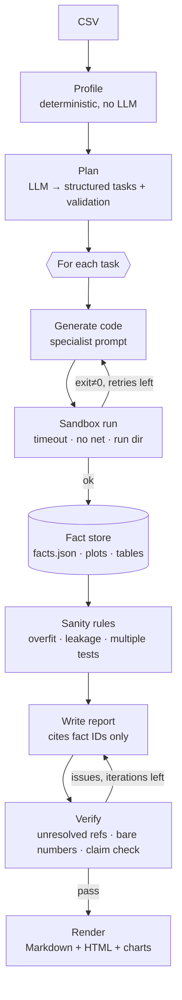

# Project Plan: Grounded Data Analyst Agent

> **This is the main plan for the project.** It replaces `todo.md`; everything still useful from there is folded in below (see [Appendix: todo.md mapping](#appendix-todomd-mapping)).
> Update the checkboxes and the **Status** block as work lands. Record decisions in the [Decision log](#decision-log).

**Status:** Phase 0 in progress: P0.1–P0.8 done (push blocked on GitHub auth); P0.9 reference run next, then review → new Phase 1 · **Last updated:** 2026-10-31

---

## 1. Goal

Turn the prototype into a portfolio project that shows off **agent engineering**, not just "agents talking to each other":

> *A local-first data analyst agent. Point it at a CSV and it plans an analysis, runs sandboxed Python, and writes a report in which **every number traces back to code that actually ran**. An eval harness measures how often it is right.*

The story this project tells:
1. **v1 hallucinated.** The saved Titanic report says "61.62% survived" (61.62% *died*), reports `Q1, Q3: [nan, nan]` as a finding, and misses a 98% train / 80% test overfitting gap.
2. **I built an eval harness** that measures this kind of failure.
3. **I redesigned the system** around sandboxed execution, structured facts, and a verifier loop.
4. **Here are the before/after numbers**, across local and hosted models.

### Principles
- **Eval first.** Build the harness before the big refactor so every change gets measured. No "it feels better."
- **Numbers come from code, never from the LLM.** The writer refers to facts by ID and the renderer fills in the values.
- **Deterministic before LLM.** Use plain Python for profiling, graders, and sanity rules. Use the LLM only where judgment is needed.
- **Local-first, provider-agnostic.** It runs fully on Ollama. Hosted models are optional and used for comparison.
- **Small, finished, honest.** A narrow scope that works and is measured beats a wide scope that demos once.

### Definition of done (v1.0)
- [ ] `uv run analyst run data.csv` produces an HTML/Markdown report with charts, from a clean clone, in one command.
- [ ] Generated code runs in a sandbox (timeout, no network, isolated working directory).
- [ ] Every numeric claim in the report resolves to a recorded fact from executed code.
- [ ] The eval suite (≥6 cases, including adversarial "trap" datasets) runs with one command and produces a comparison table.
- [ ] README shows the before/after eval table, a local vs. hosted model comparison, an architecture diagram, and a demo GIF.
- [ ] CI runs lint, unit tests, and a deterministic eval smoke test (replayed LLM responses) on every push.
- [ ] A short UI (upload CSV → watch progress → read report) exists and is shown in the demo.
- [ ] Tagged `v1.0.0`. Optional write-up / blog post.

### Non-goals (v1)
Big-data / out-of-core processing, multi-user hosting, auth, human-in-the-loop approval, long-term memory, clustering/time-series specialists. These go in [Stretch](#phase-7--stretch-post-v10).

---

## 2. Target architecture



### Key components

| Component | Replaces | Notes |
|---|---|---|
| **Profiler** (pure Python) | `auto_profile_dataset` + `data_loader` | Loads data once. Infers the target with heuristics plus an optional `--target` flag. Handles string targets. |
| **Planner** (one LLM node) | Orchestrator + Planner | One structured call. Plan is validated (unknown deps, cycles, unknown specialists → repair or fail loudly). |
| **Sandbox executor** | `PythonREPLTool` + regex error detection | `subprocess` with timeout and a per-task run directory; success = exit code. Docker backend optional. |
| **Analyst runtime** (injected helper module) | Regex `InsightExtractor` | Generated code calls `record_fact(...)`, `save_plot(...)`, `record_table(...)` → structured outputs on disk. |
| **Sanity rules** (deterministic) | n/a | Adds caveats automatically: train/test gap, near-perfect feature–target correlation (leakage), many tests without correction, small n. |
| **Writer** | Synthesizer + Reporter | Gets the fact table, writes prose with `{{fact:eda_1.survival_rate}}` references. Never types numbers. |
| **Verifier** | n/a | (1) all refs resolve; (2) bare numbers in prose are flagged; (3) LLM check of qualitative claims against facts. Loops back to the writer with issues. |
| **Renderer** | `report.write_text` | Fills in fact values with formatting, embeds charts, outputs `.md` + `.html`. |
| **Run store** | `output/`, scattered logs | `runs/<run_id>/` holds `plan.json`, `tasks/<id>/{code.py,stdout.txt,facts.json,*.png}`, `report.{md,html}`, `meta.json` (model, tokens, timings). Inspectable; eval reads from here. |

### Fact protocol (sketch)
```python
# available inside the sandbox
from analyst_runtime import record_fact, save_plot, record_table

rate = df["Survived"].mean()
record_fact("survival_rate", rate, desc="Share of passengers who survived", fmt="pct")
record_fact("chi2_sex_survived_p", p, desc="Chi-square p-value, Sex vs Survived", kind="p_value")
save_plot(fig, "survival_by_class", caption="Survival rate by passenger class")
```
Facts are namespaced by task (`eda_1.survival_rate`) and carry `value`, `desc`, `fmt`, `kind`, `task_id`, `code_ref`.

### Graph (LangGraph)
- Real conditional edges: retry loop per task, verifier → writer revision loop with `max_revisions`.
- Fan out tasks with the `Send` API and a `max_concurrency` setting (1 for local Ollama, higher for hosted).
- State updates return partial dicts with reducers (no in-place mutation), so streaming/checkpointing work and the task subgraph is visible.

---

## 3. Eval harness (centerpiece)

### Eval cases
Each case is `evals/cases/<name>/` with `data.csv` (or a seeded generator) and `expected.yaml`. Synthetic datasets come with **planted ground truth**, so the right answer is known exactly.

| Case | What it tests |
|---|---|
| `titanic` | Real data; ground truth from a reference script (survival rate, missing Age = 177, chi-square Sex×Survived significant, etc.). |
| `planted_effects` | Binary target; feature A strong effect, B weak, C none; 15% missing in D. Recall of real effects, ranking. |
| `pure_noise` | Target independent of everything. **Trap:** must not claim significant predictors; model ≈ baseline. |
| `leakage` | A column that nearly copies the target. **Trap:** must flag leakage instead of celebrating 99% accuracy. |
| `regression_outliers` | Continuous target, skew, outliers. Regression path, robust stats. |
| `string_target` | Target named `churned_flag` with `"yes"/"no"` values. Target detection + encoding. |
| `datetime_trend` | Trend + seasonality. Honest gap today; tracks whether dates are noticed. |

`expected.yaml` sketch:
```yaml
target: Survived
facts:                       # checked against recorded facts / report values
  survival_rate: {value: 0.3838, tol: 0.005}
  missing.Age: {value: 177}
must_find:                   # planted findings (judge + keywords)
  - "Sex strongly associated with survival (women higher)"
must_not_claim:              # traps / known false statements
  - "majority of passengers survived"
caveats_required: [overfitting]   # when applicable
```

### Metrics
| Metric | How | Grader |
|---|---|---|
| **Run success** | Pipeline finished, report produced | deterministic |
| **Task success rate** / avg retries | From run store | deterministic |
| **Fact accuracy** | Recorded facts vs `expected.facts` within tolerance | deterministic |
| **Grounded-number rate** | % of numbers in the report that resolve to a fact | deterministic |
| **Finding recall** | `must_find` items present | LLM judge with rubric |
| **False claims** | `must_not_claim` violated; significance claimed on `pure_noise` | LLM judge + rules |
| **Caveat coverage** | Required caveats present (overfit, leakage) | deterministic + judge |
| **Cost / latency** | Wall time, # LLM calls, tokens | deterministic |

- **Report-level graders must also work on v1** (no facts needed: they read the report text) so the baseline is real.
- **Repeats:** default `--repeats 3`; report mean and min–max. LLM output varies; one run proves nothing.
- **Judge calibration:** hand-label ~10 reports; check judge agreement before trusting it. Judge model fixed and recorded.

### Harness features
- `uv run python -m evals run --suite core --model ollama:<model> --repeats 3` → `evals/results/<timestamp>_<model>.jsonl`
- `uv run python -m evals report [run ...]` → Markdown table (also feeds the README).
- `uv run python -m evals compare A B` → per-metric deltas, per-case regressions.
- **LLM record/replay cache** (keyed by model + prompt hash): makes re-runs free and deterministic, lets graders be developed offline, powers the CI smoke test.
- Results are committed (small JSONL) so history is visible in git.
- **LangSmith:** every eval run is traced and tagged with its case and repeat, so a failing case can be opened straight from the results table. Optionally, results are also pushed as LangSmith experiments for side-by-side comparison. The local JSONL stays the source of truth: it works offline, is committed to git, and feeds the README.

### Test harness (separate from evals)
- `pytest` unit tests for pure logic: profiler, plan validation/topo sort, sanity rules, fact resolution, verifier number-scan, renderer.
- Sandbox tests: timeout kills, network blocked, non-zero exit → failure, stdout containing "Error:" → **not** a failure.
- Graph integration tests with LangChain's fake chat models (scripted responses), so no Ollama is needed.

---

## 4. Phases

Sizes: **S** ≈ an evening, **M** ≈ a few sessions, **L** ≈ a week+ of evenings.

### Phase 0: Reset & baseline (S–M), detailed

**Goal:** a clean repo with tests and CI that runs end-to-end on `qwen3.5:9b`, with the known bugs fixed, every run fully logged locally, and a reviewed reference run that defines what to fix next.

**What "baseline" means:** the prototype design with its bugs fixed, *not* the redesign. Behavior related to hallucination (truncated context, the LLM typing numbers) is deliberately left alone so the "before" numbers are honest.

**Branch:** `phase-0`, created from `feature/new-flow`; merged to `main` at the end. `main` is 6 commits behind `feature/new-flow` and has nothing that isn't already on it.

**Exit criteria**
- [ ] CI green (ruff + pytest) on `main`
- [ ] `python run.py data/titanic.csv --target Survived` completes on `qwen3.5:9b`
- [x] Bugs B1–B6 fixed, each with a test
- [x] Each run leaves a complete run directory (logs, every LLM call, state per node, every code attempt)
- [ ] Reference run, annotations, and review committed; commit tagged `v0.1.0-baseline`
- [ ] New Phase 1 (agent quality) written into this plan from the review

#### Measured on 2026-10-30 (these shape the phase)
- `qwen3.5:9b` (Q4_K_M) on this machine: **~5 tok/s**. Only **1.7 of 6.3 GB is in VRAM**, so it runs mostly on CPU.
- **Thinking mode on:** a one-sentence answer did not finish within 280 s. **Thinking must be off.**
- **Ollama's default context is 4,096 tokens**, so longer prompts (the reporter's) get cut off without any warning.
- **LangChain defaults:** the orchestrator call hung for >10 min. With `reasoning=False, num_ctx=8192, num_predict=600` it finished in **86 s** (729 tokens in, 193 out) and returned a valid, sensible `StrategicPlan`.
- The orchestrator asked for `estimated_tasks=12`. At this speed that's well over an hour per run, so **cap the task count**.
- **Update 2026-10-31:** with `num_ctx=8192` only 18% of the model is on the GPU (1.1 of 6.4 GB), about 1.6 tok/s including prompt processing. The bigger context costs VRAM.
- **Consequence for Phase 1:** 7 cases × 3 repeats is not practical locally at this speed. See [Phase 0 risks](#phase-0-risks).

#### Steps (roughly one commit each, in this order)

**P0.1 Commit pending work** (S)
- [x] Commit the ruff formatting plus the `agent.graph` export as one commit. (Checked: apart from that export and the `run.py` import, the diff is formatting only.)
- [x] Commit `PLAN.md` and `.devcontainer/devcontainer-lock.json`.
- [ ] Push `feature/new-flow` and `phase-0` *(`phase-0` created locally; push pending)*

**P0.2 Repo cleanup** (S)
- [x] Delete `todo.md` (superseded by this plan) and `docs/` (~2,300 lines of generated docs that contradict the code).
- [x] Delete `notebooks/tests.ipynb` (scratch work).
- [x] Move `output/report_hierarchical_titanic.md` to `docs/baseline/legacy_report_titanic.md`. It's the "61.62% survived" example for the README story. Then delete `output/`.
- [x] `.gitignore`: add `output/` and `runs/`.
- [x] Delete the `multi-specialist` branch. It's a work-in-progress snapshot of the earlier hierarchical version and includes 690 committed MLflow files. Its `validation.py` (an AST import blocklist) is not carried over: a blocklist isn't a security boundary, and the Phase 2 sandbox replaces it.
- [x] Keep `feature/advanced_logging` (1 commit of file loggers) for review in Phase 5.
- [x] Add `.env.example` (variable names only).

**P0.3 Tooling & metadata** (S)
- [x] `pyproject.toml`:
  - add description, readme, and license
  - add `[dependency-groups] dev = ["pytest", "ruff", "ipykernel"]` and remove `ipykernel` from runtime deps
  - remove `mlflow` and its usage in `run.py` (LangSmith is the only tracer); the local `mlruns/` folder can then be deleted
  - keep `langsmith`; use the current `LANGSMITH_*` env var names in `.env.example` (the legacy `LANGCHAIN_*` names still work)
  - keep `langchain_experimental` until Phase 2
- [x] Add `[tool.ruff]` (line length 88; rules `E, F, I, B, UP`) and `[tool.pytest.ini_options]` (`testpaths = ["tests"]`).
- [x] Run `uv lock && uv sync --group dev`, then `ruff check --fix` and fix what's left by hand.
- [x] `tests/conftest.py` with small in-memory DataFrame fixtures. Tests must never depend on `data/`, which is gitignored.

**P0.4 CI** (S). Done early so every later commit is checked.
- [x] `.github/workflows/ci.yml` runs on push and PR: `astral-sh/setup-uv` → `uv sync --group dev --locked` → `ruff check` → `ruff format --check` → `pytest`. There's no Ollama in CI, and no test calls an LLM.

**P0.5 Local model configuration** (S–M)
- [x] `config.py`: set default models to `qwen3.5:9b`. Add settings `llm_reasoning: bool = False`, `llm_num_ctx: int = 8192`, `llm_max_tokens: int = 2048`, `llm_timeout_s: int = 600`, `max_tasks: int = 6`.
- [x] `LLMManager.get_llm`: when the provider is `ollama`, pass `reasoning`, `num_ctx`, `num_predict`, and the timeout.
- [x] `scripts/llm_smoke.py`: check Ollama is reachable and the model is pulled, make one structured-output call that must parse, then print tok/s and the GPU/CPU split (from `/api/ps`). Run it before every long run.
- [x] *(Host, not code)* Find out why only 1.7 GB is offloaded to the GPU. **Result (2026-10-31):** the GPU has 4 GB dedicated + 7.9 GB shared memory, and the model is ~5.5 GB of weights plus a vision encoder, so it can't fit fully. Ollama's automatic estimate placed only ~1.65 GB on the GPU. Forcing layers with `num_gpu` (new `LLM_NUM_GPU` setting, per machine in `.env`):

  | GPU layers | On GPU | Generation | Prompt (4.3k tokens) |
  |---|---|---|---|
  | auto | 1.65 GB | 4.8 tok/s | slow |
  | **18 (chosen)** | **3.40 GB** | **7.7–10.4 tok/s** | ~750 tok/s |
  | 20 | 3.6 GB | ~12 tok/s | ran out of memory on long prompts in the reference run |
  | 21 | 3.79 GB | 10.6 tok/s | ~765 tok/s |
  | 33 (all) | 5.74 GB, spills to shared | 3.8 tok/s | 99 tok/s |

  Shared GPU memory is system RAM reached over the bus, so spilling into it is slower than CPU. Context size (2k/4k/8k) made no difference: only 8 of 32 layers use full attention, so the cache is small.

**P0.6 Bug fixes, test first** (M). For each: write the failing test, fix, get to green.

| ID | Bug | Fix | Test |
|---|---|---|---|
| B1 | Specialist LLM config never applied: `AGENT_CONFIGS` keys are `eda_specialist`… but the agent type is `eda` ([llm_manager.py:33](agent/core/llm_manager.py#L33)) | Rename keys to `eda` / `statistical` / `ml`; split a pure `resolve_config()` out of `get_llm`; an unknown agent type raises | `resolve_config("ml")` → coder model, temp 0.1; unknown type raises |
| B2 | Failed tasks are added to both `completed_tasks` and `failed_tasks` ([execution_manager.py:45](agent/nodes/execution_manager.py#L45)), so the success rate is wrong; 0 tasks → `ZeroDivisionError` ([reporter.py:42](agent/nodes/reporter.py#L42)) | Append to exactly one list; extract a pure `build_execution_summary(completed, failed)`; pass failed tasks to the synthesizer explicitly | 4 ok + 1 failed → 5 total, 80%; 0 tasks → no crash |
| B3 | Cyclic or broken plans silently accepted ([planner.py:123](agent/nodes/planner.py#L123)) | `validate_plan()`: duplicate IDs → error; unknown deps → dropped with a warning; cycles → `PlanValidationError`; enforce `max_tasks` (keep the top N by priority, drop deps on removed tasks) | cycle raises; unknown dep dropped; order respects deps; cap applied |
| B4 | Retries hard-coded to 2 ([execution_manager.py:39](agent/nodes/execution_manager.py#L39)) | Default from `settings.max_code_retries` | default equals the setting |
| B5 | Regex flags normal output as a failure: `print("ModelError: none")` → failed ([specialists.py:89](agent/core/specialists.py#L89)) | Interim until the Phase 2 sandbox: count it as a failure only if the output contains a traceback, or the *entire* output is a single `XxxError(...)` repr (what `PythonREPLTool` returns on an exception) | output mentioning "Error:" → success; `ValueError('x')` → failure |
| B6 | Target detection is Titanic-specific (`"survived"` is hard-coded) and non-numeric targets get type `none` ([orchestrator.py:43](agent/nodes/orchestrator.py#L43)) | `--target` override; generic name list; infer type from the number of unique values regardless of dtype (2 → binary, including `"yes"/"no"`) | string target → binary; override wins; no target → `none` |

- [x] All six fixed test-first (`tests/test_llm_manager.py`, `test_execution.py`, `test_planner.py`, `test_profiling.py`). `max_code_retries` default set to 2 (the previous hard-coded behavior).

**P0.7 Remove dead code** (S)
- [x] **State:** remove `VizOpportunity`, `viz_opportunities`, `viz_artifacts`, `pending_tasks`, `current_task_index`, and `artifacts_dir`. Also remove `cross_insights` with `_extract_cross_insights` (it only ever matched identical strings) and `parallel_groups` with `_compute_parallel_groups` (replaced by `Send` in Phase 3).
- [x] **Config:** remove `max_iterations`, `analyst_temperature`, and `coder_temperature` (unused). Remove `LLMManager.get_cache_info`.
- [x] **Strategies:** remove `TIME_SERIES` and `CLUSTERING` from the strategy enum and the orchestrator prompt. They can be chosen but no specialist runs them. Re-add in Phase 7.
- Left in place: `current_phase` is written but never read (wasn't on the list; revisit in the graph redesign).

**P0.8 CLI & local run store** (M). *Moved forward from Phase 2 on 2026-10-31.* Every run must be fully reviewable from local files; LangSmith is the viewer, not the only record.
- [x] `run.py <csv_path> [--target COL] [--max-tasks N] [--model NAME]`, accepting any path, not just files in `data/`.
- [x] Each run gets its own directory, `runs/<YYYYmmdd-HHMMSS>_<dataset>_<model>/`, plus a `runs/latest` link:

  | File | Contents |
  |---|---|
  | `run.log` | Full log at DEBUG level (the console stays at INFO) |
  | `run_meta.json` | Commit SHA (and whether the tree was dirty), command, settings, models, start/end, duration per node, token totals, task counts, status (`ok` / `failed` / `interrupted`), LangSmith trace URL |
  | `llm_calls.jsonl` | One line per LLM call: node, agent type, model, prompt, raw response (the JSON for structured calls), tokens, duration, error |
  | `state/NN_<node>.json` | Graph state after each top-level node |
  | `tasks/<task_id>/` | `attempt_N.py` and `attempt_N_output.txt` for every attempt (including failed ones), plus `result.json` |
  | `report.md` | The final report |

- [x] The run directory is written as the run progresses, so a crashed or interrupted run still leaves everything up to the failure. *(State and LLM calls are written per step; task attempts at the end of the execution step, and also in `run.log` as they happen.)*
- [x] Verified with a 1-task run (2026-10-31): 5 steps, 5 LLM calls, ~10 min.
- [x] LangSmith run name, tags (dataset, model), and metadata (commit SHA, run dir) are set through the graph `config`, so a trace and its run directory point to each other.
- [x] Settings `output_directory` → `runs_directory`; `output/` is no longer used.

**P0.9 Reference run** (M, mostly waiting)
- [ ] Run `scripts/llm_smoke.py`, then `python run.py data/titanic.csv --target Survived` (6 tasks) in the background.
- [ ] If it breaks partway, fix only what's needed to finish (no redesign) and note each fix.
- [ ] Copy the run directory to `docs/baseline/run/` and commit it. Tag the commit **`v0.1.0-baseline`** so the eval phase can always re-run exactly this version.

**P0.10 Review & re-plan** (M)
- [ ] Review the reference run node by node, using the run directory and the LangSmith trace: what each agent receives, what it produces, where quality is lost, what works.
- [ ] **`docs/baseline/annotations.md`**: every claim in the report marked correct / wrong / unsupported, with the true value. It seeds the eval judge's calibration and the README's "before" story.
- [ ] **`docs/baseline/review.md`**: findings per node and the main problems, ranked.
- [ ] Turn the findings into a new **Phase 1: agent quality**, and shift the later phases by one (eval harness becomes Phase 2, and so on).

**P0.11 Wrap-up** (S)
- [ ] README stub: what the project is, status "under active rebuild", a link to this plan, and the current quickstart.
- [ ] Push (blocked on GitHub auth, see P0.1); PR `phase-0` → `main`; update the Status block at the top.

#### Phase 0 risks
| Risk | Mitigation |
|---|---|
| Local inference is slow (~12 tok/s after GPU tuning, was ~5), so evals are expensive | GPU offload tuned (P0.5); Phase 1 replay cache; `--repeats 1` for dev loops and 3 only for published numbers (overnight); decide at Phase 1 start whether to iterate with a cheap hosted model |
| qwen3.5 output quirks (thinking, runaway JSON) | Settings are set explicitly (P0.5); the smoke script catches regressions before long runs |
| `PythonREPLTool` runs LLM-written code in-process until Phase 2 | Run only on the sample datasets, inside the devcontainer |

**Effort:** about 3–5 evenings plus one long background run.

### Phase 1: Eval harness v0 + baseline numbers (M–L)
Goal: measure v1 before changing it.
- [ ] `evals/` package skeleton: case loader, runner, results JSONL, report table.
- [ ] Dataset generators (seeded) for the synthetic cases + reference script for Titanic ground truth.
- [ ] Report-level graders: fact-in-text check, must_find / must_not_claim judge, caveat check, run/task success, timing.
- [ ] LLM record/replay cache.
- [ ] Judge calibration on ~10 hand-labeled reports.
- [ ] Run v1 on the suite (`--repeats 3`); commit results as **baseline**.

**Exit:** a committed baseline table for v1. This is the "before" number.

### Phase 2: Execution harness (M–L)
Goal: safe, inspectable execution with structured outputs.
- [ ] Sandbox executor (subprocess, timeout, per-task cwd, env scrubbed, network blocked where possible); optional Docker backend.
- [ ] `analyst_runtime` helper injected into the sandbox: `record_fact`, `save_plot`, `record_table`.
- [ ] Extend the run store from P0.8 with sandbox outputs, facts, and plots.
- [ ] Update specialist prompts to use the runtime and drop `print`-scraping.
- [ ] Profiler loads data once; target detection with `--target` override and string-label support.
- [ ] Smarter retries: pass a trimmed traceback plus the previous code; final fallback = "simplify the task".
- [ ] Add fact-accuracy and task-level metrics to the eval; rerun.

**Exit:** no in-process `exec`; facts on disk; eval shows task success / fact accuracy.

### Phase 3: Grounded reporting + graph redesign (L)
Goal: kill hallucinated numbers; make the graph a real agent loop.
- [ ] Merge Orchestrator + Planner; plan validation with one repair attempt.
- [ ] Graph rewrite: partial state updates + reducers, `Send` fan-out with `max_concurrency`, conditional retry edges.
- [ ] Deterministic sanity rules (overfit gap, leakage, multiple comparisons, small n) → caveat facts.
- [ ] Writer that cites `{{fact:…}}` only; renderer fills values.
- [ ] Verifier: unresolved refs, bare-number scan, LLM claim check → revision loop (`max_revisions`).
- [ ] Graph-level failure handling: a failed task degrades the report (listed in Limitations) instead of crashing the run.
- [ ] Eval: grounded-number rate, false claims on traps, caveat coverage. Compare with baseline.

**Exit:** grounded-number rate ≈ 100%, trap cases pass, clear improvement over baseline.

### Phase 4: Models & providers (S–M)
- [ ] Provider config: `ollama`, `anthropic`, `openai` via `init_chat_model` (add `langchain-anthropic`).
- [ ] Per-role model config (planner / coder / writer / judge) in `settings` / `.env`.
- [ ] Eval matrix: ≥2 local models + ≥1 hosted (e.g., Claude Sonnet 5.5) → comparison table with cost/latency.
- [ ] Choose and document the recommended default(s) based on the numbers.

**Exit:** model comparison table committed.

### Phase 5: Product surface (M)
- [ ] Charts: specialists save plots via `save_plot`; report embeds them.
- [ ] HTML report (single self-contained file) + Markdown.
- [ ] CLI polish: `analyst run <csv> [--target] [--model] [--out]`, live progress output (stream graph events).
- [ ] Minimal UI (Streamlit recommended): upload CSV → live task progress → rendered report + run artifacts.
- [ ] Structured logging; one LangSmith trace per analysis, linked from the run dir and the UI.

**Exit:** a demo-able app on a fresh dataset.

### Phase 6: Showcase (M)
- [ ] README rewrite: pitch, architecture diagram, before/after + model comparison tables, quickstart, design decisions, limitations.
- [ ] Demo GIF/video (UI on a non-Titanic dataset).
- [ ] Example reports in `examples/` (2–3 datasets, including a trap case).
- [ ] Clean history/branches; LICENSE check; `.env.example`.
- [ ] Tag `v1.0.0`.
- [ ] Optional: write-up "Measuring and cutting hallucinated numbers in a data-analysis agent."

### Phase 7: Stretch (post-v1.0)
- Natural-language questions ("why did survival differ by class?") → targeted plan.
- Human-in-the-loop plan approval (LangGraph interrupt).
- Time-series and clustering specialists (`datetime_trend` case becomes a real target).
- Parallel execution tuning; larger datasets (sampling / DuckDB).
- Memory of successful analysis patterns across runs.

---

## 5. Target repo layout

```
agent/                # package (rename TBD, see open decisions)
  profiling.py        # deterministic profiler + target detection
  planning.py         # planner + plan validation
  execution/          # sandbox executor, analyst_runtime, run store
  reporting/          # writer, verifier, sanity rules, renderer
  graph.py            # LangGraph wiring
  llm.py              # provider/model config
  templates/          # Jinja prompts
  cli.py
app/                  # Streamlit UI
evals/
  cases/<name>/{expected.yaml, data.csv | generate.py}
  graders/  runner.py  report.py  cache/  results/
tests/
examples/
PLAN.md  README.md
```

---

## 6. Decision log

| Date | Decision | Why |
|---|---|---|
| 2026-10-29 | `PLAN.md` is the single source of truth; `todo.md` retired | One plan, tracked in git |
| 2026-10-29 | Eval harness is built **before** the redesign | Need a measured baseline for the before/after story |
| 2026-10-29 | Numbers in reports come only from recorded facts (writer cites IDs) | Removes the main hallucination path structurally |
| 2026-10-29 | Replace `PythonREPLTool` with a subprocess sandbox; success = exit code | Security + fixes regex false failures |
| 2026-10-29 | Merge Orchestrator and Planner | Overlapping responsibilities, one fewer LLM call |
| 2026-10-29 | Stay local-first (Ollama default); hosted models for comparison | Privacy/cost selling point + interesting eval matrix |
| 2026-10-30 | `qwen3.5:9b` is the local development model; thinking off, `num_ctx=8192`, output capped | Measured: thinking/defaults hang; explicit settings give a valid plan in 86 s |
| 2026-10-30 | Baseline = prototype design + bug fixes, tagged `v0.1.0-baseline` | Before/after should compare designs, not a version crippled by trivial bugs |
| 2026-10-30 | Cap plans at `max_tasks=6` | Keeps a local run to ~30–60 min at current speed |
| 2026-10-31 | `LLM_NUM_GPU=18` on this machine (in `.env`, not a code default) | Ollama's auto offload left 60% of VRAM unused. 20 layers was faster but the first reference run slowed to ~1 tok/s and then crashed the runner on a long prompt, so 18 keeps ~0.5 GB free |
| 2026-10-31 | Tracing: **LangSmith only**; MLflow removed | Built for agents; clearer traces. Tracing is opt-in via env, because when it's on, prompts and data samples leave the machine (relevant to the local-first pitch) |
| 2026-10-31 | Delete untracked `todo.md`, `docs/`, `notebooks/`, and the `multi-specialist` branch | Confirmed by owner; superseded by this plan / `feature/new-flow` |

### Open decisions
- [ ] **Project name / package name** (`agent` is too generic for a portfolio repo).
- [ ] **UI:** Streamlit (recommended, fastest) vs FastAPI + small frontend.
- [ ] **Sandbox backend default:** subprocess (recommended for v1) vs Docker.
- [ ] **Default local model:** `qwen3.5:9b` for now; final choice decided by the Phase 4 eval.

---

## Appendix: todo.md mapping

| Old todo item | Where it lives now |
|---|---|
| Code safety checks before execution | Phase 2: sandbox executor |
| Save analysis artifacts / plots | Phase 2 (run store) + Phase 5 (charts) |
| Analyst iterates until report complete | Phase 3: verifier → writer loop |
| Drop debugger, validate imports | Done (debugger removed); covered by sandbox + retries |
| Multi-dataset CLI | Phase 0 (any CSV path) + Phase 5 (CLI polish) |
| Streaming output | Phase 5 |
| Enhanced retry strategy | Phase 2 |
| Visualization generation | Phase 5 |
| Human-in-the-loop | Phase 7 |
| Memory/history | Phase 7 |
| Web interface | Phase 5 |
| Model selection | Phase 4 |
| Parallel analysis | Phase 3 (`Send` fan-out) + Phase 7 tuning |
| PDF/HTML export | Phase 5 (HTML; PDF not planned) |
| Unit tests | Phase 0 onward |
| Structured logging / config | Phase 0 + Phase 5 |
| Graph-level error handling | Phase 3 |
| Hard-coded retry logic | Phase 0 |
| Data loading mixed with logic | Phase 2: profiler loads once |
| NL queries / data profiling / self-improvement / large data | Phase 7 or covered by profiler |
