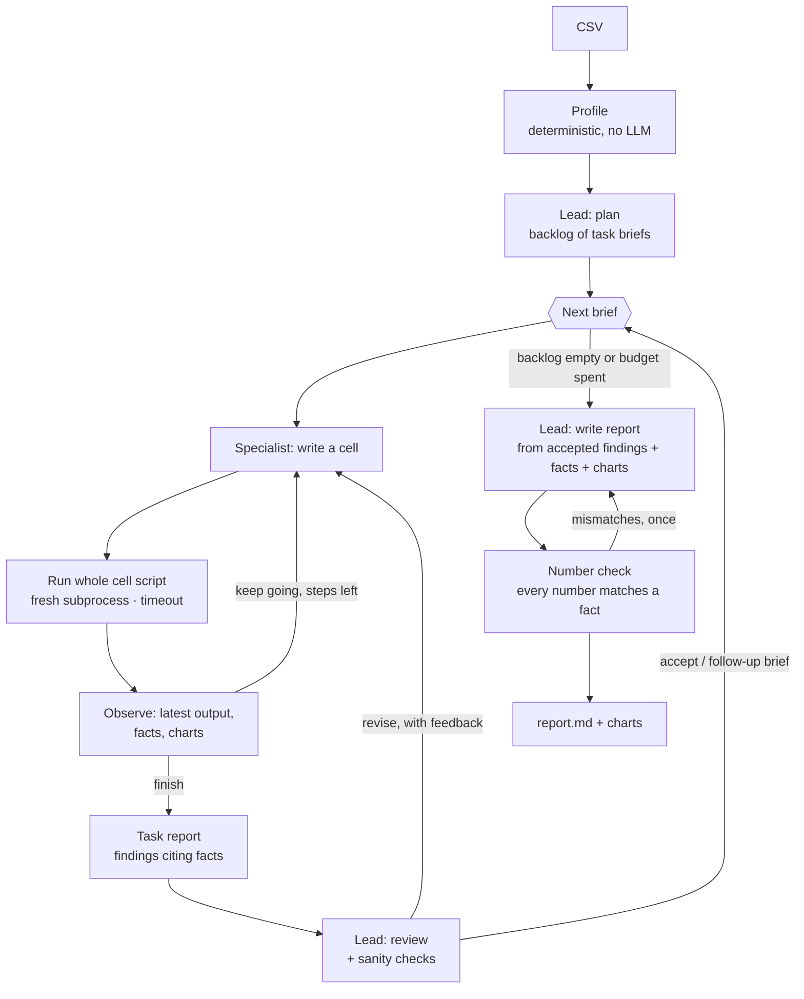

# Project Plan: Grounded Data Analyst Agent

> **This is the main plan for the project.** It replaces `todo.md`; everything still useful from there is folded in below (see [Appendix: todo.md mapping](#appendix-todomd-mapping)).
> Update the checkboxes and the **Status** block as work lands. Record decisions in the [Decision log](#decision-log).

**Status:** Phase 1 done on `phase-1` (P1.1–P1.5). Measured on the Titanic reference run: wrong claims 7 → 0, unsupported 6 → 0, baseline findings absent 7 → 0, charts in the report 0 → 5 ([P1.5 check](docs/progress/p1.5/annotations.md)). The exit criteria were met on Claude Haiku 5.5 (9 min, $0.08 a run); not yet re-run on qwen3.5. Hosted providers (OpenRouter, Anthropic) and a cost report added. Phase 2 planned (eval harness; both versions on Haiku 5.5, Sonnet 5.5 as judge). P2.0 (central configuration, presets) and P2.1 (baseline on Haiku, `v0.1.1-baseline-hosted`) done; P2.2 (7 eval cases with known answers) done; P2.3 (runner) done; first suite, judged by hand: current 30/30 findings, baseline 16/30 ([first look](docs/eval/first-look.md)). P2.3a: task scripts no longer see API keys; Ollama prompts are checked against the context window. P2.4 (deterministic graders) done; P2.5 (LLM judge) done: on the first suite it agrees with the hand labels on 87% of findings exactly, 100% within ½. P2.6 calibration: 12 labelled reports, 93–96% exact agreement, 100% within ½; the judge agrees with itself on 95%; labels spot-checked by the owner. P2.7: `evals report` / `compare`, eval traces tagged, CI regrades the committed suites. P2.8 [before/after](docs/eval/before-after.md), 7 cases × 3 repeats on Haiku 5.5: findings 53% → 98%, false claims 0.1 → 0 a run, $0.024 → $0.076 a run; the `hosted` preset adds no findings at 1.8× the cost. Phase 2 done. Phase 3 planned: network block, 5–6 harder cases (real and synthetic), faster runs. P3.1 done (network block). P3.2: 5 new cases; the current agent scores 96% findings on them, no false claims (the bar). Fixes will be developed on these and the original cases, and judged on held-out cases nothing is tuned on. P3.2b: 4 held-out cases written by the owner ([brief](docs/eval/heldout-brief.md)), their hash committed. P3.3: time measured, parallel tasks (−13%), effort setting. P3.4 narrowed to one bug fix (findings that cite no fact); the bar's two weaknesses are measured on the held-out cases, not fixed. API spend capped at $10 for everything left (2026-11-12): the remaining plan is cut to fit. An empty report now fails the run; the writer's cap is 32k. P3.5 dev × 3: findings 96%, one half false claim in 36 runs, 9.5 min a run; on the original 7, −37% time at 98% → 96% findings. `low` effort × 1: findings 95%, −15% cost, −12% time; no large difference. $5.00 of $10 spent. Agent tagged `v0.3.0-phase3`. Held-out ([results](docs/eval/phase3.md)): findings 78% vs the baseline's 19%, but 0.2 false claims a run, all in h3 (zeros that mean "missing"; its dev twin, Pima, scored 100%, likely from memory). After it, a profile fix (numeric columns' spread; "empty cells") took h3 to 75% findings and no false claims ($0.31, outside the budget). A new blind case, h5, then checked the fix (`v0.3.1`): no false claims in 15 held-out runs, h5 96% vs the baseline's 25%. Phase 3 closed with every exit criterion met. $8.18 of $10 spent. Phase 4 planned (timings, first local run, resume, matrix). P4.1 done: every call records why it stopped and, on Ollama, where its time went; runs count calls cut off and empty replies. P4.2: the first local run (qwen3.5:9b, titanic) failed after 2 h on a prompt too long for 16k; a replay picked 32k (same speed, 3.81 of 4 GB on the GPU). Re-scoped 2026-11-18: the goal is a well-designed agentic system, local is an option; Phase 4 ends here, and one local run next to Claude goes into Phase 6. Phase 5 planned in detail (CLI and live progress, run grades, HTML report, Streamlit app, one demo run). P5.1 done (`analyst run`); P5.2 done (live progress, `progress.jsonl`); P5.3 done (grades in every run); P5.4 done (`report.html`); P5.5 done (Streamlit app); P5.6 done (demo on WHO life expectancy, $0.11; two app fixes). $8.29 of $10 spent. Next: Phase 6 · **Last updated:** 2026-11-18

---

## 1. Goal

Turn the prototype into a portfolio project that shows off **agent engineering**, not just "agents talking to each other":

> *A data analyst agent, built as a well-designed agentic system. Point it at a CSV and a lead analyst plans the analysis, delegates tasks to specialists who iterate on what their code actually printed, reviews their work, follows up on findings, and writes a report with charts in which **every number traces back to code that actually ran**. An eval harness measures how often it is right.*

The story this project tells:
1. **The prototype was a pipeline, not a team.** Agents ran once, never saw their own results, and nobody reviewed anybody. The reports got numbers backwards (the legacy "61.62% survived"), or, with a better model, dropped the strongest findings and called overfitting "healthy" ([review](docs/baseline/review.md)).
2. **I redesigned it around delegation, feedback loops, and synthesis:** specialists iterate on their own output, a lead analyst reviews every task and digs deeper where it matters, and the report is written from complete, recorded results.
3. **I built an eval harness**, including trap datasets, that measures these failures.
4. **Here are the before/after numbers** (tagged baseline vs. redesign), plus one run of the same agent on a local model next to Claude.

### Principles
- **Measure every change.** Until the eval harness exists (Phase 2), every Phase 1 step is checked by re-running the reference run and repeating the claim-by-claim annotation. No "it feels better."
- **Numbers come from code, never from the LLM.** Code records facts; the writer works from them, and every number in the report is checked against them.
- **Look before you conclude.** Interpretations are written only after seeing real output, by whoever ran the code, and reviewed by someone else.
- **Deterministic before LLM.** Use plain Python for profiling, graders, and sanity rules. Use the LLM only where judgment is needed.
- **Provider-agnostic.** The provider is a setting: Claude (and OpenRouter) or a local model on Ollama. Local is an option, not the goal; it's shown by one comparison run, not tuned for. *(Changed 2026-11-18; was "local-first".)*
- **Small, finished, honest.** A narrow scope that works and is measured beats a wide scope that demos once.

### Definition of done (v1.0)
- [ ] `uv run analyst run data.csv` produces an HTML/Markdown report with charts, from a clean clone, in one command.
- [ ] Specialists iterate on their own output; the lead reviews every task (accept / revise / follow-up).
- [ ] Generated code runs in a sandbox (timeout, no network, isolated working directory), and each task's code is a runnable `.py` script.
- [ ] Every numeric claim in the report resolves to a recorded fact from executed code; the report includes charts.
- [ ] The eval suite (≥6 cases, including adversarial "trap" datasets) runs with one command and produces a comparison table.
- [ ] README shows the before/after eval table, one local vs. hosted comparison run, an architecture diagram, and a demo GIF.
- [ ] CI runs lint, unit tests, and a deterministic eval smoke test (graders over a committed eval run) on every push.
- [ ] A short UI (upload CSV → watch progress → read report) exists and is shown in the demo.
- [ ] Tagged `v1.0.0`. Optional write-up / blog post.

### Non-goals (v1)
Big-data / out-of-core processing, multi-user hosting, auth, human-in-the-loop approval, long-term memory, clustering/time-series specialists, sub-delegation (specialists spawning their own sub-agents). These go in [Stretch](#phase-7--stretch-post-v10).

---

## 2. Target architecture



### Roles

| Role | Does | Sees |
|---|---|---|
| **Lead analyst** | Plans a backlog of briefs from the profile; reviews each task report (accept / send back with feedback / add a follow-up brief); writes the final report | Profile, backlog, accepted findings (compact), the report under review, sanity-check results |
| **Specialist** (eda / statistical / ml) | Works one brief as a loop of cells; finishes with a task report | Its brief, its own cells, the latest cell's output (size-capped), facts and charts so far, inputs published by earlier tasks |

**Brief** (lead → specialist): question, specialist, inputs it may load, what a complete answer contains.
**Task report** (specialist → lead): findings (each citing the facts that support it), facts, charts, published outputs, open questions / suggested follow-ups, status (answered / partial / failed).

### Execution: cell scripts, one per task
Each task is a plain Python file, `runs/<run>/tasks/<task_id>/analysis.py`, split into cells with `# %%` markers (the "percent" format VS Code, Spyder, and Jupytext understand). No notebooks: they bloat context and add machinery we don't need.

- Each specialist step appends one cell (or replaces the cell that just failed).
- The **whole file is re-run in a fresh subprocess** with a timeout. Output, errors, new facts, and charts are captured per cell. No hidden state; a crash only affects that run; the saved script always reproduces the results.
- Re-running earlier cells is cheap at this scale. Add caching only if it becomes slow.
- Tasks are isolated from each other. Hand-offs are explicit: a task **publishes** named outputs (e.g. a train/test split, a fitted model), and the lead lists them as inputs in later briefs, which **load** them.

### Runtime helpers (available in every cell script)
```python
# Setup cell, written by the runner (agent/execution/runtime.py)
from agent.execution.runtime import df, load, publish, record_fact, save_chart

rate = df["Survived"].mean()
record_fact("survival_rate", rate, desc="Share of passengers who survived")
save_chart(fig, "survival_by_class", caption="Survival rate by passenger class")
publish("train_test", (X_train, X_test, y_train, y_test))   # for later tasks
X_train, X_test, y_train, y_test = load("ml_1/train_test")  # in a later task
```
Facts are stored per task in `tasks/<task_id>/facts.json` (so cited as `eda_1.survival_rate`) with value, description, and the cell that produced them; charts in `charts.json` + `charts/`; published outputs in `workspace/<task_id>/`. Each task directory has a `.analyst.json` (data path, run dir, task ID), so `python analysis.py` also runs there by hand.

### Budgets (settings)
Max steps per task, max revisions per task, max tasks including follow-ups, and max output characters shown per cell. They keep local runs bounded (~45–60 min accepted for now) and the 8k context safe.

---

## 3. Eval harness (centerpiece)

### Eval cases
Each case is `evals/cases/<name>/` with `data.csv` (or a seeded generator) and `expected.yaml`. Synthetic datasets come with **planted ground truth**, so the right answer is known exactly.

| Case | What it tests |
|---|---|
| `titanic` | Real data; ground truth from a reference script (survival rate, missing Age = 177, chi-square Sex×Survived significant, etc.). |
| `planted_effects` | Binary target; feature A strong effect, B weak, C none; 15% missing in D. Recall of real effects, ranking. |
| `pure_noise` | Target independent of everything. **Trap:** must not claim significant predictors; model ≈ baseline. |
| `leakage` | A column that nearly copies the target. **Trap:** must flag leakage instead of celebrating 99% accuracy. |
| `regression_outliers` | Continuous target, skew, outliers. Regression path, robust stats. |
| `string_target` | Target named `churned_flag` with `"yes"/"no"` values. Target detection + encoding. |
| `datetime_trend` | Trend + seasonality. Honest gap today; tracks whether dates are noticed. |

`expected.yaml` sketch:
```yaml
target: Survived
facts:                       # checked against recorded facts / report values
  survival_rate: {value: 0.3838, tol: 0.005, near: [surviv]}   # value on a line with a keyword
  missing.Age: {value: 177, near: [Age, missing]}
must_find:                   # planted findings (judge + keywords)
  - "Sex strongly associated with survival (women higher)"
must_not_claim:              # traps / known false statements
  - "majority of passengers survived"
caveats_required: [overfitting]   # when applicable
```

### Metrics
| Metric | How | Grader |
|---|---|---|
| **Run success** | Pipeline finished, report produced | deterministic |
| **Task success rate** / avg retries | From run store | deterministic |
| **Fact accuracy** | Each `expected.facts` value appears in the report (rounding-aware) on a line with one of its keywords. Read from the report, so it works for both versions; recorded fact names are free-form | deterministic |
| **Grounded-number rate** | Phase 1 agent: numbers the number check left unverified | deterministic |
| **Finding recall** | `must_find` items present | LLM judge with rubric |
| **False claims** | `must_not_claim` violated; significance claimed on `pure_noise` | LLM judge + rules |
| **Caveat coverage** | Required caveats present (overfit, leakage) | deterministic + judge |
| **Cost / latency** | Wall time, # LLM calls, tokens | deterministic |

- **Report-level graders must also work on v1** (no facts needed: they read the report text) so the baseline is real.
- **Repeats:** default `--repeats 3`; report mean and min–max. LLM output varies; one run proves nothing.
- **Judge calibration:** hand-label ~10 reports; check judge agreement before trusting it. Judge: Claude Sonnet 5.5, fixed and recorded with its prompt version.

### Harness features
- `uv run python -m evals run --suite core --version current|baseline --preset hosted --repeats 3` → `evals/results/<timestamp>_<version>_<model>.jsonl`
- `uv run python -m evals report [run ...]` → Markdown table (also feeds the README).
- `uv run python -m evals compare A B` → per-metric deltas, per-case regressions.
- **CI smoke test:** graders run over a committed eval run (run directory + stored judge verdicts): deterministic, no LLM calls. ~~LLM record/replay cache~~: deferred (decision log, 2026-11-02).
- Results are committed (small JSONL) so history is visible in git.
- **LangSmith:** every eval run is traced with its case, repeat and version as metadata, and each row of the results table links to its trace, so a failing case opens in one click. The judge is traced too. Optionally, grades are attached to traces as feedback, so they can be filtered in the UI. No LangSmith experiments: the committed table and `evals compare` cover the comparison. The local JSONL stays the source of truth: it works offline, is committed to git, and feeds the README.

### Test harness (separate from evals)
- `pytest` unit tests for pure logic: profiler, plan validation/topo sort, sanity rules, fact resolution, verifier number-scan, renderer.
- Sandbox tests: timeout kills, network blocked, non-zero exit → failure, stdout containing "Error:" → **not** a failure.
- Graph integration tests with LangChain's fake chat models (scripted responses), so no Ollama is needed.

---

## 4. Phases

Sizes: **S** ≈ an evening, **M** ≈ a few sessions, **L** ≈ a week+ of evenings.

### Phase 0: Reset & baseline (S–M), detailed

**Goal:** a clean repo with tests and CI that runs end-to-end on `qwen3.5:9b`, with the known bugs fixed, every run fully logged locally, and a reviewed reference run that defines what to fix next.

**What "baseline" means:** the prototype design with its bugs fixed, *not* the redesign. Behavior related to hallucination (truncated context, the LLM typing numbers) is deliberately left alone so the "before" numbers are honest.

**Branch:** `phase-0`, created from `feature/new-flow`; merged to `main` at the end. `main` is 6 commits behind `feature/new-flow` and has nothing that isn't already on it.

**Exit criteria**
- [ ] CI green (ruff + pytest) on `main`
- [ ] `python run.py data/titanic.csv --target Survived` completes on `qwen3.5:9b`
- [x] Bugs B1–B6 fixed, each with a test
- [x] Each run leaves a complete run directory (logs, every LLM call, state per node, every code attempt)
- [x] Reference run, annotations, and review committed; commit tagged `v0.1.0-baseline`
- [x] New Phase 1 (agent quality) written into this plan from the review

#### Measured on 2026-10-30 (these shape the phase)
- `qwen3.5:9b` (Q4_K_M) on this machine: **~5 tok/s**. Only **1.7 of 6.3 GB is in VRAM**, so it runs mostly on CPU.
- **Thinking mode on:** a one-sentence answer did not finish within 280 s. **Thinking must be off.**
- **Ollama's default context is 4,096 tokens**, so longer prompts (the reporter's) get cut off without any warning.
- **LangChain defaults:** the orchestrator call hung for >10 min. With `reasoning=False, num_ctx=8192, num_predict=600` it finished in **86 s** (729 tokens in, 193 out) and returned a valid, sensible `StrategicPlan`.
- The orchestrator asked for `estimated_tasks=12`. At this speed that's well over an hour per run, so **cap the task count**.
- **Update 2026-10-31:** with `num_ctx=8192` only 18% of the model is on the GPU (1.1 of 6.4 GB), about 1.6 tok/s including prompt processing. The bigger context costs VRAM.
- **Consequence for the eval harness (Phase 2):** 7 cases × 3 repeats is not practical locally at this speed. See [Phase 0 risks](#phase-0-risks).

#### Steps (roughly one commit each, in this order)

**P0.1 Commit pending work** (S)
- [x] Commit the ruff formatting plus the `agent.graph` export as one commit. (Checked: apart from that export and the `run.py` import, the diff is formatting only.)
- [x] Commit `PLAN.md` and `.devcontainer/devcontainer-lock.json`.
- [ ] Push `feature/new-flow` and `phase-0` *(`phase-0` created locally; push pending)*

**P0.2 Repo cleanup** (S)
- [x] Delete `todo.md` (superseded by this plan) and `docs/` (~2,300 lines of generated docs that contradict the code).
- [x] Delete `notebooks/tests.ipynb` (scratch work).
- [x] Move `output/report_hierarchical_titanic.md` to `docs/baseline/legacy_report_titanic.md`. It's the "61.62% survived" example for the README story. Then delete `output/`.
- [x] `.gitignore`: add `output/` and `runs/`.
- [x] Delete the `multi-specialist` branch. It's a work-in-progress snapshot of the earlier hierarchical version and includes 690 committed MLflow files. Its `validation.py` (an AST import blocklist) is not carried over: a blocklist isn't a security boundary; the P1.1 subprocess runner and Phase 3 isolation replace it.
- [x] Keep `feature/advanced_logging` (1 commit of file loggers) for review in Phase 5.
- [x] Add `.env.example` (variable names only).

**P0.3 Tooling & metadata** (S)
- [x] `pyproject.toml`:
  - add description, readme, and license
  - add `[dependency-groups] dev = ["pytest", "ruff", "ipykernel"]` and remove `ipykernel` from runtime deps
  - remove `mlflow` and its usage in `run.py` (LangSmith is the only tracer); the local `mlruns/` folder can then be deleted
  - keep `langsmith`; use the current `LANGSMITH_*` env var names in `.env.example` (the legacy `LANGCHAIN_*` names still work)
  - keep `langchain_experimental` until P1.1 replaces `PythonREPLTool`
- [x] Add `[tool.ruff]` (line length 88; rules `E, F, I, B, UP`) and `[tool.pytest.ini_options]` (`testpaths = ["tests"]`).
- [x] Run `uv lock && uv sync --group dev`, then `ruff check --fix` and fix what's left by hand.
- [x] `tests/conftest.py` with small in-memory DataFrame fixtures. Tests must never depend on `data/`, which is gitignored.

**P0.4 CI** (S). Done early so every later commit is checked.
- [x] `.github/workflows/ci.yml` runs on push and PR: `astral-sh/setup-uv` → `uv sync --group dev --locked` → `ruff check` → `ruff format --check` → `pytest`. There's no Ollama in CI, and no test calls an LLM.

**P0.5 Local model configuration** (S–M)
- [x] `config.py`: set default models to `qwen3.5:9b`. Add settings `llm_reasoning: bool = False`, `llm_num_ctx: int = 8192`, `llm_max_tokens: int = 2048`, `llm_timeout_s: int = 600`, `max_tasks: int = 6`.
- [x] `LLMManager.get_llm`: when the provider is `ollama`, pass `reasoning`, `num_ctx`, `num_predict`, and the timeout.
- [x] `scripts/llm_smoke.py`: check Ollama is reachable and the model is pulled, make one structured-output call that must parse, then print tok/s and the GPU/CPU split (from `/api/ps`). Run it before every long run.
- [x] *(Host, not code)* Find out why only 1.7 GB is offloaded to the GPU. **Result (2026-10-31):** the GPU has 4 GB dedicated + 7.9 GB shared memory, and the model is ~5.5 GB of weights plus a vision encoder, so it can't fit fully. Ollama's automatic estimate placed only ~1.65 GB on the GPU. Forcing layers with `num_gpu` (new `LLM_NUM_GPU` setting, per machine in `.env`):

  | GPU layers | On GPU | Generation | Prompt (4.3k tokens) |
  |---|---|---|---|
  | auto | 1.65 GB | 4.8 tok/s | slow |
  | **18 (chosen)** | **3.40 GB** | **7.7–10.4 tok/s** | ~750 tok/s |
  | 20 | 3.6 GB | ~12 tok/s | ran out of memory on long prompts in the reference run |
  | 21 | 3.79 GB | 10.6 tok/s | ~765 tok/s |
  | 33 (all) | 5.74 GB, spills to shared | 3.8 tok/s | 99 tok/s |

  Shared GPU memory is system RAM reached over the bus, so spilling into it is slower than CPU. Context size (2k/4k/8k) made no difference: only 8 of 32 layers use full attention, so the cache is small.

**P0.6 Bug fixes, test first** (M). For each: write the failing test, fix, get to green.

| ID | Bug | Fix | Test |
|---|---|---|---|
| B1 | Specialist LLM config never applied: `AGENT_CONFIGS` keys are `eda_specialist`… but the agent type is `eda` ([llm_manager.py:33](agent/core/llm_manager.py#L33)) | Rename keys to `eda` / `statistical` / `ml`; split a pure `resolve_config()` out of `get_llm`; an unknown agent type raises | `resolve_config("ml")` → coder model, temp 0.1; unknown type raises |
| B2 | Failed tasks are added to both `completed_tasks` and `failed_tasks` ([execution_manager.py:45](agent/nodes/execution_manager.py#L45)), so the success rate is wrong; 0 tasks → `ZeroDivisionError` ([reporter.py:42](agent/nodes/reporter.py#L42)) | Append to exactly one list; extract a pure `build_execution_summary(completed, failed)`; pass failed tasks to the synthesizer explicitly | 4 ok + 1 failed → 5 total, 80%; 0 tasks → no crash |
| B3 | Cyclic or broken plans silently accepted ([planner.py:123](agent/nodes/planner.py#L123)) | `validate_plan()`: duplicate IDs → error; unknown deps → dropped with a warning; cycles → `PlanValidationError`; enforce `max_tasks` (keep the top N by priority, drop deps on removed tasks) | cycle raises; unknown dep dropped; order respects deps; cap applied |
| B4 | Retries hard-coded to 2 ([execution_manager.py:39](agent/nodes/execution_manager.py#L39)) | Default from `settings.max_code_retries` | default equals the setting |
| B5 | Regex flags normal output as a failure: `print("ModelError: none")` → failed ([specialists.py:89](agent/core/specialists.py#L89)) | Interim until the P1.1 runner: count it as a failure only if the output contains a traceback, or the *entire* output is a single `XxxError(...)` repr (what `PythonREPLTool` returns on an exception) | output mentioning "Error:" → success; `ValueError('x')` → failure |
| B6 | Target detection is Titanic-specific (`"survived"` is hard-coded) and non-numeric targets get type `none` ([orchestrator.py:43](agent/nodes/orchestrator.py#L43)) | `--target` override; generic name list; infer type from the number of unique values regardless of dtype (2 → binary, including `"yes"/"no"`) | string target → binary; override wins; no target → `none` |

- [x] All six fixed test-first (`tests/test_llm_manager.py`, `test_execution.py`, `test_planner.py`, `test_profiling.py`). `max_code_retries` default set to 2 (the previous hard-coded behavior).

**P0.7 Remove dead code** (S)
- [x] **State:** remove `VizOpportunity`, `viz_opportunities`, `viz_artifacts`, `pending_tasks`, `current_task_index`, and `artifacts_dir`. Also remove `cross_insights` with `_extract_cross_insights` (it only ever matched identical strings) and `parallel_groups` with `_compute_parallel_groups` (replaced by `Send` in Phase 3).
- [x] **Config:** remove `max_iterations`, `analyst_temperature`, and `coder_temperature` (unused). Remove `LLMManager.get_cache_info`.
- [x] **Strategies:** remove `TIME_SERIES` and `CLUSTERING` from the strategy enum and the orchestrator prompt. They can be chosen but no specialist runs them. Re-add in Phase 7.
- Left in place: `current_phase` is written but never read (wasn't on the list; revisit in the graph redesign).

**P0.8 CLI & local run store** (M). *Moved forward from the old execution phase on 2026-10-31.* Every run must be fully reviewable from local files; LangSmith is the viewer, not the only record.
- [x] `run.py <csv_path> [--target COL] [--max-tasks N] [--model NAME]`, accepting any path, not just files in `data/`.
- [x] Each run gets its own directory, `runs/<YYYYmmdd-HHMMSS>_<dataset>_<model>/`, plus a `runs/latest` link:

  | File | Contents |
  |---|---|
  | `run.log` | Full log at DEBUG level (the console stays at INFO) |
  | `run_meta.json` | Commit SHA (and whether the tree was dirty), command, settings, models, start/end, duration per node, token totals, task counts, status (`ok` / `failed` / `interrupted`), LangSmith trace URL |
  | `llm_calls.jsonl` | One line per LLM call: node, agent type, model, prompt, raw response (the JSON for structured calls), tokens, duration, error |
  | `state/NN_<node>.json` | Graph state after each top-level node |
  | `tasks/<task_id>/` | `attempt_N.py` and `attempt_N_output.txt` for every attempt (including failed ones), plus `result.json` |
  | `report.md` | The final report |

- [x] The run directory is written as the run progresses, so a crashed or interrupted run still leaves everything up to the failure. *(State and LLM calls are written per step; task attempts at the end of the execution step, and also in `run.log` as they happen.)*
- [x] Verified with a 1-task run (2026-10-31): 5 steps, 5 LLM calls, ~10 min.
- [x] LangSmith run name, tags (dataset, model), and metadata (commit SHA, run dir) are set through the graph `config`, so a trace and its run directory point to each other.
- [x] Settings `output_directory` → `runs_directory`; `output/` is no longer used.

**P0.9 Reference run** (M, mostly waiting)
- [x] Run `scripts/llm_smoke.py`, then `python run.py data/titanic.csv --target Survived` (6 tasks) in the background.
- [x] If it breaks partway, fix only what's needed to finish (no redesign) and note each fix.
  - First attempt crashed the Ollama runner after 26 min (GPU memory at 20 layers). Fixed in `03d2f98`: `LLM_NUM_GPU=18`, one retry on runner crashes, tasks saved as they finish. Second attempt: 25 min, 6/6 tasks.
- [x] Copy the run directory to `docs/baseline/run/` and commit it. Tag the commit **`v0.1.0-baseline`** so the eval phase can always re-run exactly this version.

**P0.10 Review & re-plan** (M)
- [x] Review the reference run node by node, using the run directory and the LangSmith trace: what each agent receives, what it produces, where quality is lost, what works.
- [x] **`docs/baseline/annotations.md`**: every claim in the report marked correct / wrong / unsupported, with the true value. It seeds the eval judge's calibration and the README's "before" story.
- [x] **`docs/baseline/review.md`**: findings per node and the main problems, ranked.
- [x] Turn the findings into a new **Phase 1: agent quality**: done 2026-10-31 with the owner's direction (delegation, feedback loops, synthesis). The eval harness became Phase 2, the leftovers of the old execution/reporting phases became Phase 3 (hardening); Phases 4–7 are unchanged.

**P0.11 Wrap-up** (S)
- [x] README stub: what the project is, status "under active rebuild", a link to this plan, and the current quickstart.
- [ ] Push (blocked on GitHub auth, see P0.1); PR `phase-0` → `main`; update the Status block at the top.

#### Phase 0 risks
| Risk | Mitigation |
|---|---|
| Local inference is slow (~12 tok/s after GPU tuning, was ~5), so evals are expensive | GPU offload tuned (P0.5); Phase 2 replay cache; `--repeats 1` for dev loops and 3 only for published numbers (overnight); decide at Phase 2 start whether to iterate with a cheap hosted model |
| qwen3.5 output quirks (thinking, runaway JSON) | Settings are set explicitly (P0.5); the smoke script catches regressions before long runs |
| `PythonREPLTool` runs LLM-written code in-process until P1.1 | Run only on the sample datasets, inside the devcontainer |

**Effort:** about 3–5 evenings plus one long background run.

### Phase 1: Agent quality: delegation, feedback loops, synthesis (L), detailed

**Goal:** turn the pipeline into agents that build on and review each other's work. Specialists iterate on what their code actually printed; a lead analyst reviews every task and can send it back or follow up on a finding; the report is synthesized from complete, recorded results, with charts. Design: [section 2](#2-target-architecture).

**Why before the eval harness:** the [baseline review](docs/baseline/review.md) shows the main failures are structural (context loss, blind code, no review, prompts that get copied). Fixing the design matters more than measuring it precisely. The baseline is tagged (`v0.1.0-baseline`), so Phase 2 can still score it.

**Measuring progress until Phase 2:** after each step, re-run the reference run (`run.py data/titanic.csv --target Survived`) and repeat the claim check from [annotations.md](docs/baseline/annotations.md). Log the counts below.

**Exit criteria**
- [x] Specialists see their output and iterate; each task's code is a runnable `.py` cell script in the run directory
- [x] The lead reviews every task result (accept / revise / follow-up) within budgets
- [x] The report is written from accepted findings, facts, and charts; every number in it matches a recorded fact (automatic check)
- [x] Reference run: 0 wrong claims, ≤ 2 unsupported, every "computed but missing" baseline finding present, ≥ 2 charts. *(Met on Claude Haiku 5.5, 2026-11-02: 0 / 0 / 7 of 7 / 5. Not yet run on qwen3.5.)*
- [x] No dataset-specific text and no example pipelines in prompts

#### Progress log
| Step | Run | Time | Wrong | Unsupported | Missing findings | Charts |
|---|---|---|---|---|---|---|
| Baseline | `20261031-204254` | 25 min | 7 | 6 | 7 | 0 |
| P1.2 specialist loop | `20261101-112045` ([check](docs/progress/p1.2/annotations.md)) | 45 min | 4 | 7 | 6 (now *never computed*, not lost) | 6 |
| P1.3 prompts & profile | `20261101-121244` ([check](docs/progress/p1.3/annotations.md)) | 54 min | 3 | 7 | 5 (no model trained this run) | 9 |
| P1.4 lead analyst | `20261101-192628` ([check](docs/progress/p1.4/annotations.md)) | 120 min | 5 (imputed t-test, unscaled coefficients ranked) | 6 | 2 | 12 (not yet in the report) |
| P1.4 on Claude Haiku 5.5 (same code, hosted) | `20261102-170201` ([check](docs/progress/models/haiku-5.5/annotations.md)) | 12.5 min, $0.12 | 0 | 3 (writer prose) | 0 | 1 (link broken) |
| P1.5 synthesis & report (Haiku 5.5) | `20261102-181146` ([check](docs/progress/p1.5/annotations.md)) | 9.3 min, $0.08 | 0 | 0 | 0 | 5 (all in the report) |

#### Steps (in this order)

**P1.1 Cell-script runner** (M)
- [x] `agent/execution/`: read/write `# %%` cell files; run the whole file in a fresh subprocess (task directory as working dir, timeout); capture stdout, stderr, and the exception per cell.
- [x] `agent/execution/runtime.py`: `df`, `record_fact`, `save_chart` (non-interactive backend), `publish` / `load`.
- [x] Replaces `PythonREPLTool`; drop `langchain_experimental`.
- [x] Tests: cell round-trip; a failing cell is reported by index with its traceback; timeout kills the run; facts, charts, and published outputs land on disk; output that mentions "Error:" is not a failure.
- [x] Verified 2026-11-01: 1-task run through the full flow (11 min, task ok first attempt); the saved `analysis.py` re-run by hand gives identical output.

**P1.2 Specialist loop** (M–L)
- [x] Each step returns structured output: short reasoning plus either `run` (one new cell) or `finish` (task report).
- [x] The observation after each run: the latest cell's output (capped), facts and charts so far, the error if any.
- [x] `finish` produces the task report; cited facts must exist (validated).
- [x] Budget: max steps; on exhaustion the specialist must finish with status `partial`.
- [x] Remove `InsightExtractor` and "interpretation in print statements".
- [x] Interim: the existing planner and reporter consume task reports (findings + facts) instead of truncated stdout.
- [x] Reference run + annotation → progress log.
- Found on the way: under constrained JSON decoding qwen3.5 almost never emits the status value `answered` (0 of 9), so 4 of 6 tasks reported `failed` and were dropped from the report; renamed to `complete` (3 of 3). A run also stalled for 8 hours overnight, most likely the host sleeping. Task reports now list published outputs.

**P1.3 Prompts & profile** (S–M)
- [x] Rewrite specialist prompts as role + rules + environment (installed libraries, runtime helpers, `df`, available inputs) + output contract. No dataset-specific text, no full example pipelines. A test fails if any template mentions a test dataset's columns.
- [x] Specialists save charts where a chart shows the finding better than numbers.
- [x] `compile()` each new cell before running it, so syntax errors don't cost a run.
- [x] Profiler: exclude the target from features; flag ID-like (unique per row) and free-text columns.
- [x] Reference run + annotation → progress log.
- Found on the way (fixed before P1.4): findings citing no facts passed validation; a failed cell's replacement dropped its imports; `seaborn` tried despite the library list; the report was cut off by the 8k context. See [check](docs/progress/p1.3/annotations.md).

**P1.4 Lead analyst** (L)
- [x] Merge orchestrator + planner into the lead's planning step: a backlog of briefs, aware of the task budget. Briefs name the outputs to publish; a specialist can't finish without them.
- [x] Lead review after each task: accept, send back with feedback (max revisions), or add a follow-up brief; stop when the backlog is empty or the budget is spent.
- [x] Deterministic sanity checks on task results, shown to the lead during review: train/test gap, near-perfect test score, model no better than the majority baseline (via `record_model`), leakage suspects and class imbalance (from the profile). ~~Many tests without correction~~: dropped for now (needs another helper).
- [x] Graph rewrite: loops as conditional edges; nodes return partial state updates; a failed task is recorded and the run continues.
- [x] Reference run + annotation → progress log. Two runs failed first (empty brief ids; an Ollama stream with no data), and the second showed reviews introducing errors; fixed before the third. See [check](docs/progress/p1.4/annotations.md).

**P1.5 Synthesis & report** (M)
- [x] The lead writes the report from accepted findings, the fact table, and charts (replaces synthesizer + reporter). It sees each finding with only the facts it cites, so stale facts from failed attempts are out.
- [x] Number check: every number in the report must match a recorded fact (allowing rounding and percent formatting); mismatches go back to the writer once, any left are listed in the report's limitations. (`agent/number_check.py`)
- [x] Charts embedded in `report.md`; images whose file doesn't exist are removed.
- [x] Reference run + annotation → progress log; exit criteria checked.
- Found on the way: Haiku saved 1 chart per run under "save a chart when it shows a finding better than numbers", so specialists are now asked for a chart of each main finding about distributions, groups or models (5 charts in the reference run). The check's first version missed numbers recorded inside strings and fact names (interval labels); it now reads both.

#### Phase 1 risks
| Risk | Mitigation |
|---|---|
| A 9B model loops forever, finishes too early, or returns malformed steps | Budgets, schema validation with one retry, forced `finish` on exhaustion |
| Runs get longer (more LLM calls) | Accepted for local testing (~45–60 min); budgets; hosted models later (Phase 4) |
| 8k context fills up (lead sees many findings) | Capped observations; compact accepted-findings summaries; facts referenced by name |

### Phase 2: Eval harness + before/after numbers (M–L), detailed

**Goal:** measure the tagged baseline and the Phase 1 agent on the same suite of cases with known answers, including trap datasets, and commit a before/after table.

**Decided 2026-11-02:** both versions run on **Claude Haiku 5.5**: the baseline gets the hosted provider on a branch and nothing else. The judge is **Claude Sonnet 5.5**. The local vs hosted comparison is Phase 4's.

**Exit criteria**
- [x] `uv run python -m evals run --version current --repeats 3` works from a clean clone with an API key, and `evals report` turns the results into a table *(2026-11-08: fresh clone of `phase-1` from GitHub, `uv sync`, `.env` with the Anthropic and LangSmith keys; `titanic` (downloaded, checksum checked) and `pure_noise` (generated) ran ok, with traces. There's no `--suite` flag: all cases are the default)*
- [x] ≥ 6 cases, including the `pure_noise` and `leakage` traps, each with seeded data (or a downloaded, checksummed file) and an `expected.yaml` *(7 cases, `evals/cases/<case>.yaml`)*
- [x] The judge agrees with hand labels on ≥ 90% of items across ≥ 10 reports; judge model and prompt version are recorded with every result *(93% exact, 100% within ½, 15 reports)*
- [x] CI grades a committed eval run: no LLM calls, no API keys
- [x] Committed before/after table: baseline vs Phase 1 on Haiku 5.5, 3 repeats, mean and min–max per metric *([before/after](docs/eval/before-after.md))*

#### Steps (in this order)

**P2.0 Central run configuration** (S–M). First, because eval runs vary and record these.
- [x] Move the behaviour knobs that are hard-coded today into `Settings`, grouped and documented: review script cap, fact value cap, planning description cap, sanity-check thresholds, profiling thresholds, per-role temperatures, retries, report rewrites, number-check exemptions (plus the Anthropic output cap). Left in code: the id/text column heuristics (detection rules, not run knobs) and the top-10 features in `record_model` (it runs in the task subprocess).
- [x] Named presets, e.g. `local` (today's budgets, for qwen) and `hosted` (5 follow-ups, 2 revisions), selected with `--preset` / `PRESET`. Precedence: defaults < preset < `.env` / environment < CLI.
- [x] Tests for the precedence; `run_meta.json` records the resolved values (it already dumps `Settings`). Checked in a 1-task Haiku run with `--preset hosted`, `MAX_FOLLOW_UPS=0` and `--max-tasks 1`: 2 revisions, 0 follow-ups, 1 task.
- Found on the way: role temperatures were read at import time, so no override reached them; now read when used. On a rewrite, the writer appended a list of its corrections to the report, quoting the old numbers; it is now told to return only the report (3 of 3 replays clean).

**P2.1 Baseline on Haiku** (S)
- [x] Branch `baseline-hosted` from `v0.1.0-baseline`. Add the Anthropic provider with the same fixes Phase 1 needed: no temperature, JSON outputs for structured calls, `.text()` for block replies. Prompts, flow and the baseline's bugs stay as tagged. (The model comes from the baseline's `--model` flag.)
- [x] One Titanic run on Haiku completes and writes a report. If it breaks, fix only what's needed to finish (as in P0.9), and note each fix. *Run `20261102-194520`: 6/6 tasks, 3.7 min, 10 LLM calls, $0.02, no fixes needed. The report says key results "were truncated in the source material", the baseline's context loss, and leaves them out instead of estimating them, as qwen did.*
- [x] Tag `v0.1.1-baseline-hosted`. The eval runs it from a git worktree.

**P2.2 Cases and ground truth** (M)
- [x] `evals/cases/<name>/`: `generate.py` (seeded, writes `data.csv`) and `expected.yaml`. Titanic's data is gitignored today: commit the file if its licence allows, otherwise download it with a checksum. *Simpler layout: one `evals/cases/<name>.yaml` per case and all generators in `evals/generators.py`; `evals.cases.dataset()` writes `evals/data/<name>.csv` (gitignored). Titanic is downloaded at eval time from a public mirror (same 891 rows as our copy), pinned by SHA-256.*
- [x] Start with `titanic`, `planted_effects`, `pure_noise`, `leakage`; then `regression_outliers`, `string_target`, `datetime_trend` (see [section 3](#3-eval-harness-centerpiece)). *All 7, seed 6 for the synthetic ones.*
- [x] Ground truth is computed by code: Titanic from a reference script (the values used in the claim checks), synthetic cases from the generator's parameters. *Fact values are stored unrounded, because a report's value passes if the true value rounds to it.*
- [x] Tests: generators are deterministic (same seed, same file); a plain test recovers each planted effect, and finds nothing on `pure_noise`, at the chosen seed. *Also: every stored fact matches its data; the profile flags `refund_issued` in `leakage`; downloads are checked against their checksum.*
- Notes: the eval always passes the target, so target detection is covered by the profiler's tests, not the eval. In `datetime_trend` the profile classifies `date` as an id column, so the time pattern is likely missed: the gap this case tracks.

**P2.3 Runner** (M)
- [x] `python -m evals run --suite core --version current|baseline --preset … --repeats 3 --jobs 4`: one `run.py` subprocess per case × repeat (the baseline from its worktree), each with its own runs directory under `evals/runs/` (gitignored), tagged with case, repeat and version for LangSmith. *`--cases` instead of `--suite`; each suite traces to its own LangSmith project (`evals-<suite id>`), so the tagged baseline needs no change.*
- [x] One JSONL line per run in `evals/results/<timestamp>_<version>_<model>.jsonl` (committed): case, repeat, version, model, preset, commit, run directory, grader outputs. *Grader outputs come with P2.4.*
- [x] A failed or timed-out run is a result (run success = false), not a crash of the suite.
- [x] Verify: a 1-case, 1-repeat suite end to end on both versions. *All 7 cases on both versions, judged by hand: [first look](docs/eval/first-look.md). Current 30/30 `must_find` items, baseline 16/30; the baseline loses findings to truncated output.*
- Found on the way: the dataset file names gave the answers away (a baseline report cited "the file name, pure_noise"); cases now have neutral file names, and the first suite was discarded.

**P2.3a Secrets and context guard** (S). Added 2026-11-02, after reviewing robustness: LLM-written analysis code ran with our whole environment, API keys included, and Ollama cuts over-long prompts silently.
- [x] Task scripts get an allowlisted environment (`PATH`, `HOME`, `LANG`, `LC_ALL`, `TMPDIR`): no API keys or other secrets from `.env`. Test: a script prints its environment.
- [x] Context check before every Ollama call (`agent/context.py`): a prompt that can't fit the window (even at 4.5 characters per token) stops the run with an error saying to raise `LLM_NUM_CTX`; one that may not fit (at 2.7) is logged and listed in `run_meta.json`. Hosted providers aren't checked: they reject oversized prompts.
- [x] Prompt caps count their cuts; `run_meta.json` gets `context`: largest prompt, window warnings, cuts per cap.
- Found: of the 62 writer prompts recorded on Haiku, at today's qwen settings (16k window, 4k output) 10 would stop and 38 be flagged. Before the next qwen run: a larger `LLM_NUM_CTX`, or a more compact writer input.

**P2.4 Deterministic graders** (M)
- [x] From the run directory (both versions): run success, tasks completed / failed, wall time, LLM calls, tokens, cost (the `scripts/run_cost.py` functions).
- [x] From the report text (both versions): fact-in-text (each expected value appears, rounding-aware, on a line with one of its keywords; reuses `number_check`), caveat keywords.
- [x] Phase 1 agent only: numbers left unverified, review verdicts and revisions, follow-ups used.
- [x] Unit tests on small fixture reports and run directories.
- `evals/graders.py`; every result line gets `grades`, and `python -m evals grade <results…>` recomputes them in place. Re-grading the first suite reproduced the hand analysis (facts 9/21 vs 21/21, caveats 4/4 each, $0.16 vs $0.50) and added the review figures: 3–5 revisions per run, 6 objections left unresolved across 7 runs, the follow-up budget used up in 6 of 7.

**P2.5 LLM judge** (M)
- [x] Claude Sonnet 5.5 through the Anthropic provider, with its own settings, independent of the agent's provider and model. *`evals/judge.py`, the Anthropic SDK with `output_config.format`; `JUDGE_MODEL`. Server-side fallback on (recommended for Sonnet 5.5); the serving model is recorded, so a fallback shows.*
- [x] One call per report, JSON output: each `must_find` item present or absent, each `must_not_claim` item violated or not, each required caveat present; every verdict with the quote it rests on. *Verdicts are yes / partly / no (1 / ½ / 0); quotes are checked against the report.*
- [x] Verdicts are stored with the results, so scores can be recomputed without calling the judge again. *Tagged with a hash of the prompt and schema: `python -m evals judge` judges only what this rubric hasn't judged.*
- First suite (14 reports, $0.27): judge vs the hand labels of the [first look](docs/eval/first-look.md): `must_find` 87% exact, 100% within ½; `must_not_claim` 32/32; findings 15/30 vs 16/30 (baseline), 30/30 vs 30/30 (current). One rubric fix on the way: "says it could not determine it" is `no`, not `partly`. Most remaining differences are labels made from report summaries: P2.6 labels must be made from whole reports.

**P2.6 Judge calibration** (S–M)
- [x] Labels: the 6 Titanic reports already checked claim by claim (baseline, P1.2, P1.3, P1.4, P1.4 on Haiku, P1.5), plus ≥ 4 reports from synthetic cases, labelled by hand and spot-checked by the owner. *12 reports (6 Titanic + 6 synthetic, 110 items) in `docs/eval/calibration/`, labelled from whole reports before judging. Drafted by Claude; the owner spot-checked the 13 borderline calls (2026-11-05) and changed none.*
- [x] ≥ 90% agreement per item. Disagreements are fixed in the rubric, not by relabelling. The judge prompt is versioned (hash recorded). *`python -m evals agree`. Rubric `983aca5d02a5`: `must_find` 88% / 94% exact in two runs, `must_not_claim` 100%, caveats 100%; every verdict within ½ of its label. The judge agrees with itself on 95% of items, so agreement moves ±3 points by noise ([calibration](docs/eval/calibration/README.md)).*
- [x] Trace the judge (`wrap_anthropic` in `evals/judge.py`), tagged with case, repeat, version and rubric hash, so each disagreement can be read with exactly what the judge was given and returned. Labels stay in git, not in a LangSmith annotation queue. *Calibration traces go to `evals-calibration`, suite verdicts to the suite's project. Checked by a unit test; not yet seen in LangSmith (no key in this environment).*
- [x] Before trusting the rubric on P2.8: label 2–3 fresh P2.8 reports before looking at their verdicts (the rubric was adjusted on these 12). *3 reports labelled by the owner: 15 / 20 exact, 20 / 20 within ½ (9 / 14 and 14 / 14 on the items labelled blind). All 5 disagreements are in the baseline report, the judge more generous each time; 3 are hedged findings (`no` by the owner, `partly` by the judge), which the rubric doesn't cover. Left as is: it can only flatter the baseline. The label format was misread once (`must_not_claim` `yes` read as "passes"); the calibration README now says what a label means.*
- Found: the judge doesn't always follow an explicit rule. A baseline given as 58.7% (true ~62%) stays `yes`; a report that never compares the model with the baseline gets `partly`, though its own reason says so. One item each, in every run. Re-judging stored suites: their verdicts carry the old rubric hash, so `evals judge` will judge them again.

**P2.7 Report, compare, CI** (S)
- [x] `python -m evals report <results…>`: Markdown table per version, mean and min–max over repeats, per case and overall. *`evals/report.py`. Columns: runs ok, findings, false claims, facts, caveats, unverified numbers, cost, minutes. Overall = the mean over cases within each repeat, then mean and min–max over repeats, so each case weighs the same (the first suite's baseline: 54% of findings as a mean over cases, 15/30 items pooled). A run without a report counts as finding nothing. The table names the judge's rubric and says when it is stale.*
- [x] `python -m evals compare A B`: per-metric deltas and per-case regressions. *Regressions: any case whose mean gets worse on a quality metric (not cost or time).*
- [x] CI grades a committed eval run (run directory + stored judge verdicts) and checks the scores; no LLM calls. *`python -m evals snapshot <results>` keeps what the graders read of each run in `evals/snapshots/` (272 KB for the first suite, against 34 MB of run directories); `tests/test_eval_snapshots.py` regrades every snapshotted suite and recomputes the judge scores from the stored verdicts, and both must match the results file. Cost isn't checked: it needs the LLM call logs, which the snapshot leaves out. Checked that a changed grade fails the test.*
- [x] Eval traces carry case, repeat and version: the runner passes them, `run.py` adds them to the trace's tags and metadata, and `run_meta.json` records the root `run_id`. The tagged baseline is unchanged; its traces are found through the `trace_url` it already writes. *As metadata only (`EVAL_CASE`, `EVAL_REPEAT`, `EVAL_VERSION`; `agent/tracing.py`); result lines now carry `run_id` and `trace_url`.*
- [x] Each row of the `evals report` table links to its run's trace. *One link per repeat; the first suite ran with tracing off, so it has none.*
- [ ] *Optional:* `python -m evals push <results…>` attaches each run's grades (finding recall, false claims, unverified numbers, cost) to its trace as feedback, so "recall < 1" is a filter in the LangSmith UI.
- Found 2026-11-03: P2.3 says runs are tagged with case, repeat and version, but traces get only the dataset name (the neutral file name in evals, [run.py](run.py)) and the suite's project; `run_meta.json` has the trace URL but not the `run_id`.
- Found 2026-11-05: a fact can match by coincidence. In the first suite's current Titanic report, the survival rate (0.3838) also matches "rank-biserial = 0.384" on a line that mentions survivors. It errs only toward "stated", and that report states 38.4% as well. Watch for it in P2.8 (the judge's findings don't have this problem).

**P2.8 Before/after** (S, mostly waiting)
- [x] First: specialists record every number they cite as a fact value, not inside its description, where the number check doesn't read it (open in the [first look](docs/eval/first-look.md): 8 untraced numbers in `planted_effects`, 3 in `datetime_trend`). Otherwise the unverified-numbers figure in the before/after table is inflated. *One prompt line in `step.jinja2`; a two-case check gave 0 and 0, the suite 0.1 a run.*
- [x] Suite × 3 repeats on Haiku 5.5 for: the baseline, the Phase 1 agent with today's budgets, and the Phase 1 agent with the `hosted` preset (which also answers Phase 3's budget question). *All 63 runs ok. Findings 53% → 98% (`hosted` 96%), false claims 0.1 → 0, facts 57% → 90%, cost $0.024 → $0.076 a run, 4.1 → 14.3 min (under load). `hosted`: fewer unresolved objections (1.2 → 0.7 a run), no more findings, 1.8× the cost. After the results, `target` was added to the keywords of two outcome-rate facts (3 matches, checked by hand).*
- [x] Commit the results and the table (`docs/eval/`); update the Status block. *[Before/after](docs/eval/before-after.md); the three suites are snapshotted for CI (1.3 MB, next to the first suite's).*
- Estimate: 63 runs, about $8–10 of agent calls plus about $2 for the judge; 1–2 h of wall time with `--jobs 4`. *Actual: $5.00 of agent calls, about 2 h with the suites partly overlapping.*
- Found 2026-11-05: the cases are near the ceiling for the current agent (98% findings), so Phase 3 changes can show up only on `datetime_trend` (the weekend effect, missed in 1 of 3 repeats), unresolved objections, cost and time. Harder cases would be needed to measure more depth.

#### Phase 2 risks
| Risk | Mitigation |
|---|---|
| The baseline breaks on Haiku beyond the provider patch | Fix only what's needed to finish, noted (as in P0.9); its design and prompts stay |
| An expected value matches the report text by coincidence | Keywords on the same line; tight tolerances |
| Judge bias or drift | A different, stronger model than the agent; calibration; model and prompt hash recorded; stored verdicts |
| Synthetic cases too easy or too artificial | Effect sizes a plain test finds with margin (tested); traps mirror failures seen in the claim checks (leakage celebrated, noise called significant) |
| Large variance across 3 repeats | Report min–max; add repeats for cases that swing |
| Rate limits with parallel runs | `--jobs`; the SDKs retry 429s |

### Phase 3: Hardening and harder cases (M–L), detailed

**Goal:** isolate the code the agent runs, give the eval cases the current agent can still fail, and make runs faster without losing findings.

**Decided 2026-11-09:** P2.8 left Phase 3 little to measure on the 7 cases: findings 98%, no false claims, 63 of 63 runs ok, 0.1 unverified numbers a run. So the conditional items (fact references, an LLM claim check, targeted retries) wait for the new cases to show their failure. The new cases mix real datasets (open licences, stable URLs, not Kaggle: it needs an account and often forbids redistribution) and synthetic ones where exact ground truth matters. The target for speed is time; cost may rise.

**Decided 2026-11-09, after the bar:** fixes are developed on a **dev** suite (the 7 original cases and the 5 from P3.2) and judged on a **held-out** suite that nobody runs or looks at before P3.5. Tuning prompts until the dev cases pass and then scoring the same cases would measure the tuning. The bar also left little to gain on the dev cases (96%), so a dev score alone couldn't show a fix works.

**Decided 2026-11-10:** P3.4 makes no change aimed at the bar's misses (effect direction, penguins' confounding). They are 3–4 items of about 70; prompt changes picked by which verdicts they flip would be selection on the test, however general their wording. They are recorded as known weaknesses, and the held-out cases, written to test those types, measure how often they occur on unseen data. The one change is a bug fix: findings that cite no fact got through.

**Decided 2026-11-12 (owner): at most $10 of API spend for everything left, through Phase 6, a hard limit.** About $12 had been spent by then. Phase 3's paid runs are cut to fit: the P3.3 and P3.4 checks come from P3.5's dev run instead of runs of their own; the P3.2 agent doesn't run on the held-out cases; `low` effort is run × 1, not × 3. Development checks use tests or local models. Every paid run is announced with its cost and the running total first.

**Exit criteria**
- [x] A task script can't open a network connection (a test proves it); where the block isn't available, `run_meta.json` says so *(P3.1)*
- [x] ≥ 4 new cases, real and synthetic, each with its expected answers checked by a committed script
- [x] ≥ 3 held-out cases, written by the owner before any P3.4 change, their hash committed, run only in P3.5 *(the run is P3.5's)*
- [x] On the held-out cases: the Phase 3 agent finds more than the baseline (a held-out check of P2.8's gap), with no false claims. *Met by `v0.3.1`, the Phase 3 agent plus the profile fix (2026-11-17, [second round](docs/eval/phase3.md#a-second-held-out-round-v031)): no false claims in 15 runs (h1, h2, h4 and a new blind case h5 × 3, h3 × 3 from the fix's check, reported as seen); findings above the baseline on every case, h5 96% against 25%. h5's placeholder showed in a profile line the Phase 3 agent also had, so it doesn't show the new numeric lines carry over. Not met by `v0.3.0-phase3` (2026-11-16, [results](docs/eval/phase3.md)): 78% against 19% findings, but 0.2 false claims a run, all in h3 (zeros that mean "missing" reverse the weight effect; the agent reports heavier parcels as faster in 2 of 3 runs, half a claim in the third). Dev 96% vs held-out 78%; without h3 90%. Its dev twin, diabetes (Pima), scored 100%, which suggests memory more than prompt tuning.* Dev and held-out results are reported side by side; a gap between them is reported as tuning. *(Changed 2026-11-12, for the budget: no P3.2 agent run on them. P3.4 is a bug fix, so that comparison would mostly show no regression, which the dev run covers.)*
- [x] The known weaknesses (effect direction, confounding) reported with their rates on the dev and held-out cases *(dev: direction 2 findings in 36 runs, penguins' confounding 2 of 3 runs; held-out: direction 0 in 3 runs (h2 100%), confounding followed through with partial misses in h1 (83%), no false claim)*
- [x] No regression on the original 7 cases *(findings 98% → 96%, one half false claim in 21 runs; within noise, owner 2026-11-14: two runs' misses, overlapping per-run ranges; see the P3.3 check)*
- [x] Time per run down by a third at equal findings (same machine load as the reference) *(14.3 → 9.0 min, −37%, at the findings above)*

**P3.1 Network block** (S)
- [x] Task scripts run under `unshare -rn` (a user and network namespace: loopback only, no root needed). Scripts never need the network: libraries are installed, data is local. *`agent/execution/runner.py`. Parallel scikit-learn (`n_jobs=-1`, joblib) works inside it. Checked in a titanic eval run: ok, no task hit a network error.*
- [x] Where `unshare` isn't available or not permitted (macOS, Windows, some containers): run without it, log a warning once, and record `"network_blocked": false` in `run_meta.json`. *Also Ubuntu 24.04+ by default (AppArmor restricts unprivileged user namespaces); CI lifts the restriction so the test runs.*
- [x] Tests: a script that opens a socket fails with the block on; a normal cell still runs. *The script sees only `lo` and gets `ENETUNREACH`; with the block replaced by a no-op the test fails.*
- [ ] *Optional:* bubblewrap (`bwrap`) when installed: the script sees only its task directory (writable), the dataset and the Python environment (read-only). Falls back to the network block.
- Not planned: a Docker backend (Docker isn't installed here; the namespace covers exfiltration, the worst case).
- Found 2026-11-09, in the check run: a whole task (titanic `ml_1`, 6 findings) cited no facts, and review accepted it, so the report had 23 unverified numbers. In P2.8: 0 of 706 findings in the current suite, 4 of 985 with `hosted`. Candidate for P3.4: the specialist's report is sent back when a finding states numbers and cites no fact (deterministic, no LLM call).

**P3.2 Harder cases** (M)
- [x] Real, downloaded and checksummed, with a script that computes every expected finding and fact from the file: *the checks are tests in `tests/test_eval_cases.py`; a case can name a CSV inside a downloaded zip (bike sharing). Pima comes from a GitHub mirror (`plotly/datasets`), with its zeros most common in insulin (374) and skin thickness (227).*
  - **penguins** (Palmer penguins, CC0): confounding. Bill depth vs length is negative pooled, positive within each species.
  - **diabetes** (Pima, OpenML): missing values in disguise. Zeros in glucose, BMI and blood pressure mean "missing".
  - **bike sharing** (UCI daily, CC BY 4.0): a real time series. Season, weather and working-day effects.
- [x] Synthetic, exact ground truth: *`u_shape` and `small_sample` in `evals/generators.py`.*
  - **u_shape:** a strong non-linear effect with correlation ≈ 0.
  - **small_sample:** n ≈ 60 with one real and several null effects; caution is the right answer.
- [ ] ~~**imbalance:**~~ *Proposed 2026-11-09 to skip: the agent already compares models with the majority-class baseline and reports F1, so it would most likely score 100% too.* Adult census income (UCI, CC BY 4.0, 76/24, 48k rows) if one run shows its size is workable; a synthetic 95/5 case otherwise. Accuracy alone must not be called good.
- [ ] Licence and URL checked before each real case goes in. Neutral file names, as for the others.
- [ ] Memorisation: the model may know a famous dataset from its columns. The number check catches memorised numbers (they match no recorded fact); findings without numbers it doesn't. Note it with the results.
- [x] Current agent × 3 repeats on the new cases: the bar for P3.4. *2026-11-09, agent at `71d5304`, 15 of 15 runs ok: findings 96% (92–98%), no false claims, facts 96%, 0.1 unverified numbers, $0.091 and 12.2 min a run ($1.37 in all). diabetes, small_sample and u_shape 100% in every repeat (checked against the reports: zeros treated as missing and counted, feat_3's p = 0.063 not called an effect after Holm, the U found with a squared term). Missed: penguins' within-species slope in 2 of 3 runs (83%); the direction of an effect twice (temperature in bike_sharing, flipper length in penguins), given only as an importance rank. The real datasets are well known, so part of the score may be memory; the held-out cases are synthetic for that reason.*

**P3.2b Held-out cases** (S, owner)
- The owner writes them, so the person writing the fixes hasn't seen them: [brief](docs/eval/heldout-brief.md). They live in `evals/heldout/` (gitignored until P3.5) with their own generators and checks; one sha256 over the directory is committed, so they can't change after the fixes without it showing.
- [x] Harness: `evals run --suite heldout`; held-out cases load and grade by name like the dev ones; the main test suite doesn't collect their checks.
- [x] 3–4 cases written before any P3.4 change. *4 cases, 2026-11-10; their checks pass (owner).* They test the failure types the bar showed, in forms the dev cases don't, plus older trap types in new forms. Synthetic, with neutral names and no well-known dataset, so the model can't know the answers:
  - confounding of a different shape from penguins (e.g. a group mix that changes over time and reverses a trend);
  - effects whose direction is the finding, in data where a model's importance rank is the easy answer;
  - a P2 trap type in a new form (e.g. leakage through a timestamp, not a copied column).
- [x] Expected answers checked by a script (`evals/heldout/test_cases.py`), committed with the cases in P3.5. *18 checks pass (`uv run pytest evals/heldout`); pytest's default paths and CI don't collect them; ruff excludes the directory, so the files stay byte-identical to the hash.*
- [x] Hash committed (`evals/heldout.sha256`, `84373d41…`, recomputed and matching before the commit). Nobody runs the agent on them before P3.5.

**P3.3 Faster runs** (M)
- [x] Measure where a run's time goes: LLM calls (per node), script execution, waiting. *2026-11-10, from the 36 Phase 1 runs on record (bar and P2.8 current, 4 runs at a time), per run: LLM 6.6–7.2 min, scripts 3.4–5.4, other 1.2–1.8, of 11.8–13.8. Tasks run one after another and take 90% of the run; specialists' steps are three-quarters of task time, reviews the rest.*
  - *LLM time is output length: about 200 tokens a second on Haiku 5.5. A specialist step writes about 1,400 tokens, a review 1,950, the report 8,000; the visible text is about a third of that, so most output is (hidden) thinking, at the default effort `medium`.*
  - *Script time grows with the step: each step re-runs the whole script (median 6 s at step 1, 11–13 s at steps 4–6).*
  - *Upper bound for parallel tasks: with unlimited concurrency and the plan's dependencies (follow-ups after the review that adds them), runs would take 39–41% less.*
- [x] *Found by the measurement:* lower effort for some roles (`lead_effort`, `specialist_effort`: `output_config.effort`; None = the model's default, `medium` on Haiku 5.5). *Decided 2026-11-10 (owner): a setting, not a new default. Quick performance checks use `SPECIALIST_EFFORT=low`; eval suites run at the default (`medium`); P3.5 compares the two.*
  - *First look 2026-11-10, specialists at `low`, bar cases × 1, with parallel tasks: a specialist call 6.8 → 5.0 s and 1,490 → 1,060 output tokens; 8.3 min a run (−32% against the bar). Findings 86% (penguins 50%, bike_sharing and diabetes 90%); the misses are the bar's two weaknesses (effect direction, penguins' confounding), not new ones. One run per case can't tell whether low effort makes them more frequent: needs × 3.*
- [x] Parallel task execution for independent tasks. *Briefs whose dependencies are accepted start ahead of their turn in background threads (`max_parallel_tasks`: 3 on hosted providers, 1 on Ollama); reviews stay one at a time, in backlog order, so each sees what it would in a serial run. A test proves overlap, review order, and that calls in task threads reach the run's callbacks.*
  - *Check 2026-11-10, bar cases × 3, 4 runs at a time as for the bar: 12.2 → 10.5 min a run (−13%), findings 96% → 94%, facts 96% → 90%, no false claims; 13 of 15 runs (2 lost to a DNS outage, below). Per-call LLM and per-step script times barely changed: the limit is the plans' shape. Most tasks depend on `eda_1`, and a task starts only once its dependencies are accepted, so about half the tasks start ahead. (The 40% upper bound assumed reviews overlap too.)*
- [x] Revisions (4.6 a run) against what they change: objections resolved vs findings. Cut only what doesn't move findings.
  - *Measured 2026-11-10 on the 36 serial Phase 1 runs (P2.8 current, bar): 176 of 245 tasks (72%) are sent back; revisions (rework plus re-review) take 4.6 of 13.0 min a run (36%); 77% are accepted on re-review. A revised task goes from 4.7 to 5.7 findings, mostly reworded, with 1.2 more facts; 16 go from partial to complete. The feedback asks for tests the brief required, hedges claims beyond what was computed, corrects numbers, and adds context (e.g. a leakage flag from the profile). That is the rigour the eval rewards, but whether it moves its findings can only be measured: `max_revisions=0` on the bar cases.*
  - *Measured 2026-11-10, bar cases × 3 with parallel tasks, `max_revisions=0` against revisions on: 10.5 → 5.6 min a run (−47%), $0.096 → $0.057, but findings 94% → 88% and false claims 0 → 0.07 a run. What goes missing is what reviews send back: feat_3 in small_sample left as a possible effect (2 runs), diabetes zeros used as real values (the half false claim), findings shown in a table but not stated. Revisions stay on for evals; `MAX_REVISIONS=0` joins `SPECIALIST_EFFORT=low` as a setting for quick runs.*
- [x] Check: the 7 original cases × 3, same load as the reference suite. Time down by a third, findings and false claims unchanged. *(2026-11-12: read from P3.5's dev run, which includes them; no separate run.)*
  - *2026-11-13, from P3.5's dev run (`20261113-181103`) against P2.8 current, both 4 runs at a time: 14.3 → 9.0 min a run (−37%), findings 98% → 96%, false claims 0 → one half claim in 21 runs, $0.076 → $0.082. The findings dip is two cases: datetime_trend 89% → 78% (r3 never compares weekends with weekdays, a task the lead didn't plan; r1 and r3 call the two-year rise a possible level shift), leakage 100% → 97% (r3 calls it open whether refund_issued is leakage or a driver: half a false claim). Per-run ranges overlap (95–100% vs 91–100%).*
- Found 2026-11-10: the report writer can spend its whole output cap (`anthropic_max_tokens`, 16,000) thinking and return no text. The run ends without a report and nothing flags it (diabetes r1 in the no-revisions suite; 3 report calls at the cap, all in the last two suites; long reports reach 12–15k tokens). Candidate: a higher cap for the writer (needs streaming above ~21k tokens) and a failed run, not a silent one, when the report is empty.
  - *Fixed 2026-11-12, the silent part: a writer reply with no text (first draft or rewrite) raises, so the run ends `failed` with the stop reason in `run_meta.json`. Test in `tests/test_report.py`. The writer's cap is now 32,000 (`anthropic_report_max_tokens`; other roles keep 16,000). No streaming needed: the SDK requires it above ~21k only with its default timeout, and `llm_timeout_s` sets one (checked offline). A report cut off at the cap with some text still passes; Phase 4's cut-off counts cover that.*
- Found 2026-11-10: a DNS outage on the host lost 2 whole runs (both lead calls failed in the same second; the SDK's 2 quick retries fell inside it). Candidate: more retries with longer backoff for connection errors; resuming (Phase 4) would also cover it.

**P3.4 Findings that cite no fact** (S)
- Every finding must cite a recorded fact (decided 2026-11-01). The specialist's check sends uncited findings back only before its last step, and the lead's review doesn't check, so a whole task can get through uncited: titanic `ml_1` in the P3.1 check run, 6 findings, 23 unverified numbers in the report. Rare in the suites (0 of 706 findings in P2.8 current, 4 of 985 with `hosted`), but it defeats the number check.
- [x] The review's sanity checks list findings that cite no fact or an unrecorded one, and an accept is overridden to a revision, as for missing outputs (in code, no LLM call). Tests. *`citation_gaps` in `agent/checks.py`, shared with the specialist's own check. The test replays ml_1's path (an uncited finish on the last step, then the lead accepts); without the override it fails.*
- [x] Check: no regression on the bar cases. *It applies to the rare task that gets through, so the suites will barely move; the test is what proves it. Read from P3.5's dev run.*
  - *2026-11-13, bar cases in P3.5's dev run against the bar: findings 96% → 95%, no false claims, facts 96% → 91% (bike_sharing 78% → 56%), 0.1 → 0.3 unverified numbers, 12.2 → 10.4 min. The unverified numbers in the whole run (11 in 36 runs) are the writer's arithmetic on recorded values (a gain of 21 points from 82.7% and 61.5%; 86.3% from 176 of 204), listed under Limitations as designed; no task got through uncited.*
- **Known weaknesses, not fixed here** (bar, 2026-11-09): effect direction missing when a model's importance is reported (2 findings in 15 runs, 2 more in the 5 low-effort runs); confounding not followed through (penguins, 2 of 3 runs). Reported with their rates in P3.5.
- Not done, and why: rules aimed at those two (state an association's sign; show an effect with and without a named confounder). The evidence is one or two cases; see the decision above. Older candidates (a closing review that ranks open questions, an LLM claim check, `{{fact:…}}` references, targeted retries) stay parked: no failure calls for them. Larger budgets (`hosted`) were measured in P2.8 and rejected: no more findings, 1.8× the cost.

**P3.5 Re-run and compare** (S)
- [x] Dev cases × 3 with the Phase 3 agent; compare with the P3.2 bar and the P2.8 suites. *About $3.90 (36 runs at ~$0.09, plus ~$0.02 each for the judge).*
  - *2026-11-13, `20261113-181103` at `b5cd09c`: 36 of 36 runs ok, findings 96% (94–97%), false claims 0.01 a run (one half claim), facts 92%, 0.3 unverified numbers, $0.087 and 9.5 min a run. Spent $3.87 ($3.13 agent, $0.74 judge); budget used $3.87 of $10. Comparisons under the P3.3 and P3.4 checks above. Known weaknesses on dev: effect direction given only as importance in 2 findings of 36 runs (bike_sharing temperature, penguins flipper length); penguins' confounding not followed through in 2 of 3 runs, as in the bar.*
- [x] Specialists at `low` vs the default `medium`: dev cases × 1 at `low` against the × 3 run above; findings, false claims, cost, time. *About $1.10. × 1 shows large differences only; reported as such.*
  - *2026-11-13, `20261113-194554` (`SPECIALIST_EFFORT=low`, 12 of 12 ok) against the dev × 3 run: findings 95% vs 96%, false claims 0.04 vs 0.01 a run (diabetes says "no missing values" and then that zeros are missing: half a claim), facts 94% vs 92%, $0.074 vs $0.087 a run (−15%), 8.4 vs 9.5 min (−12%). No large difference either way, which is all × 1 can show. Its misses are the medium run's kind (datetime_trend's weekends, leakage's hedge), plus regression_outliers' "outliers" not said in words; penguins was 100% this once. Spent $1.13 ($0.89 agent, $0.24 judge); budget used $5.00 of $10.*
- [x] Tag the Phase 3 agent; check the held-out hash; commit the cases. *Tagged `v0.3.0-phase3` at `b5cd09c`, the code the dev run measured (2026-11-14). Hash recomputed 2026-11-16 at the owner's go-ahead (by Claude, printing only the hash): `84373d41…`, matching. Cases committed after the run.*
- [x] Held-out cases × 3 with the baseline and the Phase 3 agent: the first time anyone sees them run. *About $1.90. (The P3.2 agent, `71d5304`, was dropped 2026-11-12 for the budget, so `evals run` needs no run-at-a-commit option.)*
  - *2026-11-16, from `phase-1` at `cdcd62e`, whose agent and harness code is identical to the tag's (no diff outside docs, results and snapshots). Phase 3 `20261116-140723`, baseline `20261116-143625`, 24 of 24 runs ok: findings 78% vs 19%, false claims 0.2 vs 0.0 a run. Spent $1.71 ($1.22 agent, $0.49 judge); budget used $6.71 of $10.*
- [x] Changes made after seeing the held-out results are reported separately, not folded into the Phase 3 numbers. *One, 2026-11-16 (`8a83b62`, [details](docs/eval/phase3.md#after-the-run)): the profile said "Missing values: none" on h3, counting empty cells only; it now says "Empty cells" and gives each numeric column its min, 1st percentile, median, max and most common value (when ≥ 1% of rows). Facts, no judgement. h3 × 3 after it (`20261116-154250`, $0.31, outside the $10 budget per the owner): findings 42% → 75%, false claims 0.8 → 0, every plan names the 150 zeros. Other cases not re-run (owner's choice); titanic, diabetes and bike_sharing see new lines.*
  - *2026-11-17, a second held-out round for the fix ([brief](docs/eval/heldout2-brief.md)): one new case, h5, written blind, hash committed before any run (`68056dc`); `v0.3.1` tagged at `8a83b62`. `v0.3.1` on h1, h2, h4, h5 × 3 (`20261117-160331`), baseline on h5 × 3 (`20261117-163817`), 15 of 15 runs ok: no false claims; h5 findings 96% against 25%. Spent $1.47; budget used $8.18 of $10.*
  - *2026-11-17, `v0.3.1` on the three dev cases whose profile changed (titanic, diabetes, bike_sharing × 3, `20261117-171234`, $1.15, outside the budget per the owner): no regression. Findings 100%, 100%, 93% → 90% (within range), no false claims.*
- [x] Rates of the known weaknesses (effect direction, confounding) on dev and held-out, from the judge's verdicts. *In the exit criteria above and [docs/eval/phase3.md](docs/eval/phase3.md).*
- [x] Commit the tables (dev and held-out side by side) and snapshots. *[docs/eval/phase3.md](docs/eval/phase3.md); snapshots of all four P3.5 suites, regraded in CI.*

Moved to Phase 4: resume an interrupted run (a LangGraph checkpointer and `run.py --resume`). It matters for local models, where runs take 1–2 h.

### Phase 4: Models & providers (S), detailed

**Goal:** the agent runs on Claude or on a local Ollama model by a setting, and every run says where its time went and whether a call was cut off.

**Re-scoped 2026-11-18 (owner):** the project's aim is a well-designed agentic system, not a local one. The first local run took 2 h to get two-thirds through titanic (Haiku: ~8 min), so a model matrix (~2 days of GPU time a model) doesn't fit. Local stays an option; one local run next to Claude goes into Phase 6 as the only comparison. Dropped: the eval matrix, a second local model, mixed role models, a recommended local default. Resume moved to Phase 7.

**Starting point (measured 2026-11-14)**
- Only `qwen3.5:9b` (Q4_K_M, 6.6 GB) is usable here (the other pulled models are an OCR model and an unknown 4B). The GPU has 4 GB of dedicated memory, so the model runs partly on CPU: ~12 tok/s with `LLM_NUM_GPU=18` (P0.5). The Phase 1+ agent has never run on it; the last local run was Phase 0's (25 min, 6 tasks).
- A Haiku dev run (P3.5) makes 53 calls, reads ~390k prompt tokens and writes ~95k output tokens, about a third of it visible text (~30k). Without thinking at ~12 tok/s that is ~40 min of generation plus prompt processing: **1.5–2 h a run**, one at a time (`max_parallel_tasks=1` on Ollama).
- **The report writer's prompt doesn't fit the local window:** 25k tokens at the median, up to 76k; over the 12k left for input at `num_ctx=16384` in 63 of 64 report calls. Specialists and reviews fit (26 of 1,370 and 9 of 433 calls over). P0.5 found context size barely costs VRAM on this model (8 of 32 layers use full attention), so a larger window is the first thing to try.
- Budget: local runs cost GPU time only; judging costs ~$0.02 a run. Phase 4 has $0.50 of the $10 (~24 judged runs).

**Exit criteria**
- [x] Every call records its stop reason; local calls also their load, prompt and generation time; a run counts calls cut off at the cap and empty replies (tests) *(P4.1, 2026-11-17)*
- [x] The local window fits the agent's prompts on this machine *(P4.2: 32k, 2026-11-17)*

**Done earlier**
- [x] Provider config: `ollama`, `openrouter`, `anthropic` via `init_chat_model` (`MODEL_PROVIDER` / `--provider`, one model setting per provider). Done early, 2026-11-02, because local runs were the bottleneck. `openai` dropped: OpenRouter serves those models.
- [x] Token and cost report per run: `scripts/run_cost.py` (tokens per node; cost at OpenRouter list prices, also projected onto other models).
- [x] Role models: `ANALYST_MODEL` / `CODER_MODEL` / `REPORTER_MODEL` override the provider's model; the judge has `judge_model`.

**P4.1 Call timings and output health** (S), before any local run. *Proposed 2026-11-10, after reviewing an article on monitoring an on-prem LLM; only what a single-user batch tool needs (see the decision log).* *Done 2026-11-17: as below, with 10 tests, and checked on one real structured call to qwen3.5. Less than planned in two places: the hardware snapshot is what `/api/ps` gives (each loaded model's size, GB in VRAM, share on the GPU, context length) plus `num_gpu` / `num_ctx` from the settings, with no GPU name; and the time split per node is in `run_cost.py` only. `evals report` flags runs instead, leaving slow ones out of Minutes.*
  - Per call (`llm_calls.jsonl`): the stop reason on every provider (`done_reason` / `stop_reason` / `finish_reason`); on Ollama also load, prompt-processing and generation seconds and both speeds (`load_duration`, `prompt_eval_*`, `eval_*`, already read by `scripts/llm_smoke.py`). Fields are absent where the provider doesn't return them.
  - Per run (`run_meta.json`): calls cut off at the output cap and empty responses (counted); on Ollama the totals above and one snapshot of the hardware (GPU, VRAM, `num_gpu`, `num_ctx`, CPU/GPU split from `ollama ps`). *Nothing records a call that hit `num_predict` / `max_tokens` today; it shows up as a failed parse or a thin report (the 8k report cut-off, 2026-11-01).*
  - `scripts/run_cost.py` and `evals report`: time per node split into loading, prompt processing and generation; runs with cut-off calls, or generation well below the model's median in the suite (host asleep, hot, GPU shared), are flagged so they don't skew the latency column.
  - The split shows where local time goes (prompt vs output at 16k context and partial offload) and what per-role models cost on Ollama: different models that don't fit in VRAM together reload on every role switch (`load_duration`). Check on one local run before deciding per-role defaults and sizing the matrix (12 dev cases × 3 at 1–2 h a run is ~70–140 h a model).
  - Tests: Ollama and Anthropic metadata recorded; a call stopped at the cap counted; fields absent when not returned.
  - Also covers the case P3.3 left open: a report cut off at the cap that still has text is counted, not silent.

**P4.2 First local run** (S). No API spend except judging (~$0.02).
- [x] `scripts/llm_smoke.py`, then qwen3.5:9b on titanic × 1 with the Phase 3 agent. Record: whether it finishes; every failure and where (parse failures, retries, prompt cuts, calls cut off); the time split from P4.1.
  - First run (2026-11-17, 16k, `8bb917f`): failed after 2 h 6 min, no report, $0. 36 calls; eda_1 and eda_2 done, stat_1 stopped in its revision: its closing prompt (59.5k characters, ≥13.2k tokens) couldn't fit the 12,288 left, and the guard stopped the run. Before that, two of its steps filled the 16,384-token window (prompt + reply = 16,384: Ollama says "length", which P4.1 counted as the output cap; now counted apart as `window_full`). The reviewer hit the 4,096-token cap once. eda_1 spent 8 attempts on one pandas error (`isna`/`notna`/`notnull` on a `SeriesGroupBy`). No parse failures; prompt cuts: dataset description 1, review script 2. Time: generation 98% (7,272 s), prompt 142 s, load 0.2 s; generation 9.7 tok/s at 1k-token prompts, 4.2 at 14k; 51% of the model on the GPU. Haiku on titanic: ~8 min.
- [x] The writer's window: replay the run's report prompt at `num_ctx` 16k and 32k (one call each, no full re-run): VRAM, speed, prompt cuts. Pick the local `num_ctx`.
  - The run never reached the report, so the replay used the stat_1 step that filled the window (14,166-token prompt). 16k: cut at 2,218 tokens, as in the run. 32k: finished at 2,427 tokens; same speed (prompt 706 tok/s, generation 4.4 tok/s); GPU 3.39 → 3.81 GB of 4 GB. **`llm_num_ctx` is 32k** (Ollama only). The local `.env` timeout is 1,800 s: a full 4k reply at ~3 tok/s (prompts near 25k) needs ~23 min.
- A re-run at 32k was started on 2026-11-17 and stopped after 12 calls (owner): it becomes Phase 6's comparison run.
- A prompt that can't fit the window now ends its task, not the run (2026-11-18): a first run fails; a revision keeps the last report with its objection unresolved; neither is reviewed again. Tests in `tests/test_lead.py`.
- If the agent fails locally, fixes go behind Ollama-only settings (prompt caps, budgets) or are shown by tests not to change what Haiku sees. A change that does would make the P3.5 numbers stale, and the budget has no room to re-run them.

**Dropped 2026-11-18 (owner):** P4.3 resume (moved to Phase 7), P4.4 mixed role models, P4.5 eval matrix, P4.6 recommended local defaults. See the re-scope note above.

**Exit:** the provider is a setting, local runs fit their window, and every run records where its time went.

### Phase 5: Product surface (M), detailed

**Goal:** one command, or a small web page, takes a CSV to a report you can open anywhere: live progress while it runs, a self-contained HTML report with its charts, and the run's own grades (failed tasks, unchecked numbers, cost) next to it.

**Starting point (2026-11-18)**
- `run.py <csv>` runs the graph and streams its node updates, but only into log lines; the console shows the full INFO log.
- A run writes `report.md` with charts as PNG files under `tasks/<id>/charts/`, linked by relative path, so the report doesn't open correctly anywhere else. No HTML.
- Run-level grades (run ok, failed tasks, unverified numbers, revisions, unresolved objections, follow-ups, cost) exist only in `evals/graders.py`, mixed with the case-specific ones (facts, caveats).
- Prompt cuts and window warnings are counted in module globals, one run per process (`agent/context.py`). The UI must run each analysis in its own process.
- Stored Haiku runs (P3.5, the `v0.3.1` dev check) have full reports with charts: the HTML report and the UI are built and checked on them, with no paid runs.

**Decided 2026-11-18 (owner):** UI in Streamlit; LangSmith stays the tracing backend; monitoring is the run-level grades in each run and in the UI, with no trace feedback or review queue; an `analyst` console script, with the `agent` package kept.

**Exit criteria**
- [x] `uv run analyst run data.csv` shows live progress and writes `report.md` and `report.html`; `analyst report <run dir>` renders an existing run (tests)
- [x] `report.html` is one file: charts embedded, no external requests, readable offline (test)
- [x] Every run's `run_meta.json` has its run-level grades; the eval graders use the same code (CI's regrade of the committed suites unchanged)
- [x] The Streamlit app: upload a CSV → progress per task → report and grades; opens past runs (a smoke test)
- [x] One demo run on a dataset the agent has never seen, through the app, on Haiku

**P5.1 One entry point for a run** (S–M)
- [x] `agent/cli.py`: `run_analysis(csv, target=None, ...) -> Path` holds what `run.py`'s `main()` does today; `analyst run <csv> [--target] [--provider] [--model] [--preset] [--max-tasks] [--out DIR] [--verbose]` and `analyst report <run dir>`. Console script `analyst` in `pyproject.toml` (and its description: no longer "local-first").
- [x] `run.py` stays as a thin wrapper, so the eval runner's command and the committed suites keep working.
- [x] Tests: flags reach the settings; a scripted run (ScriptedLLM) returns its run directory with `report.md`.
- *Done 2026-11-18, except `analyst report`, which comes with the HTML report (P5.4) and `--verbose`, with the progress output (P5.2).*

**P5.2 Live progress** (S–M)
- [x] `progress.jsonl` in the run directory, one line per event: plan made (tasks), task started, specialist step (run / finish, cell ok or error), review verdict, follow-ups added, report written, run done (status, minutes, cost). Node events come from the stream's `updates`; steps inside a task from LangGraph's custom stream (`get_stream_writer`).
- [x] The console prints one short line per event (e.g. `✓ eda_1 accepted · 3 findings · 1m12s`); the full log goes only to `run.log`, or to the console with `--verbose`.
- [x] Tests: a scripted run writes the expected events in order, including from a task run in parallel.
- *Done 2026-11-18. Custom stream events reach the stream from task threads (checked first; no fallback needed). Events: `plan`, `task_started`, `step` (one per cell, with the exception line if it failed), `task_finished`, `reviewed` (verdict, outcome, feedback, follow-ups), `report`, `run_done`. Code in `agent/progress.py`.*

**P5.3 Run grades in every run** (S–M)
- [x] `agent/run_grades.py`: the run-level grades from a run directory, moved out of `evals/graders.py` (which keeps facts and caveats and imports the rest), plus calls cut off, windows filled and empty replies (P4.1). Written into `run_meta.json` as `grades` when a run ends; cost at OpenRouter's list prices, None when offline or local.
- [x] Tests: grades of a scripted run; the committed suites regrade unchanged (the existing CI test).
- *Done 2026-11-18. Cut-off, window-full and empty call counts stay top-level in `run_meta.json`, not in the grades: the eval results compare grades exactly, so new keys would break the committed suites' regrade. The cost helpers moved from `scripts/run_cost.py` to `agent/costs.py`, since the agent can't import `scripts/`. The console's last line shows the grades (e.g. `7 tasks done · 5 numbers not traced to a fact · 1 open objection · $0.087`).*

**P5.4 HTML report** (S)
- [x] `report.html` next to `report.md`, written at the end of every run and by `analyst report`: Markdown rendered (tables too), charts embedded as base64, plain CSS that prints well.
- [x] A header with the dataset, target, model, date, minutes, cost and the grades; any failed task or unverified number shown there, not only in Limitations.
- [x] An appendix per task: status, revisions, the lead's last objection if one stands, and its script in a collapsed block, so each finding's numbers can be traced to the code that printed them.
- [x] Tests: no external URLs or relative image paths; charts present; tables rendered; a run without a report renders its failure. Checked by eye on 2–3 stored Haiku runs.
- *Done 2026-11-18 (`agent/html_report.py`, `markdown-it-py`). Raw HTML in the report text is escaped, since a model wrote it; images outside the run directory are dropped. Checked on two stored Haiku titanic runs (one with 5 unverified numbers: ~390 KB, 7 charts) and the failed qwen run. Older runs get the dataset from their command and no cost; new runs record `dataset`.*

**P5.5 Streamlit app** (M)
- [x] `app/streamlit_app.py`; `streamlit` in an optional `ui` dependency group. `uv run --group ui streamlit run app/streamlit_app.py`.
- [x] New run: upload a CSV (or pick one from `data/`), the target (a column, or "detect"), provider and model (Anthropic Haiku by default; Ollama with a note on run time). Start runs `analyst run` as a subprocess (one run per process; a crash doesn't take the app down) and reads `progress.jsonl` every few seconds: plan, then one row per task with its steps and verdict.
- [x] Done: the report with its charts, the grades, the trace link, a download of `report.html`.
- [x] Past runs: pick any run directory and see its report and grades (the demo can use stored runs; no API spend).
- [x] Uploads are saved under the runs directory. The page says what leaves the machine: prompts and data samples go to the chosen provider and, when tracing is on, LangSmith.
- [x] Tests: the progress and run-listing helpers; a Streamlit `AppTest` smoke test opening a stored fixture run.
- *Done 2026-11-18. The page shows `report.html` itself (its header carries the grades), so the app and the file can't drift apart. The app finds a run by its first console line, which is now flushed (it wasn't: a real run would have stayed invisible until it ended). Checked with a real launch that fails at once (Ollama, a model that doesn't exist: free, nothing leaves the machine) and a headless start of the server. CI installs the `ui` group. Not yet seen in a browser with a full run: that is P5.6.*

**P5.6 Demo on a fresh dataset** (S). *~$0.10–0.20.*
- [x] A public CSV the agent has never been run or tuned on (chosen by the owner), run once through the app on Haiku. Its report is read for errors and kept for Phase 6's `examples/` if good.
- *Done 2026-11-18. WHO life expectancy (2,938 country-years × 22 columns), target Life expectancy: 9.3 min, $0.112, 7 tasks done, none failed, every number traced to a fact. Its numbers match the CSV on a spot-check (group means, the below-50 rows, missing shares, the 99s). Weak points: one limitation backs "Income composition and Schooling are strongly related" with their missingness correlation (0.987) rather than their values' (ρ 0.90); two limitations describe the review process (record names, a copied value) instead of the data. Two tasks ended with an open objection, because the app ran Claude on the `local` preset's limits (1 revision); the app now passes `--preset hosted` for hosted providers. The browser check found two app bugs, both fixed: `app` wasn't an installed package, so Streamlit couldn't import it (the tests add the repo root themselves); and the page showed nothing while the lead wrote the report (~70 s after the last task), now "All tasks are done. The lead is writing the report…". The run stays in `runs/` for Phase 6's `examples/`.*

**Not planned** (decided 2026-11-18): Langfuse; grades on traces as LangSmith feedback and a review queue; an online LLM judge; OpenTelemetry; structured (JSON) console logging, since `run_meta.json`, `llm_calls.jsonl` and `progress.jsonl` already hold every run as data. Renaming the `agent` package stays open for Phase 6.

**Budget:** $1.82 left at the start ($1.71 after the demo run). Phase 5 spends only the demo run (~$0.10–0.20); development uses tests with scripted models and stored runs. Phase 6 keeps ~$0.65 (example reports, judging the local comparison run).

**Phase 5 risks**
- Custom stream events from tasks started in parallel threads may not reach the stream. Checked first in P5.2; the fallback is node-level events only.
- Streamlit reruns the whole script on every interaction, so long runs live in a subprocess and the page only reads files. Closing the tab doesn't stop a run; its directory still records it.
- Charts embedded as base64 make the HTML ~0.3–1 MB; fine for a report.

**Exit:** a demo-able app on a fresh dataset.

### Phase 6: Showcase (M)
- [ ] README rewrite: pitch, architecture diagram, before/after + model comparison tables, quickstart, design decisions, limitations.
- [ ] Demo GIF/video (UI on a non-Titanic dataset).
- [ ] One local vs. hosted comparison: qwen3.5:9b (32k) on titanic × 1 next to Haiku's titanic runs (P3.5 and the `v0.3.1` dev check): finished or not, findings, false claims, minutes, where the time went. One run (~3–4 h, ~$0.02 judging); if it fails, the failure is the result.
- [ ] Example reports in `examples/` (2–3 datasets, including a trap case). *Taken from runs already made (P3.5) where possible; ~$0.60 in all for Phases 5–6.*
- [ ] Clean history/branches; LICENSE check; `.env.example`.
- [ ] Tag `v1.0.0`.
- [ ] Optional: write-up "Measuring and cutting hallucinated numbers in a data-analysis agent."

### Phase 7: Stretch (post-v1.0)
- Natural-language questions ("why did survival differ by class?") → targeted plan.
- Resume an interrupted run: a LangGraph checkpointer and `run.py --resume`; `evals run --resume` for suites (was P4.3; moved 2026-11-18).
- Human-in-the-loop plan approval (LangGraph interrupt).
- Time-series and clustering specialists (`datetime_trend` case becomes a real target).
- Parallel execution tuning; larger datasets (sampling / DuckDB).
- Memory of successful analysis patterns across runs.
- Sub-delegation: specialists split a brief into sub-tasks for their own sub-agents (deferred 2026-10-31; briefs and task reports already allow it).
- Specialists look at their own charts (qwen3.5 accepts images).

---

## 5. Target repo layout

```
agent/                # package (rename TBD, see open decisions)
  profiling.py        # deterministic profiler + target detection
  lead.py             # lead analyst: plan, review, report
  specialist.py       # specialist loop
  execution/          # cell files, runner + driver, runtime helpers
  reporting/          # writer, verifier, sanity rules, renderer
  graph.py            # LangGraph wiring
  llm.py              # provider/model config
  templates/          # Jinja prompts
  cli.py
app/                  # Streamlit UI
evals/
  cases/<name>/{expected.yaml, data.csv | generate.py}
  graders/  runner.py  report.py  results/
tests/
examples/
PLAN.md  README.md
```

---

## 6. Decision log

| Date | Decision | Why |
|---|---|---|
| 2026-10-29 | `PLAN.md` is the single source of truth; `todo.md` retired | One plan, tracked in git |
| 2026-10-29 | ~~Eval harness is built **before** the redesign~~ (superseded 2026-10-31) | Need a measured baseline for the before/after story |
| 2026-10-29 | Numbers in reports come only from recorded facts (writer cites IDs) | Removes the main hallucination path structurally |
| 2026-10-29 | Replace `PythonREPLTool` with a subprocess sandbox; success = exit code | Security + fixes regex false failures |
| 2026-10-29 | Merge Orchestrator and Planner | Overlapping responsibilities, one fewer LLM call |
| 2026-10-29 | Stay local-first (Ollama default); hosted models for comparison | Privacy/cost selling point + interesting eval matrix |
| 2026-10-30 | `qwen3.5:9b` is the local development model; thinking off, `num_ctx=8192`, output capped | Measured: thinking/defaults hang; explicit settings give a valid plan in 86 s |
| 2026-10-30 | Baseline = prototype design + bug fixes, tagged `v0.1.0-baseline` | Before/after should compare designs, not a version crippled by trivial bugs |
| 2026-10-30 | Cap plans at `max_tasks=6` | Keeps a local run to ~30–60 min at current speed |
| 2026-10-31 | `LLM_NUM_GPU=18` on this machine (in `.env`, not a code default) | Ollama's auto offload left 60% of VRAM unused. 20 layers was faster but the first reference run slowed to ~1 tok/s and then crashed the runner on a long prompt, so 18 keeps ~0.5 GB free |
| 2026-11-01 | Context 16k (`llm_num_ctx`), `LLM_NUM_GPU=17` on this machine | Complete task reports made the reporter's prompt + output fill 8k and cut the report off; 16k at 17 layers keeps the same GPU headroom (3.39 GB) at ~12% slower generation |
| 2026-11-01 | Install `seaborn` for task scripts | Two runs in a row lost steps trying it despite the library list |
| 2026-11-01 | Every finding must cite at least one recorded fact | Uncited findings carried the remaining wrong statistics in the P1.3 run |
| 2026-11-01 | Budgets: 6 planned tasks + up to 2 follow-ups, 1 revision per task | Keeps a local run to an estimated 60–75 min |
| 2026-11-01 | A task sent back continues its own script with the lead's feedback | Keeps its cells and facts; the fix costs a step or two instead of a rerun |
| 2026-11-01 | `record_model()` helper computes model scores in code | Fact names are free-form, so checks can't find "train accuracy" otherwise; it also makes ML numbers consistent (same metrics, a baseline every time) |
| 2026-11-01 | Missing brief outputs are enforced in code (specialist can't finish, a lead's accept is overridden); outputs nothing depends on are dropped from the plan | The ML hand-off failed in two runs despite a prompt rule; qwen3.5 lists outputs on every brief |
| 2026-11-01 | The lead reviews with the task's code, not only its report | The P1.2 Cramér's V error was only visible in the code |
| 2026-11-01 | Brief ids are assigned in code; `depends_on` may name an id or an output | qwen3.5 left every id empty and named outputs instead (first P1.4 run) |
| 2026-11-01 | The lead takes numbers only from facts, the profile and accepted findings; the prompts define the trivial baseline | In the second P1.4 run, reviews made up per-class rates and enforced the plan's "mean survival rate" as the baseline accuracy |
| 2026-11-01 | Keep 1 revision per task despite the 120-min run | 4 of 6 send-backs in the reference run fixed real errors; revisit if runs stay this long |
| 2026-11-02 | OpenRouter as a second provider for dev runs (`MODEL_PROVIDER` / `--provider`, one model setting per provider), through `ChatOpenAI` and `langchain-openai<1`; structured output over function calling | Local runs take ~2 h; a 1-task run took 5 min on OpenRouter. `langchain-openrouter` needs LangChain 1.x. Free models often lack `response_format` |
| 2026-11-02 | The smoke script fails a model whose structured output loses line breaks in code | `nemotron-3-ultra-550b-a55b:free` turns newlines in tool-call arguments into spaces (and double-escapes them in plain JSON), so every cell became one comment line and ran as a no-op; `nemotron-3.5-super-vl:free` keeps them |
| 2026-11-02 | Anthropic as a third provider (`langchain-anthropic<1`); structured output through JSON outputs (`output_config.format`), no temperature sent | Forced tool calls let Haiku 5.5 drop required fields (a review without a verdict ended a run); JSON outputs are schema-valid by construction and work on Sonnet / Opus 5.5, which reject forced tool calls. Current Claude models reject sampling parameters. |
| 2026-11-02 | Claim-check model runs like the P1.x steps (`docs/progress/models/<model>/`) | Same method, so model and design changes compare on one scale until Phase 2 |
| 2026-11-02 | Number check: a number passes if a recorded value rounds to it (shares may be written as percentages, sign not compared). Recorded = cited facts (values and names), the profile, number literals in task code. Plain integers ≤ 10, thresholds (`p < 0.001`) and confidence levels are not checked | On the earlier Haiku report it flagged exactly the 7 untraced numbers among hundreds. Small integers are mostly labels (class 3, df 2); code literals are parameters (`test_size=0.25`) |
| 2026-11-02 | The report has Summary, Data, Findings, Limitations, Open questions; no "Recommendations" | The old Recommendations / Future analysis sections were where writers speculated beyond the findings |
| 2026-11-02 | Before/after on Claude Haiku 5.5 for both versions; the baseline gets only the hosted provider, on a branch (`v0.1.1-baseline-hosted`) | Owner's choice. The same model on both sides isolates the design change; ~$10 and 1–2 h per suite instead of days on qwen. Local vs hosted is Phase 4. |
| 2026-11-02 | Eval judge: Claude Sonnet 5.5 | Owner's choice: a different, stronger model than the agent, at about half Opus's cost |
| 2026-11-02 | No LLM record/replay cache in Phase 2; CI grades a committed eval run instead | Graders work on saved run directories, and hosted reruns are cheap; what's left of the cache's purpose (deterministic CI) is covered by stored runs and judge verdicts. Revisit if eval runs get expensive. |
| 2026-11-02 | Fact accuracy is read from the report text (value + keyword on one line), not from recorded facts | Fact names are free-form, so expected facts can't be matched to them reliably; reading the report works for the baseline too |
| 2026-11-02 | Task scripts get an allowlisted environment; no code blocklist; network isolation moves to the front of Phase 3 | They ran with our API keys and network access, and they're written by an LLM that reads user data (a prompt-injection path). A blocklist of "dangerous" calls is easy to get around (as decided in Phase 0); isolation is the boundary |
| 2026-11-02 | Context check only for Ollama: certain overflow stops the run, possible overflow is flagged | Ollama cuts long prompts silently; a stop is better than a report written from a cut prompt. Without qwen's tokenizer the size is a range (2.7–4.5 chars/token), so only the certain case stops |
| 2026-11-02 | No idle watchdog; resume via checkpoints instead (Phase 3) | Calls, scripts and eval runs already have timeouts; the stalls seen were the host sleeping, which only resuming helps with |
| 2026-11-03 | Eval results link to their traces; grades can be attached as feedback; no LangSmith experiments or annotation queues. The JSONL stays the source of truth | The tracing UI is the viewer for a failing case; comparison and labels already live in git (`evals compare`, the calibration labels), where they're versioned and reviewable |
| 2026-11-03 | Stay on LangSmith through Phase 2; choose LangSmith vs self-hosted Langfuse at the start of Phase 5 | Switching mid-measurement adds risk and no numbers. Langfuse's one real advantage here is free self-hosting, i.e. always-on tracing for local runs without data leaving the machine; it matters for the demo, not the eval |
| 2026-11-03 | Judge: one call per report, no majority vote over repeated calls; within ½ is the figure to quote; no more rubric tuning on the calibration set | The judge disagrees with itself on 5% of items, all at the `partly` boundary, so exact agreement moves ±3 points by noise. The before/after gap (16/30 vs 30/30 findings in the first suite) is far larger. Revisit (median of 3 calls, ~$4 more for P2.8) if a comparison comes down to a few half-points |
| 2026-11-03 | No separate OpenTelemetry layer | A single-process CLI with a local run store and no OTel backend: it would be code with no consumer. LangChain callbacks give richer LLM detail, and non-LangChain code (judge, sandbox) can be traced with the SDK's decorator. If Langfuse is chosen, OTel comes with its SDK |
| 2026-11-09 | Phase 3 adds harder cases, real and synthetic; its conditional items wait for them | P2.8: 98% findings, no false claims, no failed runs on the 7 cases, so nothing left to measure there. Real data (penguins, Pima, bike sharing) brings realistic mess and credibility; synthetic keeps exact truth where it matters (non-linear, small sample) |
| 2026-11-09 | Task scripts run in a network namespace (`unshare -rn`), not Docker | Blocks exfiltration and downloads, the worst a prompt-injected script can do; no root, no daemon, a few lines. Files stay readable and writable: bubblewrap is the optional next step |
| 2026-11-09 | Phase 3's speed target is time per run (−⅓ at equal findings), not cost | Wall time matters for the demo and local runs; the current agent's cost ($0.08 a run on Haiku) is not a constraint |
| 2026-11-09 | Dev and held-out eval suites: fixes are developed on the 12 dev cases and judged on held-out cases first run in P3.5, against the P3.2 agent | Fixing the bar's misses (penguins confounding, effect direction) and scoring on the same cases would measure the tuning. With 3 repeats, one item moving on one case can't be told from noise anyway |
| 2026-11-09 | The owner writes the held-out cases; a hash is committed, the files only in P3.5; the baseline runs on them too | Claude writes the fixes, so cases it wrote would not be blind to it. The hash shows they didn't change after the fixes. The baseline run makes them a held-out check of P2.8's gap as well, which can't be re-measured on the 7 cases |
| 2026-11-10 | Claude's effort is a per-role setting, default unchanged (`medium` on Haiku 5.5); `low` for quick performance checks, the default for eval suites | Specialists at `low` cut a call by a quarter (thinking is most of the output), but one run per case can't show what it costs in findings; P3.5 compares the two at × 3 |
| 2026-11-09 | ~~No case, file or column name in a prompt, enforced by a test~~ (superseded 2026-11-10: no prompt changes in Phase 3) | Keeps fixes general; makes the rule checkable instead of a promise |
| 2026-11-10 | P3.4 fixes only findings that cite no fact; effect direction and confounding are recorded as known weaknesses and measured on the held-out cases | At 96% the misses are 3–4 items of ~70; choosing prompt changes by which verdicts they flip is selection on the test. The citation check enforces an existing design rule, so it stands without the eval |
| 2026-11-10 | From on-prem LLM monitoring, Phase 4 takes only per-call timings (load, prompt, generation), stop reasons and a hardware snapshot, as fields in the run directory; no time-to-first-token, percentiles, queue depth, GPU-use alerts, dashboards or Prometheus/Grafana | Those watch a shared server under concurrent load; this is one user's batch runs (`max_parallel_tasks=1` on Ollama). What carries over: latency split into prompt vs generation, explaining local run times and model reloads; cut-off and empty responses, which nothing detects today; and the hardware, without which local numbers can't be compared |
| 2026-11-12 | API spend capped at $10 for everything left, through Phase 6 (owner, hard limit). Plan: P3.5 dev × 3 ($3.90), held-out × 3 for the baseline and the Phase 3 agent ($1.90), `low` effort on dev × 1 ($1.10), Phase 4 judging of local runs ($0.50), Phases 5–6 ($0.60), $1.50 spare. No Sonnet 5.5 row in Phase 4; no P3.2 agent on the held-out cases; no separate P3.3 / P3.4 check runs | The full plan was estimated at ~$85, three-quarters of it a Sonnet 5.5 agent row. Owner chose `low` vs `medium` (decides a default) over the P3.2 agent on held-out (after P3.4 shrank to a bug fix, mostly a no-regression check) |
| 2026-11-14 | P3.5's 98% → 96% findings on the original 7 cases counts as noise; both exit criteria ticked with the causes noted (owner) | Two runs' misses (a weekday task not planned, a hedge on leakage), per-run ranges overlapping, and nothing in Phase 3 changed planning or the writer's hedging |
| 2026-11-14 | Specialist effort stays at the default (`medium`) for evals; `SPECIALIST_EFFORT=low` stays a quick-run setting (owner) | `low` × 1: 95% vs 96% findings at −15% cost and −12% time. One repeat shows large differences only, and the saving (~$0.013 a run) doesn't justify an unmeasured quality risk |
| 2026-11-14 | The held-out run waits for the owner's call (API credits), and is made from the tag `v0.3.0-phase3` | Phase 4 code may land first; running from the tag keeps the held-out numbers those of the Phase 3 agent |
| 2026-11-14 | Phase 4's second local model is chosen after the first qwen3.5 run (owner) | The Phase 1+ agent has never run locally; that run shows whether it works and what fits a 4 GB GPU |
| 2026-11-16 | The h3 fix is judged on one new blind case (h5) plus h1, h2, h4, not on h3; no dev re-run (owner) | h3 can't judge a fix built while looking at it. A new case tests the fix on unseen data; h1, h2, h4 check it broke nothing there. The dev re-run (~$1.15) didn't fit next to Phase 4–6's reserve |
| 2026-11-17 | The held-out criterion is ticked for `v0.3.1` (no false claims in 15 runs, h5 96% vs 25%); Phase 3 closed | It's met with the fix, and h3's run is labelled as seen. h5's placeholder showed in a line the Phase 3 profile already had, so the result covers handling a visible placeholder, not the new lines carrying over |
| 2026-11-17 | Ollama's context window 16k → 32k; local call timeout 1,800 s (`.env`) | The first local run failed when a statistical task's prompt outgrew 16k. A replay at 32k finished the cut reply at the same speed, with 3.81 of 4 GB on the GPU. Only Ollama reads `llm_num_ctx`, so Haiku's numbers stand |
| 2026-11-18 | The goal is a well-designed agentic system, not a local-first one; local stays a setting. Phase 4 cut to P4.1–P4.2; one local run next to Claude in Phase 6 (owner) | The first local run took 2 h for two-thirds of titanic (Haiku ~8 min); a matrix of ~2 days of GPU time a model doesn't fit the time left. Replaces the 2026-10-29 local-first decision |
| 2026-11-18 | Default provider Ollama → Anthropic; a prompt too long for Ollama's window ends its task, not the run (owner) | Follows the re-scope: Claude is the main path, `--provider ollama` the option. The first local run lost 2 h to one oversized prompt. The overflow check only runs on Ollama, so hosted runs are unchanged |
| 2026-11-18 | Phase 5: Streamlit UI; LangSmith stays (no Langfuse); monitoring = run-level grades in each run and the UI, no trace feedback or review queue; an `analyst` console script, `agent` package kept (owner) | Langfuse's draw was traces that never leave the machine, which matters less now that Claude is the default. The grades already exist in the eval graders; a review queue has little to show in a demo |
| 2026-11-18 | The app runs hosted providers with the `hosted` preset (2 revisions, 5 follow-ups); the CLI and evals keep `local` as the default (owner) | The demo run on Haiku left 2 review objections open at the `local` limit of 1 revision. Changing the default everywhere would make new eval runs incomparable with the stored ones. ~2× the time and cost (~$0.18 a run) |
| 2026-10-31 | Tracing: **LangSmith only**; MLflow removed | Built for agents; clearer traces. Tracing is opt-in via env, because when it's on, prompts and data samples leave the machine (relevant to the local-first pitch) |
| 2026-10-31 | Delete untracked `todo.md`, `docs/`, `notebooks/`, and the `multi-specialist` branch | Confirmed by owner; superseded by this plan / `feature/new-flow` |
| 2026-10-31 | New Phase 1 (agent quality) before the eval harness | The baseline review shows structural failures; the tagged baseline keeps the before/after story measurable |
| 2026-10-31 | Lead analyst + specialists with two feedback loops (specialist iterates on output; lead reviews, revises, follows up) | Owner's direction: delegation and synthesis at both levels, ability to dig deeper and change the plan |
| 2026-10-31 | Task code is a plain `.py` file with `# %%` cells, re-run whole in a fresh subprocess each step; no Jupyter | Notebooks bloat context; re-running gives no hidden state and reproducible scripts |
| 2026-10-31 | One session per task with explicit publish/load hand-offs (not one shared session) | Matches delegation; tasks stay reproducible and can't clobber each other |
| 2026-10-31 | Sub-delegation deferred | Specialist loop + lead follow-ups cover iteration and depth; nesting multiplies LLM calls at ~10 tok/s |
| 2026-10-31 | Local runs of ~45–60 min are acceptable for now | Owner will test hosted models later |
| 2026-10-31 | Prompts give rules and an output contract, never example pipelines | The baseline copied the examples verbatim (all 6 ML attempts used the example's model and split) |

### Open decisions
- [ ] **Project name / package name** (`agent` is too generic for a portfolio repo).
- [x] **UI:** Streamlit (decided 2026-11-18).
- [ ] **Sandbox backend default:** subprocess (recommended for v1) vs Docker.
- [x] **Default local model:** `qwen3.5:9b`; no comparison of local models (closed 2026-11-18).

---

## Appendix: todo.md mapping

| Old todo item | Where it lives now |
|---|---|
| Code safety checks before execution | Phase 1 (subprocess runner) + Phase 3 (isolation) |
| Save analysis artifacts / plots | Phase 0 (run store) + Phase 1 (charts, published outputs) |
| Analyst iterates until report complete | Phase 1: specialist loop + lead review |
| Drop debugger, validate imports | Done (debugger removed); covered by sandbox + retries |
| Multi-dataset CLI | Phase 0 (any CSV path) + Phase 5 (CLI polish) |
| Streaming output | Phase 5 |
| Enhanced retry strategy | Phase 1 (specialist loop) + Phase 3 |
| Visualization generation | Phase 1 |
| Human-in-the-loop | Phase 7 |
| Memory/history | Phase 7 |
| Web interface | Phase 5 |
| Model selection | Phase 4 (provider setting); one local comparison in Phase 6 |
| Parallel analysis | Phase 3 (`Send` fan-out) + Phase 7 tuning |
| PDF/HTML export | Phase 5 (HTML; PDF not planned) |
| Unit tests | Phase 0 onward |
| Structured logging / config | Phase 0 + Phase 5 |
| Graph-level error handling | Phase 1 (graph rewrite) |
| Hard-coded retry logic | Phase 0 |
| Data loading mixed with logic | Phase 1: runtime loads `df` once per script |
| NL queries / data profiling / self-improvement / large data | Phase 7 or covered by profiler |
| Collaborative mode (specialized roles) | Phase 1: lead + specialists |
