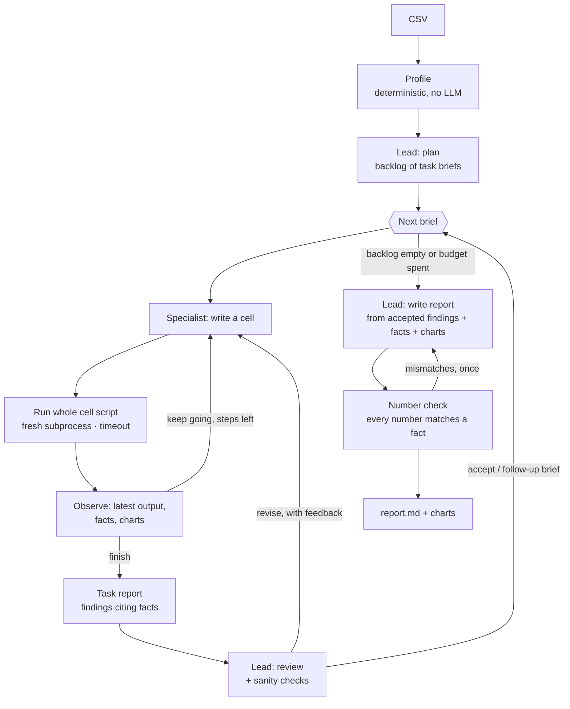

# Project Plan: Grounded Data Analyst Agent

> **This is the main plan for the project.** It replaces `todo.md`; everything still useful from there is folded in below (see [Appendix: todo.md mapping](#appendix-todomd-mapping)).
> Update the checkboxes and the **Status** block as work lands. Record decisions in the [Decision log](#decision-log).

**Status:** Phase 1 done on `phase-1` (P1.1–P1.5). Measured on the Titanic reference run: wrong claims 7 → 0, unsupported 6 → 0, baseline findings absent 7 → 0, charts in the report 0 → 5 ([P1.5 check](docs/progress/p1.5/annotations.md)). The exit criteria were met on Claude Haiku 5.5 (9 min, $0.08 a run); not yet re-run on qwen3.5. Hosted providers (OpenRouter, Anthropic) and a cost report added. Next: plan Phase 2 (eval harness) · **Last updated:** 2026-11-02

---

## 1. Goal

Turn the prototype into a portfolio project that shows off **agent engineering**, not just "agents talking to each other":

> *A local-first data analyst agent. Point it at a CSV and a lead analyst plans the analysis, delegates tasks to specialists who iterate on what their code actually printed, reviews their work, follows up on findings, and writes a report with charts in which **every number traces back to code that actually ran**. An eval harness measures how often it is right.*

The story this project tells:
1. **The prototype was a pipeline, not a team.** Agents ran once, never saw their own results, and nobody reviewed anybody. The reports got numbers backwards (the legacy "61.62% survived"), or, with a better model, dropped the strongest findings and called overfitting "healthy" ([review](docs/baseline/review.md)).
2. **I redesigned it around delegation, feedback loops, and synthesis:** specialists iterate on their own output, a lead analyst reviews every task and digs deeper where it matters, and the report is written from complete, recorded results.
3. **I built an eval harness**, including trap datasets, that measures these failures.
4. **Here are the before/after numbers** (tagged baseline vs. redesign), across local and hosted models.

### Principles
- **Measure every change.** Until the eval harness exists (Phase 2), every Phase 1 step is checked by re-running the reference run and repeating the claim-by-claim annotation. No "it feels better."
- **Numbers come from code, never from the LLM.** Code records facts; the writer works from them, and every number in the report is checked against them.
- **Look before you conclude.** Interpretations are written only after seeing real output, by whoever ran the code, and reviewed by someone else.
- **Deterministic before LLM.** Use plain Python for profiling, graders, and sanity rules. Use the LLM only where judgment is needed.
- **Local-first, provider-agnostic.** It runs fully on Ollama. Hosted models are optional and used for comparison.
- **Small, finished, honest.** A narrow scope that works and is measured beats a wide scope that demos once.

### Definition of done (v1.0)
- [ ] `uv run analyst run data.csv` produces an HTML/Markdown report with charts, from a clean clone, in one command.
- [ ] Specialists iterate on their own output; the lead reviews every task (accept / revise / follow-up).
- [ ] Generated code runs in a sandbox (timeout, no network, isolated working directory), and each task's code is a runnable `.py` script.
- [ ] Every numeric claim in the report resolves to a recorded fact from executed code; the report includes charts.
- [ ] The eval suite (≥6 cases, including adversarial "trap" datasets) runs with one command and produces a comparison table.
- [ ] README shows the before/after eval table, a local vs. hosted model comparison, an architecture diagram, and a demo GIF.
- [ ] CI runs lint, unit tests, and a deterministic eval smoke test (replayed LLM responses) on every push.
- [ ] A short UI (upload CSV → watch progress → read report) exists and is shown in the demo.
- [ ] Tagged `v1.0.0`. Optional write-up / blog post.

### Non-goals (v1)
Big-data / out-of-core processing, multi-user hosting, auth, human-in-the-loop approval, long-term memory, clustering/time-series specialists, sub-delegation (specialists spawning their own sub-agents). These go in [Stretch](#phase-7--stretch-post-v10).

---

## 2. Target architecture



### Roles

| Role | Does | Sees |
|---|---|---|
| **Lead analyst** | Plans a backlog of briefs from the profile; reviews each task report (accept / send back with feedback / add a follow-up brief); writes the final report | Profile, backlog, accepted findings (compact), the report under review, sanity-check results |
| **Specialist** (eda / statistical / ml) | Works one brief as a loop of cells; finishes with a task report | Its brief, its own cells, the latest cell's output (size-capped), facts and charts so far, inputs published by earlier tasks |

**Brief** (lead → specialist): question, specialist, inputs it may load, what a complete answer contains.
**Task report** (specialist → lead): findings (each citing the facts that support it), facts, charts, published outputs, open questions / suggested follow-ups, status (answered / partial / failed).

### Execution: cell scripts, one per task
Each task is a plain Python file, `runs/<run>/tasks/<task_id>/analysis.py`, split into cells with `# %%` markers (the "percent" format VS Code, Spyder, and Jupytext understand). No notebooks: they bloat context and add machinery we don't need.

- Each specialist step appends one cell (or replaces the cell that just failed).
- The **whole file is re-run in a fresh subprocess** with a timeout. Output, errors, new facts, and charts are captured per cell. No hidden state; a crash only affects that run; the saved script always reproduces the results.
- Re-running earlier cells is cheap at this scale. Add caching only if it becomes slow.
- Tasks are isolated from each other. Hand-offs are explicit: a task **publishes** named outputs (e.g. a train/test split, a fitted model), and the lead lists them as inputs in later briefs, which **load** them.

### Runtime helpers (available in every cell script)
```python
# Setup cell, written by the runner (agent/execution/runtime.py)
from agent.execution.runtime import df, load, publish, record_fact, save_chart

rate = df["Survived"].mean()
record_fact("survival_rate", rate, desc="Share of passengers who survived")
save_chart(fig, "survival_by_class", caption="Survival rate by passenger class")
publish("train_test", (X_train, X_test, y_train, y_test))   # for later tasks
X_train, X_test, y_train, y_test = load("ml_1/train_test")  # in a later task
```
Facts are stored per task in `tasks/<task_id>/facts.json` (so cited as `eda_1.survival_rate`) with value, description, and the cell that produced them; charts in `charts.json` + `charts/`; published outputs in `workspace/<task_id>/`. Each task directory has a `.analyst.json` (data path, run dir, task ID), so `python analysis.py` also runs there by hand.

### Budgets (settings)
Max steps per task, max revisions per task, max tasks including follow-ups, and max output characters shown per cell. They keep local runs bounded (~45–60 min accepted for now) and the 8k context safe.

---

## 3. Eval harness (centerpiece)

### Eval cases
Each case is `evals/cases/<name>/` with `data.csv` (or a seeded generator) and `expected.yaml`. Synthetic datasets come with **planted ground truth**, so the right answer is known exactly.

| Case | What it tests |
|---|---|
| `titanic` | Real data; ground truth from a reference script (survival rate, missing Age = 177, chi-square Sex×Survived significant, etc.). |
| `planted_effects` | Binary target; feature A strong effect, B weak, C none; 15% missing in D. Recall of real effects, ranking. |
| `pure_noise` | Target independent of everything. **Trap:** must not claim significant predictors; model ≈ baseline. |
| `leakage` | A column that nearly copies the target. **Trap:** must flag leakage instead of celebrating 99% accuracy. |
| `regression_outliers` | Continuous target, skew, outliers. Regression path, robust stats. |
| `string_target` | Target named `churned_flag` with `"yes"/"no"` values. Target detection + encoding. |
| `datetime_trend` | Trend + seasonality. Honest gap today; tracks whether dates are noticed. |

`expected.yaml` sketch:
```yaml
target: Survived
facts:                       # checked against recorded facts / report values
  survival_rate: {value: 0.3838, tol: 0.005}
  missing.Age: {value: 177}
must_find:                   # planted findings (judge + keywords)
  - "Sex strongly associated with survival (women higher)"
must_not_claim:              # traps / known false statements
  - "majority of passengers survived"
caveats_required: [overfitting]   # when applicable
```

### Metrics
| Metric | How | Grader |
|---|---|---|
| **Run success** | Pipeline finished, report produced | deterministic |
| **Task success rate** / avg retries | From run store | deterministic |
| **Fact accuracy** | Recorded facts vs `expected.facts` within tolerance | deterministic |
| **Grounded-number rate** | % of numbers in the report that resolve to a fact | deterministic |
| **Finding recall** | `must_find` items present | LLM judge with rubric |
| **False claims** | `must_not_claim` violated; significance claimed on `pure_noise` | LLM judge + rules |
| **Caveat coverage** | Required caveats present (overfit, leakage) | deterministic + judge |
| **Cost / latency** | Wall time, # LLM calls, tokens | deterministic |

- **Report-level graders must also work on v1** (no facts needed: they read the report text) so the baseline is real.
- **Repeats:** default `--repeats 3`; report mean and min–max. LLM output varies; one run proves nothing.
- **Judge calibration:** hand-label ~10 reports; check judge agreement before trusting it. Judge model fixed and recorded.

### Harness features
- `uv run python -m evals run --suite core --model ollama:<model> --repeats 3` → `evals/results/<timestamp>_<model>.jsonl`
- `uv run python -m evals report [run ...]` → Markdown table (also feeds the README).
- `uv run python -m evals compare A B` → per-metric deltas, per-case regressions.
- **LLM record/replay cache** (keyed by model + prompt hash): makes re-runs free and deterministic, lets graders be developed offline, powers the CI smoke test.
- Results are committed (small JSONL) so history is visible in git.
- **LangSmith:** every eval run is traced and tagged with its case and repeat, so a failing case can be opened straight from the results table. Optionally, results are also pushed as LangSmith experiments for side-by-side comparison. The local JSONL stays the source of truth: it works offline, is committed to git, and feeds the README.

### Test harness (separate from evals)
- `pytest` unit tests for pure logic: profiler, plan validation/topo sort, sanity rules, fact resolution, verifier number-scan, renderer.
- Sandbox tests: timeout kills, network blocked, non-zero exit → failure, stdout containing "Error:" → **not** a failure.
- Graph integration tests with LangChain's fake chat models (scripted responses), so no Ollama is needed.

---

## 4. Phases

Sizes: **S** ≈ an evening, **M** ≈ a few sessions, **L** ≈ a week+ of evenings.

### Phase 0: Reset & baseline (S–M), detailed

**Goal:** a clean repo with tests and CI that runs end-to-end on `qwen3.5:9b`, with the known bugs fixed, every run fully logged locally, and a reviewed reference run that defines what to fix next.

**What "baseline" means:** the prototype design with its bugs fixed, *not* the redesign. Behavior related to hallucination (truncated context, the LLM typing numbers) is deliberately left alone so the "before" numbers are honest.

**Branch:** `phase-0`, created from `feature/new-flow`; merged to `main` at the end. `main` is 6 commits behind `feature/new-flow` and has nothing that isn't already on it.

**Exit criteria**
- [ ] CI green (ruff + pytest) on `main`
- [ ] `python run.py data/titanic.csv --target Survived` completes on `qwen3.5:9b`
- [x] Bugs B1–B6 fixed, each with a test
- [x] Each run leaves a complete run directory (logs, every LLM call, state per node, every code attempt)
- [x] Reference run, annotations, and review committed; commit tagged `v0.1.0-baseline`
- [x] New Phase 1 (agent quality) written into this plan from the review

#### Measured on 2026-10-30 (these shape the phase)
- `qwen3.5:9b` (Q4_K_M) on this machine: **~5 tok/s**. Only **1.7 of 6.3 GB is in VRAM**, so it runs mostly on CPU.
- **Thinking mode on:** a one-sentence answer did not finish within 280 s. **Thinking must be off.**
- **Ollama's default context is 4,096 tokens**, so longer prompts (the reporter's) get cut off without any warning.
- **LangChain defaults:** the orchestrator call hung for >10 min. With `reasoning=False, num_ctx=8192, num_predict=600` it finished in **86 s** (729 tokens in, 193 out) and returned a valid, sensible `StrategicPlan`.
- The orchestrator asked for `estimated_tasks=12`. At this speed that's well over an hour per run, so **cap the task count**.
- **Update 2026-10-31:** with `num_ctx=8192` only 18% of the model is on the GPU (1.1 of 6.4 GB), about 1.6 tok/s including prompt processing. The bigger context costs VRAM.
- **Consequence for the eval harness (Phase 2):** 7 cases × 3 repeats is not practical locally at this speed. See [Phase 0 risks](#phase-0-risks).

#### Steps (roughly one commit each, in this order)

**P0.1 Commit pending work** (S)
- [x] Commit the ruff formatting plus the `agent.graph` export as one commit. (Checked: apart from that export and the `run.py` import, the diff is formatting only.)
- [x] Commit `PLAN.md` and `.devcontainer/devcontainer-lock.json`.
- [ ] Push `feature/new-flow` and `phase-0` *(`phase-0` created locally; push pending)*

**P0.2 Repo cleanup** (S)
- [x] Delete `todo.md` (superseded by this plan) and `docs/` (~2,300 lines of generated docs that contradict the code).
- [x] Delete `notebooks/tests.ipynb` (scratch work).
- [x] Move `output/report_hierarchical_titanic.md` to `docs/baseline/legacy_report_titanic.md`. It's the "61.62% survived" example for the README story. Then delete `output/`.
- [x] `.gitignore`: add `output/` and `runs/`.
- [x] Delete the `multi-specialist` branch. It's a work-in-progress snapshot of the earlier hierarchical version and includes 690 committed MLflow files. Its `validation.py` (an AST import blocklist) is not carried over: a blocklist isn't a security boundary; the P1.1 subprocess runner and Phase 3 isolation replace it.
- [x] Keep `feature/advanced_logging` (1 commit of file loggers) for review in Phase 5.
- [x] Add `.env.example` (variable names only).

**P0.3 Tooling & metadata** (S)
- [x] `pyproject.toml`:
  - add description, readme, and license
  - add `[dependency-groups] dev = ["pytest", "ruff", "ipykernel"]` and remove `ipykernel` from runtime deps
  - remove `mlflow` and its usage in `run.py` (LangSmith is the only tracer); the local `mlruns/` folder can then be deleted
  - keep `langsmith`; use the current `LANGSMITH_*` env var names in `.env.example` (the legacy `LANGCHAIN_*` names still work)
  - keep `langchain_experimental` until P1.1 replaces `PythonREPLTool`
- [x] Add `[tool.ruff]` (line length 88; rules `E, F, I, B, UP`) and `[tool.pytest.ini_options]` (`testpaths = ["tests"]`).
- [x] Run `uv lock && uv sync --group dev`, then `ruff check --fix` and fix what's left by hand.
- [x] `tests/conftest.py` with small in-memory DataFrame fixtures. Tests must never depend on `data/`, which is gitignored.

**P0.4 CI** (S). Done early so every later commit is checked.
- [x] `.github/workflows/ci.yml` runs on push and PR: `astral-sh/setup-uv` → `uv sync --group dev --locked` → `ruff check` → `ruff format --check` → `pytest`. There's no Ollama in CI, and no test calls an LLM.

**P0.5 Local model configuration** (S–M)
- [x] `config.py`: set default models to `qwen3.5:9b`. Add settings `llm_reasoning: bool = False`, `llm_num_ctx: int = 8192`, `llm_max_tokens: int = 2048`, `llm_timeout_s: int = 600`, `max_tasks: int = 6`.
- [x] `LLMManager.get_llm`: when the provider is `ollama`, pass `reasoning`, `num_ctx`, `num_predict`, and the timeout.
- [x] `scripts/llm_smoke.py`: check Ollama is reachable and the model is pulled, make one structured-output call that must parse, then print tok/s and the GPU/CPU split (from `/api/ps`). Run it before every long run.
- [x] *(Host, not code)* Find out why only 1.7 GB is offloaded to the GPU. **Result (2026-10-31):** the GPU has 4 GB dedicated + 7.9 GB shared memory, and the model is ~5.5 GB of weights plus a vision encoder, so it can't fit fully. Ollama's automatic estimate placed only ~1.65 GB on the GPU. Forcing layers with `num_gpu` (new `LLM_NUM_GPU` setting, per machine in `.env`):

  | GPU layers | On GPU | Generation | Prompt (4.3k tokens) |
  |---|---|---|---|
  | auto | 1.65 GB | 4.8 tok/s | slow |
  | **18 (chosen)** | **3.40 GB** | **7.7–10.4 tok/s** | ~750 tok/s |
  | 20 | 3.6 GB | ~12 tok/s | ran out of memory on long prompts in the reference run |
  | 21 | 3.79 GB | 10.6 tok/s | ~765 tok/s |
  | 33 (all) | 5.74 GB, spills to shared | 3.8 tok/s | 99 tok/s |

  Shared GPU memory is system RAM reached over the bus, so spilling into it is slower than CPU. Context size (2k/4k/8k) made no difference: only 8 of 32 layers use full attention, so the cache is small.

**P0.6 Bug fixes, test first** (M). For each: write the failing test, fix, get to green.

| ID | Bug | Fix | Test |
|---|---|---|---|
| B1 | Specialist LLM config never applied: `AGENT_CONFIGS` keys are `eda_specialist`… but the agent type is `eda` ([llm_manager.py:33](agent/core/llm_manager.py#L33)) | Rename keys to `eda` / `statistical` / `ml`; split a pure `resolve_config()` out of `get_llm`; an unknown agent type raises | `resolve_config("ml")` → coder model, temp 0.1; unknown type raises |
| B2 | Failed tasks are added to both `completed_tasks` and `failed_tasks` ([execution_manager.py:45](agent/nodes/execution_manager.py#L45)), so the success rate is wrong; 0 tasks → `ZeroDivisionError` ([reporter.py:42](agent/nodes/reporter.py#L42)) | Append to exactly one list; extract a pure `build_execution_summary(completed, failed)`; pass failed tasks to the synthesizer explicitly | 4 ok + 1 failed → 5 total, 80%; 0 tasks → no crash |
| B3 | Cyclic or broken plans silently accepted ([planner.py:123](agent/nodes/planner.py#L123)) | `validate_plan()`: duplicate IDs → error; unknown deps → dropped with a warning; cycles → `PlanValidationError`; enforce `max_tasks` (keep the top N by priority, drop deps on removed tasks) | cycle raises; unknown dep dropped; order respects deps; cap applied |
| B4 | Retries hard-coded to 2 ([execution_manager.py:39](agent/nodes/execution_manager.py#L39)) | Default from `settings.max_code_retries` | default equals the setting |
| B5 | Regex flags normal output as a failure: `print("ModelError: none")` → failed ([specialists.py:89](agent/core/specialists.py#L89)) | Interim until the P1.1 runner: count it as a failure only if the output contains a traceback, or the *entire* output is a single `XxxError(...)` repr (what `PythonREPLTool` returns on an exception) | output mentioning "Error:" → success; `ValueError('x')` → failure |
| B6 | Target detection is Titanic-specific (`"survived"` is hard-coded) and non-numeric targets get type `none` ([orchestrator.py:43](agent/nodes/orchestrator.py#L43)) | `--target` override; generic name list; infer type from the number of unique values regardless of dtype (2 → binary, including `"yes"/"no"`) | string target → binary; override wins; no target → `none` |

- [x] All six fixed test-first (`tests/test_llm_manager.py`, `test_execution.py`, `test_planner.py`, `test_profiling.py`). `max_code_retries` default set to 2 (the previous hard-coded behavior).

**P0.7 Remove dead code** (S)
- [x] **State:** remove `VizOpportunity`, `viz_opportunities`, `viz_artifacts`, `pending_tasks`, `current_task_index`, and `artifacts_dir`. Also remove `cross_insights` with `_extract_cross_insights` (it only ever matched identical strings) and `parallel_groups` with `_compute_parallel_groups` (replaced by `Send` in Phase 3).
- [x] **Config:** remove `max_iterations`, `analyst_temperature`, and `coder_temperature` (unused). Remove `LLMManager.get_cache_info`.
- [x] **Strategies:** remove `TIME_SERIES` and `CLUSTERING` from the strategy enum and the orchestrator prompt. They can be chosen but no specialist runs them. Re-add in Phase 7.
- Left in place: `current_phase` is written but never read (wasn't on the list; revisit in the graph redesign).

**P0.8 CLI & local run store** (M). *Moved forward from the old execution phase on 2026-10-31.* Every run must be fully reviewable from local files; LangSmith is the viewer, not the only record.
- [x] `run.py <csv_path> [--target COL] [--max-tasks N] [--model NAME]`, accepting any path, not just files in `data/`.
- [x] Each run gets its own directory, `runs/<YYYYmmdd-HHMMSS>_<dataset>_<model>/`, plus a `runs/latest` link:

  | File | Contents |
  |---|---|
  | `run.log` | Full log at DEBUG level (the console stays at INFO) |
  | `run_meta.json` | Commit SHA (and whether the tree was dirty), command, settings, models, start/end, duration per node, token totals, task counts, status (`ok` / `failed` / `interrupted`), LangSmith trace URL |
  | `llm_calls.jsonl` | One line per LLM call: node, agent type, model, prompt, raw response (the JSON for structured calls), tokens, duration, error |
  | `state/NN_<node>.json` | Graph state after each top-level node |
  | `tasks/<task_id>/` | `attempt_N.py` and `attempt_N_output.txt` for every attempt (including failed ones), plus `result.json` |
  | `report.md` | The final report |

- [x] The run directory is written as the run progresses, so a crashed or interrupted run still leaves everything up to the failure. *(State and LLM calls are written per step; task attempts at the end of the execution step, and also in `run.log` as they happen.)*
- [x] Verified with a 1-task run (2026-10-31): 5 steps, 5 LLM calls, ~10 min.
- [x] LangSmith run name, tags (dataset, model), and metadata (commit SHA, run dir) are set through the graph `config`, so a trace and its run directory point to each other.
- [x] Settings `output_directory` → `runs_directory`; `output/` is no longer used.

**P0.9 Reference run** (M, mostly waiting)
- [x] Run `scripts/llm_smoke.py`, then `python run.py data/titanic.csv --target Survived` (6 tasks) in the background.
- [x] If it breaks partway, fix only what's needed to finish (no redesign) and note each fix.
  - First attempt crashed the Ollama runner after 26 min (GPU memory at 20 layers). Fixed in `03d2f98`: `LLM_NUM_GPU=18`, one retry on runner crashes, tasks saved as they finish. Second attempt: 25 min, 6/6 tasks.
- [x] Copy the run directory to `docs/baseline/run/` and commit it. Tag the commit **`v0.1.0-baseline`** so the eval phase can always re-run exactly this version.

**P0.10 Review & re-plan** (M)
- [x] Review the reference run node by node, using the run directory and the LangSmith trace: what each agent receives, what it produces, where quality is lost, what works.
- [x] **`docs/baseline/annotations.md`**: every claim in the report marked correct / wrong / unsupported, with the true value. It seeds the eval judge's calibration and the README's "before" story.
- [x] **`docs/baseline/review.md`**: findings per node and the main problems, ranked.
- [x] Turn the findings into a new **Phase 1: agent quality**: done 2026-10-31 with the owner's direction (delegation, feedback loops, synthesis). The eval harness became Phase 2, the leftovers of the old execution/reporting phases became Phase 3 (hardening); Phases 4–7 are unchanged.

**P0.11 Wrap-up** (S)
- [x] README stub: what the project is, status "under active rebuild", a link to this plan, and the current quickstart.
- [ ] Push (blocked on GitHub auth, see P0.1); PR `phase-0` → `main`; update the Status block at the top.

#### Phase 0 risks
| Risk | Mitigation |
|---|---|
| Local inference is slow (~12 tok/s after GPU tuning, was ~5), so evals are expensive | GPU offload tuned (P0.5); Phase 2 replay cache; `--repeats 1` for dev loops and 3 only for published numbers (overnight); decide at Phase 2 start whether to iterate with a cheap hosted model |
| qwen3.5 output quirks (thinking, runaway JSON) | Settings are set explicitly (P0.5); the smoke script catches regressions before long runs |
| `PythonREPLTool` runs LLM-written code in-process until P1.1 | Run only on the sample datasets, inside the devcontainer |

**Effort:** about 3–5 evenings plus one long background run.

### Phase 1: Agent quality: delegation, feedback loops, synthesis (L), detailed

**Goal:** turn the pipeline into agents that build on and review each other's work. Specialists iterate on what their code actually printed; a lead analyst reviews every task and can send it back or follow up on a finding; the report is synthesized from complete, recorded results, with charts. Design: [section 2](#2-target-architecture).

**Why before the eval harness:** the [baseline review](docs/baseline/review.md) shows the main failures are structural (context loss, blind code, no review, prompts that get copied). Fixing the design matters more than measuring it precisely. The baseline is tagged (`v0.1.0-baseline`), so Phase 2 can still score it.

**Measuring progress until Phase 2:** after each step, re-run the reference run (`run.py data/titanic.csv --target Survived`) and repeat the claim check from [annotations.md](docs/baseline/annotations.md). Log the counts below.

**Exit criteria**
- [x] Specialists see their output and iterate; each task's code is a runnable `.py` cell script in the run directory
- [x] The lead reviews every task result (accept / revise / follow-up) within budgets
- [x] The report is written from accepted findings, facts, and charts; every number in it matches a recorded fact (automatic check)
- [x] Reference run: 0 wrong claims, ≤ 2 unsupported, every "computed but missing" baseline finding present, ≥ 2 charts. *(Met on Claude Haiku 5.5, 2026-11-02: 0 / 0 / 7 of 7 / 5. Not yet run on qwen3.5.)*
- [x] No dataset-specific text and no example pipelines in prompts

#### Progress log
| Step | Run | Time | Wrong | Unsupported | Missing findings | Charts |
|---|---|---|---|---|---|---|
| Baseline | `20261031-204254` | 25 min | 7 | 6 | 7 | 0 |
| P1.2 specialist loop | `20261101-112045` ([check](docs/progress/p1.2/annotations.md)) | 45 min | 4 | 7 | 6 (now *never computed*, not lost) | 6 |
| P1.3 prompts & profile | `20261101-121244` ([check](docs/progress/p1.3/annotations.md)) | 54 min | 3 | 7 | 5 (no model trained this run) | 9 |
| P1.4 lead analyst | `20261101-192628` ([check](docs/progress/p1.4/annotations.md)) | 120 min | 5 (imputed t-test, unscaled coefficients ranked) | 6 | 2 | 12 (not yet in the report) |
| P1.4 on Claude Haiku 5.5 (same code, hosted) | `20261102-170201` ([check](docs/progress/models/haiku-5.5/annotations.md)) | 12.5 min, $0.12 | 0 | 3 (writer prose) | 0 | 1 (link broken) |
| P1.5 synthesis & report (Haiku 5.5) | `20261102-181146` ([check](docs/progress/p1.5/annotations.md)) | 9.3 min, $0.08 | 0 | 0 | 0 | 5 (all in the report) |

#### Steps (in this order)

**P1.1 Cell-script runner** (M)
- [x] `agent/execution/`: read/write `# %%` cell files; run the whole file in a fresh subprocess (task directory as working dir, timeout); capture stdout, stderr, and the exception per cell.
- [x] `agent/execution/runtime.py`: `df`, `record_fact`, `save_chart` (non-interactive backend), `publish` / `load`.
- [x] Replaces `PythonREPLTool`; drop `langchain_experimental`.
- [x] Tests: cell round-trip; a failing cell is reported by index with its traceback; timeout kills the run; facts, charts, and published outputs land on disk; output that mentions "Error:" is not a failure.
- [x] Verified 2026-11-01: 1-task run through the full flow (11 min, task ok first attempt); the saved `analysis.py` re-run by hand gives identical output.

**P1.2 Specialist loop** (M–L)
- [x] Each step returns structured output: short reasoning plus either `run` (one new cell) or `finish` (task report).
- [x] The observation after each run: the latest cell's output (capped), facts and charts so far, the error if any.
- [x] `finish` produces the task report; cited facts must exist (validated).
- [x] Budget: max steps; on exhaustion the specialist must finish with status `partial`.
- [x] Remove `InsightExtractor` and "interpretation in print statements".
- [x] Interim: the existing planner and reporter consume task reports (findings + facts) instead of truncated stdout.
- [x] Reference run + annotation → progress log.
- Found on the way: under constrained JSON decoding qwen3.5 almost never emits the status value `answered` (0 of 9), so 4 of 6 tasks reported `failed` and were dropped from the report; renamed to `complete` (3 of 3). A run also stalled for 8 hours overnight, most likely the host sleeping. Task reports now list published outputs.

**P1.3 Prompts & profile** (S–M)
- [x] Rewrite specialist prompts as role + rules + environment (installed libraries, runtime helpers, `df`, available inputs) + output contract. No dataset-specific text, no full example pipelines. A test fails if any template mentions a test dataset's columns.
- [x] Specialists save charts where a chart shows the finding better than numbers.
- [x] `compile()` each new cell before running it, so syntax errors don't cost a run.
- [x] Profiler: exclude the target from features; flag ID-like (unique per row) and free-text columns.
- [x] Reference run + annotation → progress log.
- Found on the way (fixed before P1.4): findings citing no facts passed validation; a failed cell's replacement dropped its imports; `seaborn` tried despite the library list; the report was cut off by the 8k context. See [check](docs/progress/p1.3/annotations.md).

**P1.4 Lead analyst** (L)
- [x] Merge orchestrator + planner into the lead's planning step: a backlog of briefs, aware of the task budget. Briefs name the outputs to publish; a specialist can't finish without them.
- [x] Lead review after each task: accept, send back with feedback (max revisions), or add a follow-up brief; stop when the backlog is empty or the budget is spent.
- [x] Deterministic sanity checks on task results, shown to the lead during review: train/test gap, near-perfect test score, model no better than the majority baseline (via `record_model`), leakage suspects and class imbalance (from the profile). ~~Many tests without correction~~: dropped for now (needs another helper).
- [x] Graph rewrite: loops as conditional edges; nodes return partial state updates; a failed task is recorded and the run continues.
- [x] Reference run + annotation → progress log. Two runs failed first (empty brief ids; an Ollama stream with no data), and the second showed reviews introducing errors; fixed before the third. See [check](docs/progress/p1.4/annotations.md).

**P1.5 Synthesis & report** (M)
- [x] The lead writes the report from accepted findings, the fact table, and charts (replaces synthesizer + reporter). It sees each finding with only the facts it cites, so stale facts from failed attempts are out.
- [x] Number check: every number in the report must match a recorded fact (allowing rounding and percent formatting); mismatches go back to the writer once, any left are listed in the report's limitations. (`agent/number_check.py`)
- [x] Charts embedded in `report.md`; images whose file doesn't exist are removed.
- [x] Reference run + annotation → progress log; exit criteria checked.
- Found on the way: Haiku saved 1 chart per run under "save a chart when it shows a finding better than numbers", so specialists are now asked for a chart of each main finding about distributions, groups or models (5 charts in the reference run). The check's first version missed numbers recorded inside strings and fact names (interval labels); it now reads both.

#### Phase 1 risks
| Risk | Mitigation |
|---|---|
| A 9B model loops forever, finishes too early, or returns malformed steps | Budgets, schema validation with one retry, forced `finish` on exhaustion |
| Runs get longer (more LLM calls) | Accepted for local testing (~45–60 min); budgets; hosted models later (Phase 4) |
| 8k context fills up (lead sees many findings) | Capped observations; compact accepted-findings summaries; facts referenced by name |

### Phase 2: Eval harness + before/after numbers (M–L)
Goal: measure the tagged baseline and the Phase 1 agent on the same suite.
- [ ] **Central run configuration** (first, because eval runs vary and record these). Move the behaviour knobs that are hard-coded today into `Settings`, grouped and documented: review script cap, fact value cap, planning description cap, sanity-check thresholds, profiling thresholds, per-role temperatures, retries, report rewrites, number-check exemptions. Add named presets (e.g. `local`: today's budgets for qwen; `hosted`: larger budgets), selected with `--preset` / `PRESET`, with `.env` and CLI overrides on top. `run_meta.json` records the resolved values (it already dumps `Settings`).
- [ ] `evals/` package skeleton: case loader, runner, results JSONL, report table.
- [ ] Dataset generators (seeded) for the synthetic cases + reference script for Titanic ground truth.
- [ ] Report-level graders (work on both versions): fact-in-text check, must_find / must_not_claim judge, caveat check, run/task success, timing.
- [ ] Run-store graders for the new agent: recorded facts vs ground truth, review decisions, follow-ups.
- [ ] LLM record/replay cache.
- [ ] Judge calibration on ~10 hand-labeled reports (start from [annotations.md](docs/baseline/annotations.md)).
- [ ] Run `v0.1.0-baseline` and the Phase 1 agent on the suite; commit results.

**Exit:** a committed before/after table.

### Phase 3: Hardening, guided by the eval (M)
Goal: close the gaps the eval exposes.
- [ ] Sandbox isolation: network blocked, environment scrubbed; optional Docker backend.
- [ ] If numbers in reports still drift: the writer cites `{{fact:…}}` references and a renderer fills in values.
- [ ] If the judge finds false qualitative claims: an LLM claim check against facts, looping back to the writer.
- [ ] Retry strategies targeted at the failure types the eval shows.
- [ ] Parallel task execution (`Send`, `max_concurrency`) for hosted models.
- [ ] **Depth: fewer open questions.** The P1.5 report left 10 open questions; 9 were answerable with this data, and 1 was a review objection that ran out of revisions. Measure on the eval: (a) larger budgets in the `hosted` preset (`max_follow_ups` 2 → 5, `max_revisions` 1 → 2); (b) a closing review: when the backlog is empty and follow-up budget is left, the lead ranks every open question (suggested follow-ups and unresolved objections across tasks) and briefs the most important, instead of choosing only at each task's review; (c) the report keeps only the open questions the lead judges important. Keep a change only if finding recall goes up and false claims don't.
- [ ] Re-run the eval; compare with Phase 2.

**Exit:** trap cases pass; clear improvement over the Phase 2 numbers.

### Phase 4: Models & providers (S–M)
- [x] Provider config: `ollama`, `openrouter`, `anthropic` via `init_chat_model` (`MODEL_PROVIDER` / `--provider`, one model setting per provider). Done early, 2026-11-02, because local runs were the bottleneck. `openai` dropped: OpenRouter serves those models.
- [ ] Per-role model config (planner / coder / writer / judge) in `settings` / `.env`. *(Partly there: `ANALYST_MODEL` / `CODER_MODEL` / `REPORTER_MODEL` override the provider's model; no judge yet.)*
- [x] Token and cost report per run: `scripts/run_cost.py` (tokens per node; cost at OpenRouter list prices, also projected onto other models).
- [ ] Eval matrix: ≥2 local models + ≥1 hosted (e.g., Claude Sonnet 5.5) → comparison table with cost/latency.
- [ ] Choose and document the recommended default(s) based on the numbers.

**Exit:** model comparison table committed.

### Phase 5: Product surface (M)
- [ ] HTML report (single self-contained file, charts embedded) + Markdown.
- [ ] CLI polish: `analyst run <csv> [--target] [--model] [--out]`, live progress output (stream graph events).
- [ ] Minimal UI (Streamlit recommended): upload CSV → live task progress → rendered report + run artifacts.
- [ ] Structured logging; one LangSmith trace per analysis, linked from the run dir and the UI.

**Exit:** a demo-able app on a fresh dataset.

### Phase 6: Showcase (M)
- [ ] README rewrite: pitch, architecture diagram, before/after + model comparison tables, quickstart, design decisions, limitations.
- [ ] Demo GIF/video (UI on a non-Titanic dataset).
- [ ] Example reports in `examples/` (2–3 datasets, including a trap case).
- [ ] Clean history/branches; LICENSE check; `.env.example`.
- [ ] Tag `v1.0.0`.
- [ ] Optional: write-up "Measuring and cutting hallucinated numbers in a data-analysis agent."

### Phase 7: Stretch (post-v1.0)
- Natural-language questions ("why did survival differ by class?") → targeted plan.
- Human-in-the-loop plan approval (LangGraph interrupt).
- Time-series and clustering specialists (`datetime_trend` case becomes a real target).
- Parallel execution tuning; larger datasets (sampling / DuckDB).
- Memory of successful analysis patterns across runs.
- Sub-delegation: specialists split a brief into sub-tasks for their own sub-agents (deferred 2026-10-31; briefs and task reports already allow it).
- Specialists look at their own charts (qwen3.5 accepts images).

---

## 5. Target repo layout

```
agent/                # package (rename TBD, see open decisions)
  profiling.py        # deterministic profiler + target detection
  lead.py             # lead analyst: plan, review, report
  specialist.py       # specialist loop
  execution/          # cell files, runner + driver, runtime helpers
  reporting/          # writer, verifier, sanity rules, renderer
  graph.py            # LangGraph wiring
  llm.py              # provider/model config
  templates/          # Jinja prompts
  cli.py
app/                  # Streamlit UI
evals/
  cases/<name>/{expected.yaml, data.csv | generate.py}
  graders/  runner.py  report.py  cache/  results/
tests/
examples/
PLAN.md  README.md
```

---

## 6. Decision log

| Date | Decision | Why |
|---|---|---|
| 2026-10-29 | `PLAN.md` is the single source of truth; `todo.md` retired | One plan, tracked in git |
| 2026-10-29 | ~~Eval harness is built **before** the redesign~~ (superseded 2026-10-31) | Need a measured baseline for the before/after story |
| 2026-10-29 | Numbers in reports come only from recorded facts (writer cites IDs) | Removes the main hallucination path structurally |
| 2026-10-29 | Replace `PythonREPLTool` with a subprocess sandbox; success = exit code | Security + fixes regex false failures |
| 2026-10-29 | Merge Orchestrator and Planner | Overlapping responsibilities, one fewer LLM call |
| 2026-10-29 | Stay local-first (Ollama default); hosted models for comparison | Privacy/cost selling point + interesting eval matrix |
| 2026-10-30 | `qwen3.5:9b` is the local development model; thinking off, `num_ctx=8192`, output capped | Measured: thinking/defaults hang; explicit settings give a valid plan in 86 s |
| 2026-10-30 | Baseline = prototype design + bug fixes, tagged `v0.1.0-baseline` | Before/after should compare designs, not a version crippled by trivial bugs |
| 2026-10-30 | Cap plans at `max_tasks=6` | Keeps a local run to ~30–60 min at current speed |
| 2026-10-31 | `LLM_NUM_GPU=18` on this machine (in `.env`, not a code default) | Ollama's auto offload left 60% of VRAM unused. 20 layers was faster but the first reference run slowed to ~1 tok/s and then crashed the runner on a long prompt, so 18 keeps ~0.5 GB free |
| 2026-11-01 | Context 16k (`llm_num_ctx`), `LLM_NUM_GPU=17` on this machine | Complete task reports made the reporter's prompt + output fill 8k and cut the report off; 16k at 17 layers keeps the same GPU headroom (3.39 GB) at ~12% slower generation |
| 2026-11-01 | Install `seaborn` for task scripts | Two runs in a row lost steps trying it despite the library list |
| 2026-11-01 | Every finding must cite at least one recorded fact | Uncited findings carried the remaining wrong statistics in the P1.3 run |
| 2026-11-01 | Budgets: 6 planned tasks + up to 2 follow-ups, 1 revision per task | Keeps a local run to an estimated 60–75 min |
| 2026-11-01 | A task sent back continues its own script with the lead's feedback | Keeps its cells and facts; the fix costs a step or two instead of a rerun |
| 2026-11-01 | `record_model()` helper computes model scores in code | Fact names are free-form, so checks can't find "train accuracy" otherwise; it also makes ML numbers consistent (same metrics, a baseline every time) |
| 2026-11-01 | Missing brief outputs are enforced in code (specialist can't finish, a lead's accept is overridden); outputs nothing depends on are dropped from the plan | The ML hand-off failed in two runs despite a prompt rule; qwen3.5 lists outputs on every brief |
| 2026-11-01 | The lead reviews with the task's code, not only its report | The P1.2 Cramér's V error was only visible in the code |
| 2026-11-01 | Brief ids are assigned in code; `depends_on` may name an id or an output | qwen3.5 left every id empty and named outputs instead (first P1.4 run) |
| 2026-11-01 | The lead takes numbers only from facts, the profile and accepted findings; the prompts define the trivial baseline | In the second P1.4 run, reviews made up per-class rates and enforced the plan's "mean survival rate" as the baseline accuracy |
| 2026-11-01 | Keep 1 revision per task despite the 120-min run | 4 of 6 send-backs in the reference run fixed real errors; revisit if runs stay this long |
| 2026-11-02 | OpenRouter as a second provider for dev runs (`MODEL_PROVIDER` / `--provider`, one model setting per provider), through `ChatOpenAI` and `langchain-openai<1`; structured output over function calling | Local runs take ~2 h; a 1-task run took 5 min on OpenRouter. `langchain-openrouter` needs LangChain 1.x. Free models often lack `response_format` |
| 2026-11-02 | The smoke script fails a model whose structured output loses line breaks in code | `nemotron-3-ultra-550b-a55b:free` turns newlines in tool-call arguments into spaces (and double-escapes them in plain JSON), so every cell became one comment line and ran as a no-op; `nemotron-3.5-super-vl:free` keeps them |
| 2026-11-02 | Anthropic as a third provider (`langchain-anthropic<1`); structured output through JSON outputs (`output_config.format`), no temperature sent | Forced tool calls let Haiku 5.5 drop required fields (a review without a verdict ended a run); JSON outputs are schema-valid by construction and work on Sonnet / Opus 5.5, which reject forced tool calls. Current Claude models reject sampling parameters. |
| 2026-11-02 | Claim-check model runs like the P1.x steps (`docs/progress/models/<model>/`) | Same method, so model and design changes compare on one scale until Phase 2 |
| 2026-11-02 | Number check: a number passes if a recorded value rounds to it (shares may be written as percentages, sign not compared). Recorded = cited facts (values and names), the profile, number literals in task code. Plain integers ≤ 10, thresholds (`p < 0.001`) and confidence levels are not checked | On the earlier Haiku report it flagged exactly the 7 untraced numbers among hundreds. Small integers are mostly labels (class 3, df 2); code literals are parameters (`test_size=0.25`) |
| 2026-11-02 | The report has Summary, Data, Findings, Limitations, Open questions; no "Recommendations" | The old Recommendations / Future analysis sections were where writers speculated beyond the findings |
| 2026-10-31 | Tracing: **LangSmith only**; MLflow removed | Built for agents; clearer traces. Tracing is opt-in via env, because when it's on, prompts and data samples leave the machine (relevant to the local-first pitch) |
| 2026-10-31 | Delete untracked `todo.md`, `docs/`, `notebooks/`, and the `multi-specialist` branch | Confirmed by owner; superseded by this plan / `feature/new-flow` |
| 2026-10-31 | New Phase 1 (agent quality) before the eval harness | The baseline review shows structural failures; the tagged baseline keeps the before/after story measurable |
| 2026-10-31 | Lead analyst + specialists with two feedback loops (specialist iterates on output; lead reviews, revises, follows up) | Owner's direction: delegation and synthesis at both levels, ability to dig deeper and change the plan |
| 2026-10-31 | Task code is a plain `.py` file with `# %%` cells, re-run whole in a fresh subprocess each step; no Jupyter | Notebooks bloat context; re-running gives no hidden state and reproducible scripts |
| 2026-10-31 | One session per task with explicit publish/load hand-offs (not one shared session) | Matches delegation; tasks stay reproducible and can't clobber each other |
| 2026-10-31 | Sub-delegation deferred | Specialist loop + lead follow-ups cover iteration and depth; nesting multiplies LLM calls at ~10 tok/s |
| 2026-10-31 | Local runs of ~45–60 min are acceptable for now | Owner will test hosted models later |
| 2026-10-31 | Prompts give rules and an output contract, never example pipelines | The baseline copied the examples verbatim (all 6 ML attempts used the example's model and split) |

### Open decisions
- [ ] **Project name / package name** (`agent` is too generic for a portfolio repo).
- [ ] **UI:** Streamlit (recommended, fastest) vs FastAPI + small frontend.
- [ ] **Sandbox backend default:** subprocess (recommended for v1) vs Docker.
- [ ] **Default local model:** `qwen3.5:9b` for now; final choice decided by the Phase 4 eval.

---

## Appendix: todo.md mapping

| Old todo item | Where it lives now |
|---|---|
| Code safety checks before execution | Phase 1 (subprocess runner) + Phase 3 (isolation) |
| Save analysis artifacts / plots | Phase 0 (run store) + Phase 1 (charts, published outputs) |
| Analyst iterates until report complete | Phase 1: specialist loop + lead review |
| Drop debugger, validate imports | Done (debugger removed); covered by sandbox + retries |
| Multi-dataset CLI | Phase 0 (any CSV path) + Phase 5 (CLI polish) |
| Streaming output | Phase 5 |
| Enhanced retry strategy | Phase 1 (specialist loop) + Phase 3 |
| Visualization generation | Phase 1 |
| Human-in-the-loop | Phase 7 |
| Memory/history | Phase 7 |
| Web interface | Phase 5 |
| Model selection | Phase 4 |
| Parallel analysis | Phase 3 (`Send` fan-out) + Phase 7 tuning |
| PDF/HTML export | Phase 5 (HTML; PDF not planned) |
| Unit tests | Phase 0 onward |
| Structured logging / config | Phase 0 + Phase 5 |
| Graph-level error handling | Phase 1 (graph rewrite) |
| Hard-coded retry logic | Phase 0 |
| Data loading mixed with logic | Phase 1: runtime loads `df` once per script |
| NL queries / data profiling / self-improvement / large data | Phase 7 or covered by profiler |
| Collaborative mode (specialized roles) | Phase 1: lead + specialists |
