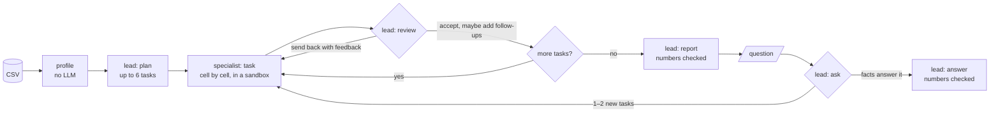

# Data Analyst Agent

Point it at a CSV and a team of agents analyses it. A lead analyst plans the work as tasks. Specialists write and run Python on the data and see what each step printed. The lead reviews every task and sends weak ones back. The report it writes may only use numbers that the analysis code recorded, and a check outside the model enforces that. Afterwards you can ask questions about the data, and the agents answer from what they found or run new tasks.

It runs on Claude by default, or on a local model through [Ollama](https://ollama.com).

**See it:** [a full report on WHO life expectancy data](examples/life-expectancy/report.md), with [three questions asked after it](examples/life-expectancy/questions.md), and [two more examples](examples/README.md).

## How well it works

Measured with an eval harness: datasets with planted findings and traps (a leaked column, pure noise, missing values coded as zero), scored by an LLM judge that was [calibrated](docs/eval/calibration/README.md) against hand labels.

| | Baseline (the prototype) | This agent |
|---|---|---|
| Planted findings found, 7 cases × 3 runs | 53% | **98%** |
| False claims a run, same | 0.1 | **0** |
| Planted findings found, held-out cases nothing was tuned on | 19% | **78%** (`v0.3.0`) |
| False claims a run, held-out | 0.0 | 0.2 → **0** after one fix (`v0.3.1`, checked on a new blind case: 96%) |
| Cost and time a run (Claude Haiku 5.5) | $0.02, 4 min | $0.08–0.20, 8–16 min |

Details: [before/after](docs/eval/before-after.md), [held-out](docs/eval/phase3.md). The held-out cases were written by the project's owner and kept unseen until they ran. The one false claim found held-out came from a trap the agent passes on a famous dataset (Pima's zeros) and failed on an unknown one, which suggests memory. A fix to the dataset profile then cleared it, and a further case written blind after the fix confirmed it.

**Local vs hosted** ([details](docs/eval/local-vs-hosted.md)): one titanic run of qwen3.5:9b on a 4 GB laptop GPU finished in 3 h 19 min with 79% of the findings and no false claims, against Haiku's 100% in 7–10 min. It wrote 4 wrong numbers, and the number check flagged all of them in the report.

## How it works



- **Profile.** A deterministic summary of the data: column types, missing values, each numeric column's spread and most common value, columns that predict the target suspiciously well.
- **Plan.** The lead writes briefs for three specialists (EDA, statistics, ML), each with what a complete answer contains and which earlier tasks it depends on. Independent tasks run in parallel.
- **Tasks.** A specialist works one cell at a time: it writes a cell, runs the script so far, reads the output or the error, and decides the next step. It records each number it relies on with `record_fact`, saves charts, and can publish objects (a train/test split) for later tasks to load. Every task ends as a runnable `analysis.py`.
- **Review.** The lead checks each task's findings against its facts and code, plus automatic checks (findings citing no fact, outputs not published). It accepts the task, sends it back with feedback (up to 1–2 times), or adds follow-up tasks.
- **Report.** The lead writes the report from the accepted findings. Code then checks every number in it against the recorded facts: a number that matches none goes back to the writer once, and any left are listed under Limitations.
- **Questions.** A question after the report runs through the same loop on a smaller scale. The answer is checked the same way, and neither the report nor the run's grades change.

**The sandbox.** Each task's script runs in a subprocess with a timeout, in its own directory, without the API keys in its environment, and with no network (a Linux user and network namespace).

**The record.** Each run writes a directory under `runs/`: the report as Markdown and as a self-contained HTML page, every LLM call, the state after each step, every task's script and facts, live progress events, and grades (tasks done, numbers not traced to a fact, open objections, cost). Tracing to LangSmith is optional.

## Quickstart

Requires [uv](https://docs.astral.sh/uv/) and one of:
- an [Anthropic](https://platform.claude.com) API key (the default);
- an [OpenRouter](https://openrouter.ai) key;
- a running Ollama with the model pulled (`ollama pull qwen3.5:9b`).

Pick one with `MODEL_PROVIDER=anthropic|openrouter|ollama` in `.env`, or with `--provider`.

```bash
uv sync
cp .env.example .env              # provider, key and model; LangSmith tracing; GPU layers
uv run python scripts/llm_smoke.py   # checks the model setup (about a minute)
mkdir -p data && curl -sSLo data/titanic.csv \
  https://raw.githubusercontent.com/datasciencedojo/datasets/master/titanic.csv
uv run analyst run data/titanic.csv --target Survived
```

The run prints its progress and ends with the path of `report.html`. Then ask about it:

```bash
uv run analyst ask runs/latest "Does the class effect hold among women only?"
```

**In the browser:** `uv run --group ui streamlit run app/streamlit_app.py`. You can upload a CSV, watch each task, read the report, and ask questions below it. Past runs open there too.

**Options:**
- `--preset hosted` gives a run more revisions and follow-up tasks. The app uses it for Claude.
- `--target` names the column to explain; without it, the agent picks one or analyses without a target.
- Every setting is in [agent/config.py](agent/config.py), and each can be overridden in `.env`.
- `uv run python scripts/run_cost.py runs/latest` shows a run's tokens and cost per step.

Prompts and samples of the data go to the chosen model provider, and to LangSmith when tracing is on. With Ollama, nothing leaves the machine; expect hours on a small GPU instead of minutes.

## Design decisions

- **Numbers come from executed code, and code checks them.** Prompting a model not to invent numbers isn't enough. Here the writer sees only recorded facts, and a check outside the model compares every number in the text against them. It is the main defence against invented numbers.
- **A lead that reviews every task.** In the prototype, nobody read anybody's output ([review](docs/baseline/review.md)). Here the lead reviews each task and can send it back or add follow-ups, within set limits.
- **Specialists see their own results.** Cell-by-cell execution, as in a notebook, instead of writing a script blind; a task sent back continues its own script.
- **Measure before and after.** An eval harness with planted findings, traps and held-out cases, an LLM judge calibrated against hand labels, and committed eval runs that CI regrades on every push. Changes were judged on cases they weren't developed on.
- **Questions reuse the analysis loop.** A question becomes 0–2 tasks after the report, reviewed and checked like any other, rather than a separate chat feature.
- **Provider-agnostic.** The same graph runs on Claude, OpenRouter or Ollama. Measured on Claude; local runs are an option, not the target.

All decisions, with their reasons, are in the [decision log](PLAN.md#6-decision-log).

## Limitations

- **Datasets the model knows.** It handled Pima's zero-coded missing values from memory but failed the same trap on an unseen dataset. That one was fixed, but well-known datasets will overstate how it does on yours.
- **Small held-out evidence.** 5 held-out cases, 3 runs each, on one model (Claude Haiku 5.5). The fix for the zeros trap was made after seeing it, and one further blind case checked it.
- **Open objections.** About one task a run still has the lead asking for changes when its revisions run out. The report states what that leaves uncertain.
- **Answers can leave out a relevant fact.** In one of the example questions, the answer said the analysis hadn't allowed for repeated countries, though a test in the run had.
- **Local models are slow.** On a 4 GB GPU, a local run takes hours where Claude takes minutes.
- **A sandbox, not a container.** Scripts run in a subprocess without network or keys, which suits your own data on your own machine. It isn't hardened isolation for untrusted input.
- **The app is single-user**, without accounts, for running locally.

## Layout

```
agent/      the agent: graph, lead/report/question nodes, specialists, sandbox, checks, CLI
app/        Streamlit app
evals/      eval harness: cases, data generators, runner, graders, LLM judge, committed runs
examples/   three exported runs
docs/       eval write-ups, the prototype's review, progress notes
scripts/    model smoke test, cost report, example export
tests/      unit and end-to-end tests with scripted models (no API calls)
```

## Development

```bash
uv sync --group dev --group ui
uv run ruff check && uv run ruff format --check
uv run pytest
```

The eval harness:
- `uv run python -m evals run --cases titanic --repeats 1` runs cases (paid on hosted models);
- `uv run python -m evals judge <results>` scores them with the judge;
- `uv run python -m evals report <results>` makes the tables.

See `uv run python -m evals --help`.

[MIT License](LICENSE)
