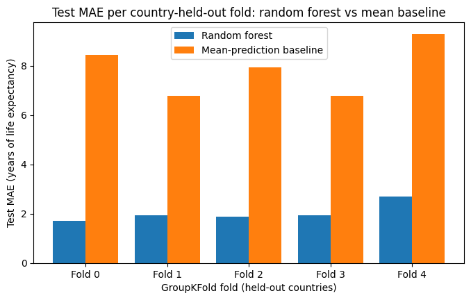

## Questions after the report

### Q1. What is the average life expectancy in Developed vs Developing countries?

Developed countries had a higher average life expectancy: 79.2 years (n = 512) versus 67.1 years (n = 2,416) in Developing countries. The mean difference is 12.1 years (95% CI 11.6 to 12.6). The Welch t-test gives t = 47.87, p < 0.001, and the Mann-Whitney test gives p < 0.001, so the gap is not an artifact of outliers or non-normality.

- **Spread:** The Developed group is tightly clustered (SD 3.9, median 79.25, IQR 76.8 to 81.7). The Developing group is more variable (SD 9.0, median 69.0, IQR 61.1 to 74.0). The Developing group has 4 low outliers and the Developed group has none.
- **Effect size:** Cohen's d is 1.45 (95% CI 1.35 to 1.55), a very large separation between the groups.

These results compare row-level observations across 2000 to 2015. The tests treat each row as an independent sample, and the facts do not show whether repeated observations from the same country were accounted for, so the confidence intervals and p-values may be too narrow. The facts also do not show how the Status categories were defined.

### Q2. Does the random forest still beat the baseline when whole countries are held out of training?

Yes. With whole countries held out (GroupKFold, 5 folds, no country in both training and test in any fold), the random forest still beats the mean-prediction baseline. Its mean test R² is 0.910 (SD 0.026), against -0.027 (SD 0.034) for the baseline. Mean MAE is 2.04 years (SD 0.38) versus 7.84 years (SD 1.09), and mean RMSE is 2.79 years (SD 0.58) versus 9.52 years (SD 1.14).

- **Fold variation:** Fold 4 is the weakest, with RF MAE 2.70 years and R² 0.873. Folds 0 to 3 have RF MAE between 1.72 and 1.94 years. The baseline is worse on every fold, with MAE between 6.77 and 9.29 years.
- **Relative to the random split:** The relative MAE reduction over the baseline is 74% under the grouped split, against 86% in the ml_1 random 80/20 split. Test R² falls from 0.967 to 0.910 and MAE rises from 1.05 to 2.04 years. This drop is consistent with the random split benefiting from countries seen in training. However, the two splits also differ in test rows (586 random rows versus 576 to 592 held-out country rows per fold), so the comparison does not isolate the country effect alone.
- **Not known:** The analysis does not show which countries have the largest errors, whether fold 4's error traces to specific countries or years, or whether country-level features would recover some of the random-split accuracy. Each would need a per-country error breakdown or a rerun with added features.

### Q3. How does life expectancy differ between men and women?

The dataset cannot answer this question. It has no column recording sex or gender, and the analysis produced no facts that break life expectancy down by sex. The target, Life expectancy, is a single figure per row (country and year), so the data does not show whether men and women differ.

Answering it would require a dataset with sex-specific life expectancy, such as male and female values per country and year, or life tables reported by sex. With that data, the comparison could be made directly.
