# Life Expectancy Across Developed and Developing Countries, 2000–2015: Final Analysis Report

## Summary

- **Status gap.** Developed countries have higher Life expectancy than Developing countries: a mean of 79.20 vs 67.11 years, a difference of 12.09 years (naive 95% CI 11.59 to 12.58; cluster-robust 95% CI 10.32 to 13.85). The gap is significant under both analyses, but the naive p-values are likely too small because the rows are repeated country-year observations.
- **Drivers.** HIV/AIDS (Spearman −0.754), Income composition of resources (Spearman 0.866) and Schooling (Spearman 0.814) have the strongest pooled rank associations with Life expectancy. The Schooling slope is about 1.50 years per year of schooling in Developing countries and 0.66 in Developed countries, and the interaction is significant. Within Developed rows, however, the Schooling rank correlation is much weaker (Spearman 0.392).
- **Prediction.** A random forest using the numeric features and Status reaches test R² 0.967 and test MAE 1.05 years, against test R² −0.002 and MAE 7.68 years for a predict-the-mean baseline. The model is overfitted (train R² 0.995), and the split was random across repeated country-year rows.
- **Trend.** The mean rose from 66.75 years in 2000 to 71.62 in 2015. Developing countries rose 5.07 years and Developed countries 3.91 years, so the Developed–Developing gap narrowed from 12.18 to 11.02 years, though not monotonically.
- **Missing values.** Missingness is not random with respect to Life expectancy. Rows missing Hepatitis B have lower mean Life expectancy (66.12 vs 69.95 years), and this association remains in an adjusted model (coefficient −5.24 years). Rows missing Population have higher mean Life expectancy (71.14 vs 68.69 years).

## Data

- **Size:** 2,938 rows and 22 columns. Life expectancy is the regression target. The analyses use 2,928 rows with a non-missing target. Features are 19 numeric columns (including Year) and 2 categorical columns (Country, Status). There are no date/time features.
- **Target distribution (2,928 rows):** mean 69.22, median 72.1, SD 9.52, Q1 63.1, Q3 75.7, range 36.3 to 89.0 years.
- **Missing values (share of rows):** Population 22.2%, Hepatitis B 18.8%, GDP 15.2%, Total expenditure 7.7%, Alcohol 6.6%, Income composition of resources 5.7%, Schooling 5.5%, BMI 1.2%, thinness 1–19 years 1.2%, thinness 5–9 years 1.2%, Polio 0.6%, Diphtheria 0.6%, Life expectancy 0.3%, Adult Mortality 0.3%. Country, Year, Status, infant deaths, percentage expenditure, Measles, under-five deaths and HIV/AIDS have no missing values.

## Findings

### 1. Distribution and trend over time

The overall Life expectancy distribution is left-skewed, since the mean (69.22) is below the median (72.1). Developed countries (n=512) have mean 79.20, median 79.25 and SD 3.93 years. Developing countries (n=2,416) have mean 67.11, median 69.0 and SD 9.01 years. Developing values are lower and more spread out. Under IQR fences, 10 rows fall below 44.2 years overall (all Developing), and none fall above 94.6.

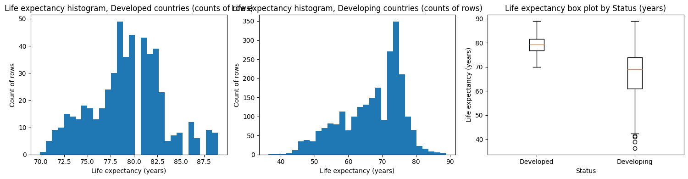

Mean Life expectancy rose from 66.75 years in 2000 to 71.62 in 2015, a gain of about 4.9 years. The rise was not perfectly smooth: 2003 (67.43) and 2010 (70.05) were only slightly above the prior year. The median rose from 71.0 to 73.9. The mean-minus-median gap moved from −4.25 years in 2000 to −2.28 years in 2015. No claim about the spread or tail of the distribution is made from these figures.

Every Year has exactly 183 rows (32 Developed and 151 Developing).

### 2. Change over time by Status

- Developing mean rose from 64.62 to 69.69 years (+5.07). Developed mean rose from 76.80 to 80.71 years (+3.91).
- The Developed–Developing gap in means was 12.18 years in 2000 and 11.02 years in 2015.
- The gap was not monotonic. It widened to 13.01 years in 2004, dipped to 11.52 in 2008, and was 11.02 in 2015.

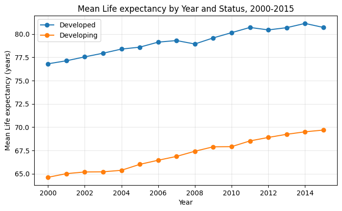

### 3. Key numeric drivers (bands and correlations)

Pooled correlations with Life expectancy, and band means across quartile bands (Q1 is the lowest band):

- **Schooling** (n=2,768): band means 58.73, 67.66, 73.26 and 78.10 years. Pearson r 0.752, Spearman ρ 0.814.
- **Income composition of resources** (n=2,768): band means 58.29, 67.12, 73.19 and 78.86 years. Pearson r 0.725, Spearman ρ 0.866, the strongest rank association of the six drivers.
- **Adult Mortality** (n=2,928): the relation is negative but not monotone. Band means are 72.54, 76.06, 70.36 and 57.75 years, so the second band (74 to 144) is above the first (1 to 74). Pearson r −0.696, Spearman ρ −0.650.
- **BMI** (n=2,896): band means 63.07, 64.48, 73.06 and 76.81 years. The jump occurs between the second and third bands. Pearson r 0.568, Spearman ρ 0.585.
- **HIV/AIDS** (n=2,928): quartile edges collapse, so the split is at 0.8 (the unit is not given in the dataset). Rows at or below 0.8 (n=2,217) have mean 73.30 years; rows above 0.8 (n=711) have mean 56.53 years. Pearson r −0.557, Spearman ρ −0.754.
- **GDP** (n=2,485, rows with GDP missing excluded): band means 62.05, 66.12, 72.40 and 76.92 years. Pearson r 0.461, Spearman ρ 0.642. The Pearson value is well below the Spearman value, consistent with the very skewed GDP range.

Scatter plots (one point per row with both values present):

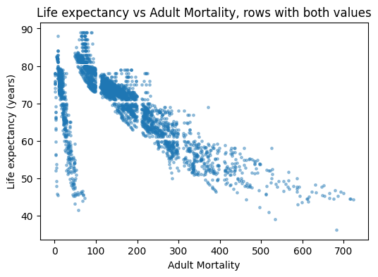

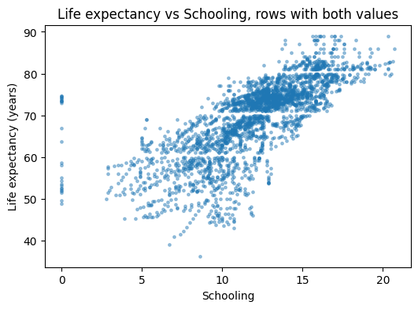

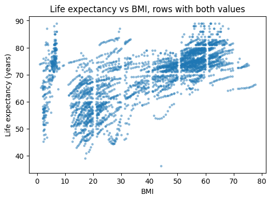

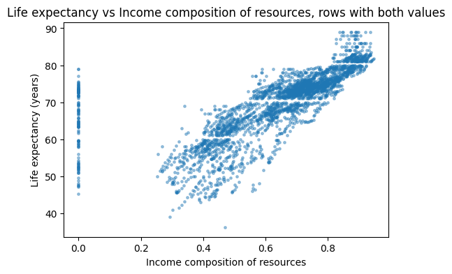

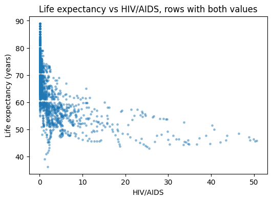

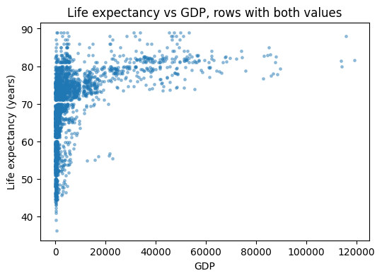

### 4. Developed vs Developing: significance and effect size

- **Life expectancy:** Developed mean 79.20 (95% CI 78.86 to 79.54, n=512) vs Developing 67.11 (95% CI 66.75 to 67.47, n=2,416). Difference 12.09 years (95% CI 11.59 to 12.58). Welch t = 47.87, p < 1e-100; Mann-Whitney p ≈ 1.4e-191. Cohen's d = 1.45 (95% CI 1.35 to 1.55).
- **Schooling:** Developed 15.85 years (n=464) vs Developing 11.22 years (n=2,311). Difference 4.63 years (95% CI 4.42 to 4.83). Welch t = 44.58, p < 1e-100. Cohen's d = 1.61 (95% CI 1.50 to 1.71).
- **Adult Mortality:** Developed 79.69 (n=512) vs Developing 182.83 (n=2,416). Difference −103.15 (95% CI −109.73 to −96.57). Welch t = −30.74, p < 1e-100. Cohen's d = −0.87 (95% CI −0.97 to −0.78).

These tests assume independent observations. The rows are country-year observations, so the p-values and CIs are likely too narrow. The direction and size of the gaps are the robust findings.

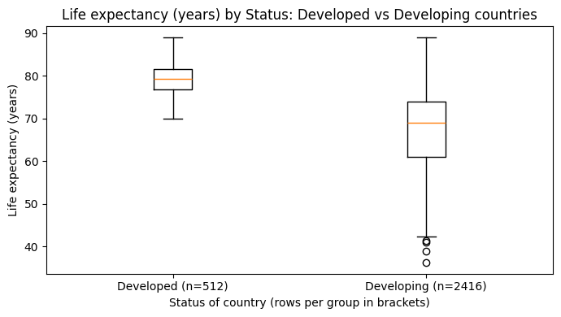

**Cluster-robust check (by Country, 183 clusters for Life expectancy):**

- Life expectancy gap 12.09 years (95% CI 10.32 to 13.85, p = 3.8e-41). This CI is about 3.6 times the naive width.
- Schooling gap 4.63 years (95% CI 3.88 to 5.37, p = 2.8e-34; 180 clusters). Width about 3.6 times the naive width.
- Adult Mortality gap −103.15 (95% CI −121.77 to −84.53, p = 1.9e-27). Width about 2.8 times the naive width.

Every cluster-robust CI excludes zero, so all three gaps remain significant after accounting for country-year structure.

### 5. Does Status change the Schooling and Adult Mortality slopes?

- **Schooling slope:** Developing +1.503 years of Life expectancy per year of Schooling (95% CI 1.428 to 1.579; n=2,304). Developed +0.658 (95% CI 0.482 to 0.833; n=464). The Schooling × Developed interaction is −0.845 (95% CI −1.118 to −0.573, p = 1.3e-9). The team's summary is that Schooling matters about 2.3 times as much in Developing countries.
- **Adult Mortality slope:** −0.0319 per adult death per 1,000 in Developing countries and −0.0371 in Developed countries. The AM × Developed interaction is −0.0052 (95% CI −0.0149 to 0.0046, p = 0.30), not significant.
- **Joint test:** the Status interaction terms are jointly significant, F = 18.66, p = 8.9e-9 (n=2,768, model R² 0.722).

The interaction runs mainly through Schooling. The p-values come from OLS on repeated country-year rows and are likely overstated, but the direction and size of the Schooling slope difference (about 1.50 vs 0.66) are the robust parts.

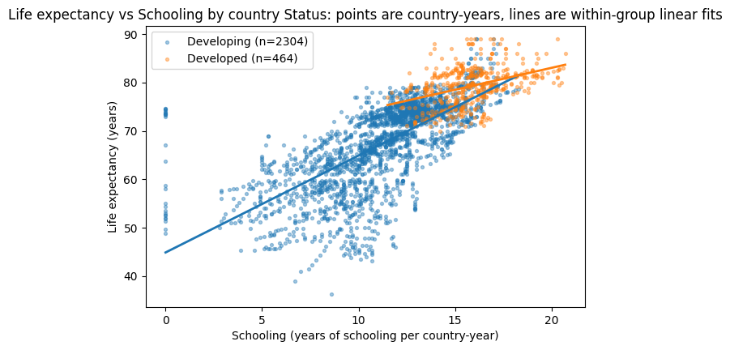

### 6. Within-Status correlations of Schooling, Income composition and HIV/AIDS

These results describe different things from Section 5. Section 5 is about slopes, while this section is about correlation strength. The two can be read together, but the within-Developed rank correlation is far weaker than the pooled value.

- **Schooling:** pooled Spearman 0.814 (n=2,768). Within Developed (n=464), Spearman 0.392 and Pearson 0.395. Within Developing (n=2,304), Spearman 0.756 and Pearson 0.688. The Fisher z test of Pearson r between groups is −8.36. The team's conclusion is that the pooled Schooling correlation mostly reflects the Developed–Developing gap.
- **Income composition of resources:** within Developed, Pearson 0.724 (pooled 0.725, n=2,768). Within Developing, Pearson 0.644. For Spearman, pooled 0.866, within Developed 0.741, within Developing 0.806. The rank association is weaker than pooled in both groups. The Fisher test for Developed vs Developing Pearson gives z = 2.96, p = 0.003.
- **HIV/AIDS:** untestable within Developed rows, because all 512 Developed rows with Life expectancy have HIV/AIDS equal to 0.1. Within Developing rows (n=2,416), Pearson −0.571 and Spearman −0.758, close to the pooled −0.557 and −0.754. The association holds within Developing rows.

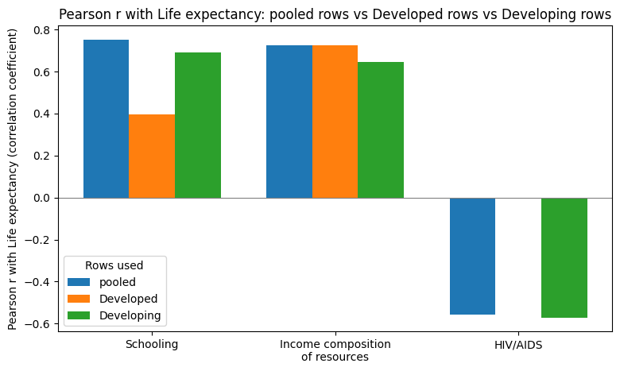

The status of this task is recorded as partial (see Limitations).

### 7. Adult Mortality band pattern within each Status

- **Pooled:** the second fixed band (74 to 144) sits above the first (1 to 74), as described in Section 3.
- **Developed, fixed bands:** the reversal does not persist. The first band (1 to 74, n=270) has mean 81.03 years and the second (74 to 144, n=183) has 78.35. Means fall to 73.36 in the third band (n=57). The fourth band (228 to 723) has only 2 rows.
- **Developed, quartile bands:** the second quartile (58 to 73, n=131) has mean 82.52 against 79.43 for the first (1 to 58, n=131). The team notes these bands are narrow and this is weaker evidence. This result disagrees with the fixed-band result above, and both are reported.
- **Developing, fixed bands:** the reversal persists. The second band (n=551) has mean 75.30 against 67.72 for the first (n=476). The third (n=667) has 70.10, and the fourth (n=722) has 57.70.
- **Developing, quartile bands:** the second quartile (92 to 163, n=605) has mean 73.88 against 69.95 for the first (1 to 92, n=607).
- **Who is in the second Developing band:** 59 countries, with the largest contributors Uruguay (16), Serbia (16), Kuwait, Jordan, Panama and Viet Nam (15 each). No single country dominates.
- **Who is in the second Developed band:** 26 countries, led by Croatia (12) and Belgium (12), then Slovenia and Slovakia (11 each).

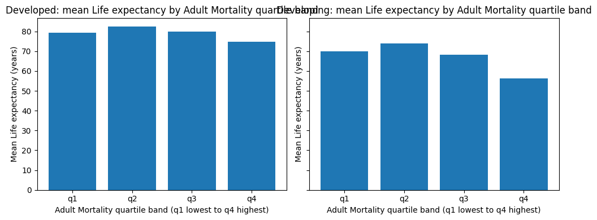

### 8. Low Life expectancy outliers (below 44.2 years)

All 10 rows below the IQR lower fence of 44.2 years are Developing rows:

- Haiti, 2010: 36.3
- Sierra Leone (5 rows): 2000: 39.0; 2001: 41.0; 2003: 41.5; 2004: 42.3; 2005: 43.3
- Malawi (3 rows): 2000: 43.1; 2001: 43.5; 2002: 44.0
- Zambia (1 row): 2000: 43.8

Sierra Leone and Malawi account for 8 of the 10 rows, across 4 countries out of 193 in the full data. The 10 rows fall in 7 years, all between 2000 and 2010. Of these, 7 fall in 2000 to 2003. No year holds more than 3 rows, so the year pattern is weak evidence of concentration. With 10 rows, the test cannot show whether the outliers are concentrated in Status; the Developing share of all rows is 82.5% (2,416 of 2,928).

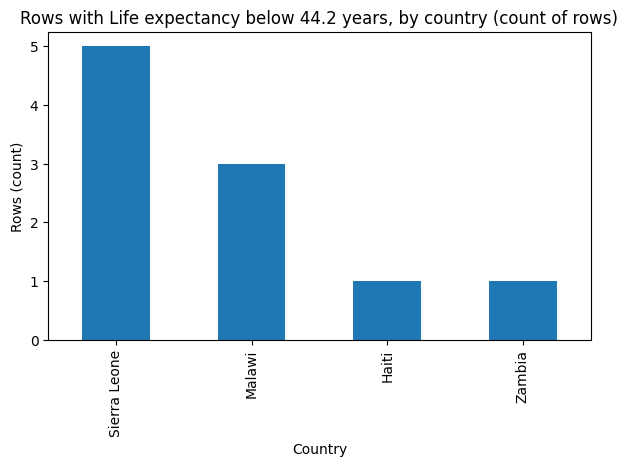

### 9. Missing values

- **Missing shares by Status:** Hepatitis B 33.79% of Developed rows vs 15.66% of Developing rows. Population 18.75% vs 22.92%. GDP 12.5% vs 15.83%. Alcohol 5.47% vs 6.84%. Total expenditure 6.25% vs 8.00%.
- **Missing shares by Year:** Hepatitis B falls from 53.6% in 2000 to 7.1% in 2011 and 2012. Population is 21.9% in 2000 to 2011, 22.4% in 2012, 25.4% in 2013, and 22.4% in 2014 and 2015. GDP ranges from 14.8% to 17.1% across years. Total expenditure is 98.9% missing in 2015 and 1.0% to 2.2% in other years. Alcohol is 96.7% missing in 2015 and about 0.5% in most other years.

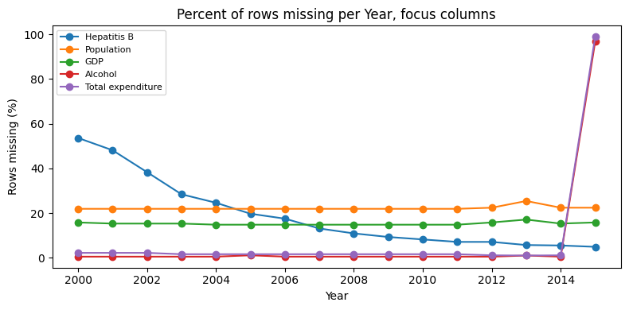

**Life expectancy by missingness (Welch t-tests, all rows):**

- Hepatitis B: missing 66.12 vs present 69.95 years (t = −6.71, p = 4.2e-11).
- Population: missing 71.14 vs present 68.69 (t = 6.47, p = 1.4e-10).
- GDP: missing 68.41 vs present 69.37 (t = −2.10, p = 0.036).
- Alcohol: missing 70.02 vs present 69.17 (t = 1.25, p = 0.21), not significant.
- Total expenditure: missing 69.22 vs present 69.23 (t = −0.006, p = 0.995), no association.

**Adjusted Hepatitis B result:** in an OLS model controlling for Status and Year, the Hepatitis B missing indicator has coefficient −5.24 years (95% CI −6.04 to −4.44, p = 1.6e-36, n=2,928, R² 0.301). The association survives these controls but is not fully explained by them. The p-values assume independent rows and are likely overstated.

**Total expenditure and Year:** because 98.9% of 2015 rows are missing Total expenditure, the all-row null is mostly a Year effect. Excluding 2015, rows missing Total expenditure have mean Life expectancy 59.58 vs 69.22 when present (t = −7.71, p = 8.1e-10). This comparison rests on 45 pre-2015 rows.

**Alcohol excluding 2015:** 16 pre-2015 rows with Alcohol missing and Life expectancy present, with mean 54.89 vs 69.15 (t = −10.09, p = 3.2e-8). With 16 rows the p-value is fragile and is not strong evidence.

### 10. Predicting Life expectancy

A random forest was fit on the numeric features plus Status (one-hot). Country was dropped, missing values were median-imputed, and an 80/20 split with seed 42 gave 2,342 training and 586 test rows.

| Model | Test R² | Test MAE (years) | Test RMSE (years) |
|---|---|---|---|
| Random forest | 0.967 | 1.05 | 1.69 |
| Mean baseline | −0.002 | 7.68 | 9.31 |

The model overfits: train R² is 0.995. The test score is the more honest figure, but some optimism remains because rows are repeated country-year observations split at random.

Permutation importance (drop in test R², 5 repeats) ranks:

1. HIV/AIDS 0.261 (SD 0.023)
2. Adult Mortality 0.223 (SD 0.016)
3. Income composition of resources 0.176 (SD 0.007)
4. BMI 0.016
5. under-five deaths 0.014
6. thinness 5–9 years 0.013
7. Year 0.008
8. Schooling 0.008
9. Alcohol 0.006
10. Polio 0.004

Features 4 to 10 each contribute between 0.0035 and 0.0159.

## Limitations

- **Non-independent rows.** The data are repeated country-year observations. Naive tests (Welch, Mann-Whitney, OLS, Fisher z, row-resampling bootstrap) give p-values and CIs that are likely too narrow and too significant. Cluster-robust checks were run only for the Life expectancy, Schooling and Adult Mortality Status gaps (Section 4). The Schooling-slope interaction (Section 5), the within-Status correlations (Section 6), the Hepatitis B and other missingness regressions (Section 9) and the random forest split (Section 10) were not clustered.
- **Small Developed sample.** Developed rows number 512 (464 with Schooling). The within-Developed results rest on a small number of countries.
- **HIV/AIDS.** The unit is not given in the dataset. The 0.8 split is the team's choice after quartile edges collapsed. HIV/AIDS is constant at 0.1 among Developed rows, so no within-Developed HIV/AIDS result exists.
- **Adult Mortality band results disagree.** Within Developed, the fixed bands show no reversal, while the quartile bands show the second quartile above the first. Both results are reported. The quartile result is described by the team as weaker evidence.
- **Row count discrepancy.** The full data has 2,938 rows, and 2013 has 193 rows against 183 for every other year. Analyses use 2,928 rows with 183 rows per Year. The discrepancy is not resolved, and the year-level outlier counts rest on raw counts.
- **Missing data.** Population (22.2%), Hepatitis B (18.8%) and GDP (15.2%) are missing for large shares of rows. The GDP and Schooling results use the subset with those values present. The missingness associations are not explained by the analysis.
- **Unresolved review issue, EDA 1 (trend).** The lead's objection stands. The claims that the distribution was "not more spread out" and that "the lower tail of low-Life-expectancy rows lifted more" were removed from this report, as they are not measured. Only the mean-minus-median gap (−4.25 years in 2000 to −2.28 in 2015) is reported. Per-year SD and Q1/Q3 are recorded in the EDA 4 results, but no spread or tail claim is made from them here.
- **Unresolved review issue, EDA 5 (outliers).** The lead asked that the Malawi and Zambia rows be listed explicitly with years and values. They are now listed in Section 8, taken from the recorded low-row facts. The task record still carries the objection as unresolved.
- **Task status.** All tasks were accepted. The stat_3 task is recorded as partial, so only the findings listed in Section 6 are reported. No other task failed.
- **Cluster count.** The cluster-robust analyses use 183 Country clusters for Life expectancy and Adult Mortality and 180 for Schooling. The full data is recorded as containing 193 countries.

## Open questions

- What explains the Developed–Developing gap? The analyses show that Adult Mortality, HIV/AIDS, Schooling and Income composition overlap with Status, but none of them has been tested as an adjusted explanation of the gap.
- Does the Developed–Developing Life expectancy gap persist after adjusting for Schooling, Adult Mortality and Income composition, using a mixed model with a random intercept for Country?
- Does the Schooling slope difference between Status groups survive controls for GDP, Income composition and health spending? Is the weaker Developed Schooling slope stable across years and individual countries?
- Do the cluster-robust CIs hold under a leave-one-country-out check, and is the Status effect driven by a small number of countries?
- Are the outlier countries (Sierra Leone, Malawi, Haiti, Zambia) the same ones that sit in the Developing tail across all years, or do they recover after 2005? What drives their low values, for example Adult Mortality, HIV/AIDS, infant deaths or income composition?
- Why does 2013 have 193 rows when other years have 183, and does this change any year-level counts?
- Why did the Developed–Developing gap peak in 2004 and fall to 11.52 years by 2008? What drives the faster rise in Developing Life expectancy?
- Is the rise over time uniform across countries, or does it reflect between-country composition? Does the Developing second-band advantage in Adult Mortality hold within countries over years?
- Does the Hepatitis B missingness association hold with country-clustered standard errors? Are Population and GDP missing rows concentrated in particular countries, and does that explain their associations with Life expectancy?
- Why is Total expenditure missing for 98.9% of 2015 rows, and does the pre-2015 gap for missing Total expenditure reflect a country-level pattern?
- Do the permutation importances in the random forest stay stable across seeds and splits? Does test R² hold when the split is grouped by Country?
- Which countries or years have the largest prediction errors, and do they concentrate in Developing countries with low HIV/AIDS or low income composition?
- Do the GDP correlations hold within each Status group, or do they mostly reflect the status gap? Are they driven by a few very high-GDP countries?
- Does the HIV/AIDS association change between 0.8 and higher prevalence levels within Developing rows?